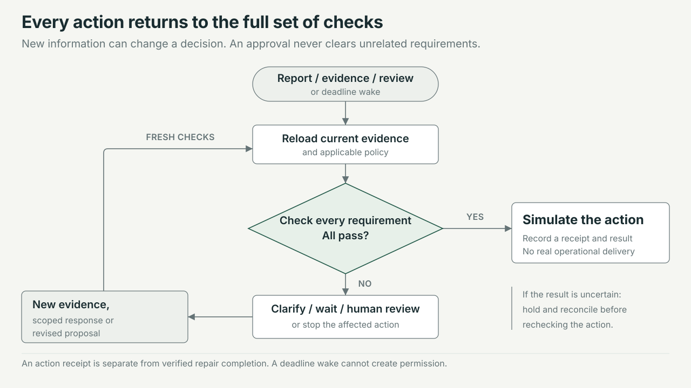

# System Architecture: Property Workflow

## Overview

Property Workflow is a Python maintenance case application with a browser interface branded **Property Desk**. It combines a modular FastAPI application, a transactional case store and a native Python Vercel Workflow coordinator. Tenants can submit a report and updates through a local demonstration conversation. Staff can inspect original evidence, resolve scoped reviews, propose an action and publish versioned policies. It tracks every requirement blocking an action and retains the evidence and decisions behind it.

The implemented environment is a local demonstration. Contractor contact, clarification messages, bookings, key supply, work instructions and other operational actions are simulated. Recorded local checks cover native SDK execution and recovery; they do not establish Vercel cloud operation, PostgreSQL behaviour, production authentication, live model quality or real delivery. This document describes the source under `app/` and `static/`. [The verification report](docs/VERIFICATION.md) records an earlier test snapshot; later changes need their own checks. The [BUILD replay boundary](docs/BUILD_REPLAY_BOUNDARY.md) explains the limits on evaluation, including the reserved record exposed during a shared-runtime check.

## Key Requirements

- Preserve original reports and exact quoted assertions. Keep unverified claims, verified facts, missing information and conflicting sources distinguishable.
- Evaluate all requirements for the proposed action. A model proposal, timer, generic approval or reported completion must not create authority.
- Scope reviews and approvals to the property, work item, action, provider, access method and relevant evidence; reject stale, expired and duplicate responses.
- Support policy drafts, impact previews, explicit publication and reassessment without rewriting historical decisions.
- Resume cases after new evidence, human decisions and deadlines using native Python Workflow hooks, steps and timers.
- Commit evidence, case state and wake intent together; prevent duplicate simulated actions across retries and local restarts.
- Limit tenant responses to their own conversations and a filtered progress summary. Demonstration role selection must remain visibly distinct from production identity.
- Use only the allowed BUILD partition for development replay and exclude future history and attachment bytes from decision snapshots.
- Prioritise correctness and inspectable history in the local prototype. **Unknown:** required production throughput, concurrent users, latency objectives, availability target and recovery objectives have not been specified or measured.

## High-Level Architecture

FastAPI serves both the static client and JSON APIs. The API authenticates the current demonstration or configured staff identity, validates input and delegates mutations to the application service. The service owns transactions and calls a pure policy evaluator. Interpretation can propose source assertions, but policy checks and role-checked review responses decide whether a proposed action is permitted.

Native Workflow stores its history separately from case data. Its registered coordinator invokes the service through a registered step, waits on a typed hook or absolute timer, then reads current case and policy state in a fresh step. The local SDK owns its event history and embedded queue; the application does not implement a substitute scheduler.


[Open the standalone system overview](docs/diagrams/system-overview.html). The figure groups components by responsibility, not separate deployments. Its project-local visual tokens are recorded in [diagram-style.md](docs/diagrams/diagram-style.md).

The diagram groups the code by responsibility; each box does not represent a separate deployed service. In the supported local mode, FastAPI, the application service and the embedded SDK queue share one process; the application database and native workflow directory must both survive a restart. The Claude connection has been verified locally with live calls; without a key, messages go to manual triage. The action ledger records simulations only.

The [interactive Archify map](docs/diagrams/property-workflow.html) provides component focus, search and guided views for report assessment, native orchestration and permission checks. Keep its [editable JSON](docs/diagrams/property-workflow.architecture.json), [delivery receipt](docs/diagrams/property-workflow.delivery.json) and [source notes](docs/diagrams/source-notes.md) together. It passed all nine showcase checks with no errors or warnings, automated browser checks at four desktop sizes, and visual review of both themes. Manual control testing was blocked by the in-app browser's restriction on local file URLs; this does not change the recorded automated results.

## Component Details

### Browser client

**Sources:** [index.html](static/index.html), [app.js](static/app.js), [style.css](static/style.css).

The client uses HTML, CSS and plain JavaScript with locally vendored Lucide icons. It keeps temporary interface state: selected conversations, staff views, editable policy proposals and request retry keys. It communicates with same-origin JSON endpoints using `fetch` and refreshes progress from the API. It has no independent authority to verify claims or approve actions. The tenant/property-management view switch is demonstration navigation; server routes enforce their own identity and role checks.

#### UI examples

These browser captures were taken on 10 October 2026 from a fresh, isolated local instance with fictional details and simulated operations. Select an image to open the full capture.

| Tenant conversation | Staff review | Policy settings |
| --- | --- | --- |
| [](docs/screenshots/tenant-request.jpg) | [](docs/screenshots/staff-review.jpg) | [](docs/screenshots/policy-settings.jpg) |
| The tenant sees their saved report and a progress message, with no booking or repair completion implied. | Each review exposes its own requirement, scope and owner while keeping the other blocker visible. | The proposed interpretation is explicitly unsaved and unpublished; version 1 is still the published policy. |

### FastAPI and authentication boundary

**Source:** [main.py](app/main.py).

FastAPI serves the client, exposes case/evidence/proposal/review/policy APIs, starts the runtime lifespan and issues workflow wakes after service transactions commit. Pydantic request models reject unsupported fields and invalid values. Synchronous case processing runs in worker threads where used by asynchronous request handlers and workflow steps.

In demo mode, staff sessions are random, loopback-only cookies backed by an in-memory session map. In non-demo mode, the API expects server-configured bearer identities with token hashes and roles. API credentials are implemented; staff login and SSO remain unfinished. Startup requires a PostgreSQL URL and configured staff identities outside demo mode; those checks do not prove connectivity or production readiness.

### Tenant conversation bridge

**Source:** [tenant.py](app/tenant.py); [portal behaviour](docs/PORTAL_UI.md).

The tenant router owns a separate session cookie, conversation ownership checks and an allowlisted response projection. Claude reads the conversation and proposes name, address and separate problems; only values found in the tenant's own words are kept, and a bounded local parser is the fallback. When all are present the tenant sees a summary and must confirm it; only then does a server-side bridge create one case through `Service.intake`. Subsequent messages use `Service.evidence`. Names and addresses remain unverified, and a tenant cannot activate the reserved fictional directory alias by entering it as an address.

Session hashes, conversation projections, owner indexes, pending deliveries and request receipts are stored in mutable `meta` entries. Message delivery is reserved durably before entering the separately transactional case service. Stable request keys let retries converge after an interrupted case commit. Completed reports and subsequent updates become immutable case evidence. This design does not make every pre-submission conversation field an immutable audit record.

Tenant responses expose owned messages, supplied details and plain-language progress; they exclude staff evidence, internal reviews, policy controls and the shared case list. Tenant routes are disabled outside demo mode because production tenant identity and organisation access are not implemented.

### Source interpretation and policy drafting

**Sources:** [ai.py](app/ai.py), [policy_assistant.py](app/policy_assistant.py).

`app.ai` calls Claude through the Anthropic Python SDK (`beta.messages.parse`, Pydantic structured output, adaptive thinking, server-side fallbacks, cached system prompt; model `CLAUDE_MODEL`, default `claude-opus-5`). The `triage_case_messages` workflow step reads each stored message: Claude chooses a route that maps to one policy action, names the work item, splits separate problems into new cases and returns quoted assertions, ambiguities and answers to open questions. The `compose_tenant_messages` step drafts tenant questions with a send recommendation that a deterministic gate checks. Quotes absent from the source are dropped. If Claude is unavailable, refuses or returns invalid output, the message is handed to a case manager; there is no keyword fallback. See [Claude triage](docs/CLAUDE_TRIAGE.md). Before that step, `route_case_messages` asks TypeSafe Jev (`app.jev`) for a route with calibrated confidence; code decides whether Jev's route stands alone, stands with Claude extracting under it, or is handed to Claude in full. See [Jev routing](docs/JEV_ROUTING.md).

Interpretation claims remain unverified. Two exceptions exist: policy `triage_auto_accept` may accept Claude's derived category label at sufficient confidence, and the fictional `DEMO-FLAT-1` directory supplies demonstration identity/route claims. Neither establishes real identity, consent, authority or completion.

Tenant name/address/issue extraction remains local. However, completed tenant intake and later updates call `Service.intake` and `Service.evidence`, and Claude then reads them in the coordinator's triage step, so those texts are sent to the Anthropic API; local slot extraction does not imply that the complete tenant journey is offline.

The policy assistant is also deterministic: it translates a bounded vocabulary of plain-English settings and conditions into a proposed `PolicyInput`, or returns clarification/unsupported results. It can derive a conservative suggestion from a resolved review, preserving its provenance. It does not write policy, rewrite code or generalise a case-specific permission. Saving, previewing and publishing remain separate service operations.

### Case service and policy engine

**Sources:** [service.py](app/service.py), [domain.py](app/domain.py).

The service owns case revisions, action revisions, evidence, claims, reviews, approvals, policy publication and simulated action history. The pure evaluator assigns `PASS`, `FAIL`, `UNKNOWN` or `CONFLICT` to relevant facts and returns the complete blocker list. The headline outcome is the highest-priority blocker: `STOP ACTION`, `HUMAN REVIEW`, `CLARIFY` or `WAIT`; an unblocked action is `ACT`. A completed business action is subsequently reported as `NO FURTHER ACTION` for that proposal.

The default action requirements are explicit:

| Proposed action | Required facts |
| --- | --- |
| `clarify` | Identity mapping, communication route |
| `request_quote` | Identity mapping, communication route, classification |
| `confirm_appointment` | Identity mapping, communication route, access, authority, schedule |
| `supply_keys` | Identity mapping, communication route, access, key custody, authority, schedule |
| `instruct_work` | Identity mapping, communication route, access, authority, schedule, usable evidence, classification, total commitment |
| `close_item` | Identity mapping, completion, outstanding commitments resolved |
| `archive` | Identity mapping, authority |

Management-key access adds a key-custody requirement to applicable actions. Other conditions add blockers for unsupported categories, possible urgent hazards, rejected action revisions, pending policy reassessment, uncertain action results and unknown policy profiles. Work instructions above the configured demonstration threshold require financial review. Custom ALL/ANY rules can add scoped holds and routing; they cannot remove the default requirements.

Reviews identify a requirement, owner, evidence, claim IDs, current scope, policy version, action revision, expiry and other remaining blockers. A reasoned correction verifies an existing claim through its permitted role and appends a new claim that supersedes earlier claims; it preserves the original evidence. Approvals are limited to authority, financial review and configured custom human-review rules. They cannot fill arbitrary missing facts or override refusal/conflict. Approval validity depends on scope, version, expiry and a hash of the material evidence.

Policy drafts and published versions are append-only records. Publication requires the editor's current saved impact preview. Incomplete current actions are held for explicit reassessment under the new version; completed actions retain their historical decision. Only the demonstration policy profile is configured.

### Native Workflow coordinator

**Source:** [workflows.py](app/workflows.py); [runtime contract and recorded checks](docs/WORKFLOW_RUNTIME.md).

The pinned `vercel-workflow==0.11.1` registry exports `case_coordinator` as a workflow and `run_case_cycle` as a step with a three-retry limit. The coordinator claims `property-case:{case_id}` through a native typed hook before its first application step. Competing starts return the existing owner's run ID, preventing simultaneous owners from both entering initial application processing.

Hook payloads contain case ID, event ID and revision hints only. The service reads substantive evidence, current policy and authority from the application database. A fresh cycle calculates its next wake; the workflow waits on an absolute aware datetime. Clarification follow-up uses Monday to Friday, 09:00 to 17:00 Europe/London working hours, with configured holiday exclusions; approval expiry uses elapsed hours. One receiver persists across timer wakes, and an arriving event cancels a superseded timer. Timers trigger reassessment, reminders or escalation, never permission.

### Persistence and simulated adapters

**Sources:** [store.py](app/store.py), [service.py](app/service.py).

SQLAlchemy provides the application store. Local SQLite uses WAL and `BEGIN IMMEDIATE`; the PostgreSQL code path uses a shared coordination-row lock. `records` is append-only through database triggers that reject updates and deletes. `cases` and `meta` are replaceable projections and coordination state. The native SDK separately persists workflow history in its selected World.

The simulated adapter writes an intent, one provider receipt per stable business-action ID, and a succeeded or uncertain result within the application transaction. Its receipt explicitly states that no contact or charge occurred. A later reconciliation can append a successful result after reading that receipt. A real network adapter, provider idempotency/read-back contract and delivery outbox are not implemented.

### BUILD loader and replay

**Sources:** [build_data.py](app/build_data.py), [replay.py](app/replay.py).

The loader enforces a fixed allowlist, validates manifest membership and history hashes, and returns an explicitly chosen chronological prefix. It excludes later events, index summaries and all attachment bytes from interpretation. The replay command forces literal mode, uses a temporary isolated application database and performs assessments without executing an adapter. Replay is a development diagnostic, not an accuracy score or proof of unseen evaluation. See [the complete disclosure](docs/BUILD_REPLAY_BOUNDARY.md).

## Data Flow

### Evidence, human review and simulated action

An intake or evidence request is validated and interpreted before the service transaction. The service stores original evidence and source claims, updates the case projection, records an `incoming_event` and `signal_outbox`, then assesses every applicable requirement. After commit, the API starts or finds the coordinator and sends a wake. Transport acceptance is recorded independently from the cycle checkpoint that acknowledges processed events.



[Open the standalone decision flow](docs/diagrams/decision-flow.html). The figure combines the clarification, waiting, review and stop branches into one held-action path; the policy outcome still determines which response is permitted. A stopped action may need a revised proposal, and an uncertain receipt requires reconciliation before retry.

The transaction and wake sequence is:

1. Validate the request and interpret source text before entering the case transaction.
2. Commit evidence, assertions, the case projection, initial assessment, incoming event and wake intent together.
3. After commit, the API starts or finds the native coordinator and signals the event.
4. The coordinator runs a fresh service step that reloads current evidence, policy and scoped decisions.
5. Record unresolved requirements and reviews, or an authorised simulated action and its receipt.
6. Commit the cycle checkpoint, then wait for a new event or the next absolute deadline.

The database commit completes before the workflow receives a wake. A saved request or accepted hook signal does not prove action completion. A human response follows the same path: the API checks role and scope, the service appends the response, and the next cycle reassesses all remaining blockers before any simulated action.

### Policy change

Plain-English interpretation produces a proposed draft without saving it. A policy editor saves a version based on the current published policy, previews its effect against current case revisions and explicitly publishes it. Publication rejects a stale base or stale/missing preview. Affected incomplete actions receive a policy-reassessment hold and wake; an authorised explicit reassessment is required before the new policy can permit action. Existing decisions continue to reference their original version.

### Local restart

Startup takes an exclusive lock on the native workflow directory, opens the SDK's embedded queue and visits stored cases. It redelivers recognised unfinished native steps through the SDK executor, then starts/finds each case coordinator and sends a recovery wake. Completed steps replay from native history; a fresh service cycle reconstructs future timers. Recovery preserves SDK attempts and retry delays and does not edit workflow history or invent step completion. See [the detailed lifecycle limitations](docs/WORKFLOW_RUNTIME.md).

## Data Model (high-level)

The application has three physical SQL tables. Most domain entities are typed JSON payloads inside `records`, rather than separate relational tables.

| Store | Contents and ownership | Mutation model |
| --- | --- | --- |
| `cases` | Current case identity, property reference, category, proposal, status, owner, next step, case/action revisions and policy hold | Mutable projection owned by the case service |
| `records` | UUID, kind, optional case ID, timestamp, JSON payload and optional unique deduplication key | Append-only through update/delete rejection triggers |
| `meta` | Active-policy pointer, transaction lock, tenant session hashes, conversations, owner indexes and message/start receipts | Mutable application coordination and portal state |
| Native World storage | Workflow runs, steps, hooks, waits and replay events | Owned by the pinned SDK; local files are separate from SQL storage |
| Staff demo session map | Random cookie token to staff actor/role | Process memory; lost on restart |

The main logical entities and relationships are:

| Entity | Relationships and retained context |
| --- | --- |
| Case and proposal | A case has a current scoped proposal and separate case/action revisions; material proposal changes advance the action revision |
| Evidence and interpretation | Original source text belongs to a case; an interpretation references its evidence ID and identifies its mode/model |
| Claim | References source evidence, exact quotation and scope; records verification, optional expiry and superseded claim IDs |
| Policy, draft and preview | Published policy references its originating draft and preview; `meta.active_policy` selects the current immutable version |
| Decision | References policy ID/version, case/action revision, canonical scope and a complete claim-ID snapshot; retains checks and all blockers |
| Review and response | Review binds to one blocker and owner; appended responses, supersession and overdue records determine its current state |
| Approval and revocation | Grant binds to evidence basis, policy/action revision, scope and expiry; revocation is a separate record |
| Question and follow-up | Question records scope and deadlines; separate reminder, closure and escalation records preserve follow-up history |
| Event, outbox and checkpoint | Incoming event has a revision; outbox references its event ID; checkpoint records consumed event IDs and assessed revision |
| Action and receipt | Stable business ID hashes case ID, action revision and canonical scope; intent/result records reference the decision and simulated provider receipt |
| Tenant conversation | Owned by a tenant demonstration session; links to at most one shared case and retains pending delivery and request receipt state |

Database references inside JSON are largely enforced by service checks, rather than SQL foreign keys. The immutable ledger is not tamper-proof against an administrator who can alter schema, files or triggers.

## Infrastructure & Deployment

Dependencies are pinned in [pyproject.toml](pyproject.toml): Python 3.12, FastAPI, Uvicorn, SQLAlchemy, Psycopg, Pydantic, HTTPX and the Python Vercel Workflow SDK. [vercel.json](vercel.json) selects the FastAPI framework, and `[[tool.vercel.workflows]]` identifies `app.workflows:wf`. There is no container, Kubernetes cluster, separate message broker or load balancer defined by this application.

| Environment or mode | Current position |
| --- | --- |
| Local `native_local` | Supported demonstration: one process, SQLite, the SDK local World and embedded queue; recorded native execution/restart checks exist |
| Local `manual_demo` | Policy/API demonstration without native background hooks or timers; explicit ticks run application logic |
| Staging | **Not provisioned or verified.** Intended acceptance environment for Vercel runtime identity, generated workflow routes, shared PostgreSQL and production identity integration |
| Production `native_cloud` | Deployment configuration is prepared, but hosted operation is unverified; requires a Vercel World, shared storage, staff identity configuration and further operational controls |

For an isolated local demonstration, after installing the pinned dependencies into `.venv`, run from this directory:

```sh
mkdir -p "$PWD/var"
property_demo_dir=$(mktemp -d "$PWD/var/local-demo.XXXXXX")
printf 'Keep this storage directory for restart: %s\n' "$property_demo_dir"
env -u VERCEL_QUEUE_BASE_URL \
  APP_MODE=demo \
  WORKFLOW_MODE=native_local \
  WORKFLOW_TARGET_WORLD=local \
  DATABASE_URL="sqlite:///$property_demo_dir/application.db" \
  WORKFLOW_LOCAL_DATA_DIR="$property_demo_dir/native-world" \
  .venv/bin/python -m uvicorn app.main:app \
  --host 127.0.0.1 --port 8027 --workers 1
```

This creates separate storage and leaves the shared default database untouched. For a recovery check, reuse the printed directory and both paths; do not run `mktemp` again. Set environment variables before import, omit hot reload, and retain one worker. The server loads only the git-ignored `.env.local` (for `ANTHROPIC_API_KEY`); [.env.example](.env.example) documents available settings without credentials. The example does not establish that port 8027 is currently available.

**Unknown deployment details:** Vercel project/account, region, public domain, database provider and sizing, TLS/database connection policy, secret manager, attachment/object store, backup schedule, retention periods and release pipeline. These need explicit deployment decisions; this document does not assume them.

## Scalability & Reliability

- **Serialised mutations:** SQLite immediate transactions and the PostgreSQL coordination-row lock serialise this prototype's transactions. This simplifies consistency but is a contention point. Case listing, policy preview and several record lookups scan application records; no production capacity claim is supported.
- **Idempotent application effects:** Intake and evidence request keys reject reuse with different content. Tenant starts/messages have durable request receipts. An identical proposal retains its action revision. The unique simulated receipt key prevents a repeated native step from creating another receipt for the same business action.
- **Uncertain results:** An uncertain action blocks retry and scope replacement until receipt reconciliation. A stable application ID alone cannot guarantee exactly-once delivery to a future external provider.
- **Wake recovery:** `signal_outbox` records are committed with events; receipt and checkpoint records distinguish signalled from processed. These are wake intents, not a complete external delivery queue. An active coordinator's five-minute recovery heartbeat and startup recovery provide opportunities to reload committed work after a lost wake. A coordinator that never starts still needs a later successful wake or application restart.
- **Local durability limit:** Native events are persisted, but the embedded delivery queue is in memory. Closing the process stops delivery. Retaining files alone does not restart timers; the application must run its recovery lifecycle.
- **Exclusive runtime ownership:** A POSIX lock prevents multiple local processes using one workflow directory. Multiple workers and hot reload are unsupported. No high-availability deployment or automatic failover is implemented.
- **SDK coupling:** Local lifecycle and interrupted-step recovery use narrowly checked private SDK interfaces because the pinned beta SDK lacks equivalent public APIs. Version guards fail on another SDK version; upgrades require revalidation.
- **Terminal semantics:** Administrative archive ends the coordinator. Verified resolution and successful intermediate actions have distinct case states; neither a finished workflow nor a simulated receipt proves physical repair.

The [runtime document](docs/WORKFLOW_RUNTIME.md) records local native hook/timer/restart tests, real FastAPI/service integration and forced interrupted-step recovery with one simulated receipt. The [verification history](docs/VERIFICATION.md) includes the earlier 71-test baseline and later 132-test snapshots. Documentation checks do not establish current full-suite results, cloud operation, PostgreSQL behaviour or real provider delivery.

## Security & Compliance

The server checks roles for mutations and fact verification. Case managers handle identity/route/classification and proposal management; access officers verify access and key claims; approvers handle authority and financial grants; reviewers verify completion; policy editors save and publish policy. Several factual checks permit more than one explicit role, as defined in [FACT_ROLES](app/domain.py). This is a demonstration delegation map, not a legal determination of who can consent.

Demo cookies are `HttpOnly` and `SameSite=Strict`, restricted to loopback and intentionally not `Secure` for local HTTP. Tenant cookies use a separate path and persisted hashed lookup; staff demo sessions are process-local. State-changing requests with a different supplied Origin are rejected. Responses include a same-origin Content Security Policy, MIME-sniffing protection and API `no-store` caching. Client-rendered text is escaped. These controls have not undergone a production security assessment.

Production staff bearer values are compared against configured SHA-256 hashes using constant-time comparison. Production tenant authentication, organisation membership, row-level access control and a staff login interface are unimplemented. Authorised staff currently operate on the shared application case set; tenant conversation ownership checks do not prove multi-organisation tenant isolation.

Sources are treated as untrusted evidence. Model output must pass schema and exact-quote validation, remains distinct from verified permission and cannot publish policy. Claude triage sends submitted source text to the Anthropic API; production data use requires a deliberate data-protection decision.

No audit certification, regulatory compliance, encryption at rest, production key management or tenant-isolation assurance is established. Property reports may contain personal data. Before real use, define lawful processing and access, retention/deletion handling, external processor arrangements and incident procedures. In particular, immutable application history and deletion obligations need a designed retention approach; the present triggers alone do not resolve that requirement.

## Observability

The staff interface exposes evidence, claim provenance, decisions, reviews, actions and timeline records. Each decision retains the policy and claim snapshot needed to explain its result. Workflow transport receipts, error types, startup recovery receipts and cycle checkpoints record the distinction between accepted wake, processing and simulated action outcome. Native SDK event history separately records step replay, hooks and timers.

`GET /api/health` reports application/workflow modes and the simulated-operation flag. It is a liveness/configuration response, not a database, queue, provider or cloud-readiness probe. Uvicorn supplies ordinary server/access output; the application has no configured central log sink, metrics exporter, distributed tracing or alerting service. **Unknown:** production monitoring provider, service-level indicators, alert thresholds and on-call ownership.

## Trade-offs & Decisions

| Decision | Reason and consequence |
| --- | --- |
| Modular Python application with a static client | Keeps the demonstration understandable and deployable through FastAPI; it shares one service and data model rather than separate microservices |
| Deterministic policy outside interpretation | Makes action permission inspectable and prevents model text from creating authority; factual verification remains explicit staff work |
| Claude reads and routes; policy decides | Claude handles open-ended wording, routing and tenant questions; deterministic gates and named roles keep permission and verification out of the model. Tenant intake uses Claude with a deterministic completeness gate and a local fallback parser; the policy parser remains local |
| Append-only records plus mutable projections | Preserves decisions while supporting current views; administrator tamper resistance and full relational integrity are outside this design |
| Native SDK orchestration plus application idempotency | Provides genuine replay/hooks/timers while protecting business effects from step retry; requires two persistent stores and careful recovery |
| Global transaction serialisation | Favours straightforward correctness for the prototype; constrains throughput and needs redesign before substantial parallel load |
| Simulated adapters | Allows policy, retry and review paths to be exercised without real operational effects; cannot prove delivery or physical outcomes |
| Versioned policy with explicit reassessment | Prevents a publication from silently changing the authority of an already assessed action; adds a deliberate staff checkpoint |
| Conservative BUILD-prefix replay | Preserves chronology and avoids retrospective attachment content; limits coverage and cannot establish evaluation accuracy |

## Future Improvements

These changes remain to be implemented:

- Validate a separate Vercel staging deployment with shared PostgreSQL, generated routes, runtime identity and recovery checks across actual hosted invocations.
- Implement staff SSO, verified tenant identity, organisation/property access rules, secure production session handling and a reviewed authorisation model.
- Add real adapters only with committed delivery intent, provider idempotency, read-back/reconciliation and an explicit operational authorisation boundary.
- Define data retention, backup/restore and recovery objectives; exercise recovery of the application database and workflow state together.
- Add versioned schema migrations and evaluate per-case locking, indexed queries and bounded history reads when measured workload justifies them.
- Integrate attachment storage and extraction with evidence provenance and temporal availability controls; retain the existing replay exclusions until that boundary is implemented.
- Evaluate live interpretation against a frozen code/policy snapshot and an explicitly governed evaluation set, preserving the existing exposure disclosure.
- Add operational metrics, structured correlation across request/case/run/action IDs, readiness probes and alerts for pending wakes, failed steps and unresolved uncertain results.
- Replace private local SDK hooks with public lifecycle/recovery interfaces when available and revalidate the pinned integration before upgrades.

## Diagram sources and scope

The embedded figures use the Diagram Design skill referenced by the project owner. Each has a self-contained HTML source and an SVG export in `docs/diagrams/`. The system overview combines the two browser views into one component and the case service/policy evaluator into one decision component. The decision figure groups the held outcomes so the resume loop remains readable. Detailed roles, API contracts, separate storage ownership and individual outcomes remain documented above.

The figures are documentation of the local implementation, not a cloud deployment receipt or a claim that a physical maintenance action occurred. The earlier interactive Archify map remains available as a separate artefact.
