# Property Desk architecture

## Overview

Property Workflow is a Python maintenance case application branded **Property Desk**. It combines a modular FastAPI application, a transactional case store and a native Python Vercel Workflow coordinator. The FastAPI-served interface provides tenant conversations, staff reviews and policy editing; a separate React/Vite dashboard presents the staff case list, progress and review actions. Jev routes new case messages first, with Claude handling uncertain routes, evidence extraction and follow-up drafting. Deterministic policies decide which actions are allowed and retain every blocker and its evidence.

The implemented environment is a local demonstration. Contractor contact, clarification messages, bookings, key supply, work instructions and other operational actions are simulated. Recorded local checks cover native SDK execution and recovery; they do not establish Vercel cloud operation, PostgreSQL behaviour, production authentication, live model quality or real delivery. This document describes the source under `app/`, `static/` and `web/`, checked against the GitHub main snapshot [712f5e0](https://github.com/MasteraSnackin/hackathon-valley/tree/712f5e0971f51fc1d572d7ced7bead2cdb24186a). [The verification report](docs/VERIFICATION.md) records an earlier test snapshot; later changes need their own checks. The [BUILD replay boundary](docs/BUILD_REPLAY_BOUNDARY.md) explains the limits on evaluation, including the reserved record exposed during a shared-runtime check.

## Key Requirements

- Preserve original reports and exact quoted assertions. Keep unverified claims, verified facts, missing information and conflicting sources distinguishable.
- Evaluate all requirements for the proposed action. A model proposal, timer, generic approval or reported completion must not create authority.
- Scope reviews and approvals to the property, work item, action, provider, access method and relevant evidence; reject stale, expired and duplicate responses.
- Support policy drafts, impact previews, explicit publication and reassessment without rewriting historical decisions.
- Resume cases after new evidence, human decisions and deadlines using native Python Workflow hooks, steps and timers.
- Commit evidence, case state and wake intent together; prevent duplicate simulated actions across retries and local restarts.
- Limit tenant responses to their own conversations and a filtered progress summary. Demonstration role selection must remain visibly distinct from production identity.
- Use only the allowed BUILD partition for development replay and exclude future history and attachment bytes from decision snapshots.
- Prioritise correctness and inspectable history in the local prototype. **Unknown:** required production throughput, concurrent users, latency objectives, availability target and recovery objectives have not been specified or measured.

## High-Level Architecture

FastAPI serves the static client and JSON APIs. The separate React application calls those APIs through Vite's development proxy; FastAPI does not serve its build output. The API authenticates the current demonstration or configured staff identity, validates input and delegates mutations to the application service. The service owns transactions and calls a pure policy evaluator. Jev and Claude can propose routes and source assertions, but policy checks and role-checked review responses decide whether an action is permitted.

Native Workflow stores its history separately from case data. Its registered coordinator runs separate assessment, Jev routing, Claude reading and tenant-message steps, waits on a typed hook or absolute timer, then reads current case and policy state in a fresh step. The local SDK owns its event history and embedded queue; the application does not implement a substitute scheduler.

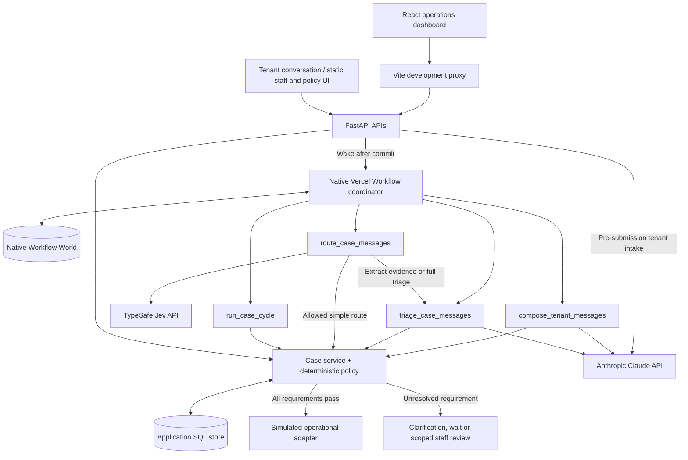

The flow above includes the current routing and React paths. The expanded image below and the standalone diagram set describe an earlier snapshot, as explained in the diagram guide.

[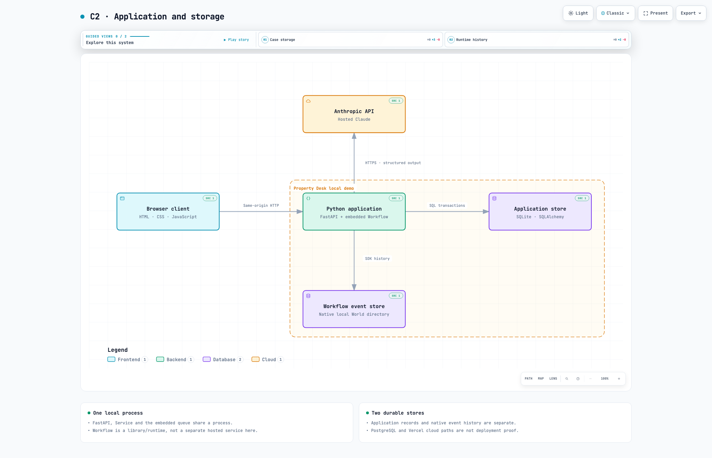](docs/diagrams/c4/c2-containers.png)

In local mode, FastAPI, the case service and the embedded Workflow queue share one Python process; the optional React development server is a separate Node process. The application database and native Workflow directory must both survive a restart. Anthropic and TypeSafe are external API integrations; model quality, hosted operation and real maintenance delivery need separate evidence.

### Diagram guide

The [diagram guide](docs/diagrams/README.md) provides ten focused views with static previews, editable sources and interactive HTML where available. Those diagrams are pinned to [2732af6](https://github.com/MasteraSnackin/hackathon-valley/tree/2732af60a920d0f9a88be18a36e078aa22fbfa6d), before the Jev router and React dashboard were added. They remain useful for the core service, policy and storage design, but omit the newer paths covered by the flow above. The four structural views follow the C4 levels: system context, containers, components and code. The code view focuses on the action decision path rather than every function in the repository.

| View | What it explains |
| --- | --- |
| [C1 context](docs/diagrams/README.md#c1-system-context) | Tenant, staff and external service boundaries |
| [C2 containers](docs/diagrams/README.md#c2-containers) | Browser, application and separate persistent stores |
| [C3 components](docs/diagrams/README.md#c3-components) | API, case service, interpretation, policy and runtime responsibilities |
| [C4 code](docs/diagrams/README.md#c4-code) | Actual calls used to assess and execute a proposed action |
| [Request and review sequences](docs/diagrams/README.md#tenant-message-sequence) | Commit, wake, model steps, scoped review and reassessment |
| [Decision and policy flows](docs/diagrams/README.md#action-decision-flow) | All blockers, valid publication and explicit policy reassessment |
| [Data storage](docs/diagrams/README.md#data-storage) | Physical tables and application-level references |
| [Local deployment](docs/diagrams/README.md#local-deployment) | One local process, two stores and the external model API |

## Component Details

### Browser clients

**Static interface:** [index.html](static/index.html), [app.js](static/app.js), [style.css](static/style.css).

The client uses HTML, CSS and plain JavaScript with locally vendored Lucide icons. It keeps temporary interface state: selected conversations, staff views, editable policy proposals and request retry keys. It communicates with same-origin JSON endpoints using `fetch` and refreshes progress from the API. It has no independent authority to verify claims or approve actions. The tenant/property-management view switch is demonstration navigation; server routes enforce their own identity and role checks.

**React dashboard:** [App.tsx](web/src/App.tsx), [API client](web/src/lib/api.ts), [presentation mapping](web/src/lib/pipeline.ts), [Vite configuration](web/vite.config.ts).

The React 19, TypeScript, Vite and Tailwind application is a separate staff-facing prototype. Its typed fetch adapter calls the existing case-list, detail, BUILD-import and review-response endpoints with a demo-session cookie. Its eight displayed stages are presentation mappings of backend outcomes and fact checks, not an additional workflow engine. The static interface remains the tenant and policy-editing surface.

Opening this dashboard can change the connected demonstration database: bootstrap creates a case-manager session, imports missing cases from a fixed nine-case BUILD selection and attempts to reject the top open review for up to two newly seeded cases. Use isolated storage. Approve, reject, defer and evidence-request buttons call real backend review operations; backend scope and role checks can reject them. The dashboard does not supply every specialised staff role or the full correction workflow.

The React dashboard starts in the case-manager role. Its approval button also appears for factual blockers, where a generic approval is rejected, while authority and financial approvals require the approver role. Complete these reviews in the original staff interface using the assigned role and supporting evidence.

The initial selection prefers the first case with a `HUMAN REVIEW` or `CLARIFY` outcome. An “Action required” panel presents its next step and an approval response. The “Approve & assign contractor” label appears for authority/finance blockers, but the button only submits a review response: it does not select or assign a contractor. Backend role and evidence checks still apply; a general approval cannot verify an underlying identity, access or completion fact.

The current dashboard refreshes on initial load, case selection and its own review responses; it does not continuously poll workflow changes. Its “Resolved today” number counts all cases whose outcome is `NO FURTHER ACTION`, without filtering by date. That outcome describes the current proposal and does not prove a physical repair or a complete case resolution. Browser display stages and demo-seeded outcomes must not be treated as verified progress or evaluation results.

The dashboard also labels an internal `signal_outbox` wake record as “Email sent to landlord” and uses it to mark “Contacted”. This records neither an outbound email nor verified contact; these display labels need correction.

#### UI examples

These static-interface browser captures were taken on 10 October 2026 from a fresh, isolated local instance with fictional details and simulated operations. They are not captures of the newer React dashboard. Select an image to open the full capture.

| Tenant conversation | Staff review | Policy settings |
| --- | --- | --- |
| [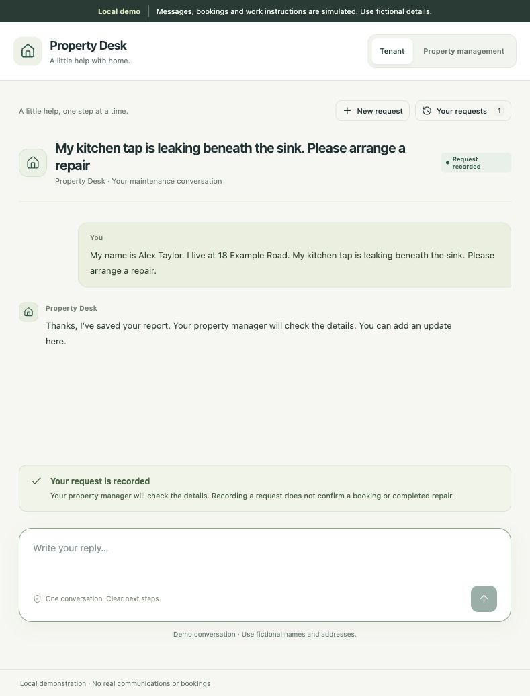](docs/screenshots/tenant-request.jpg) | [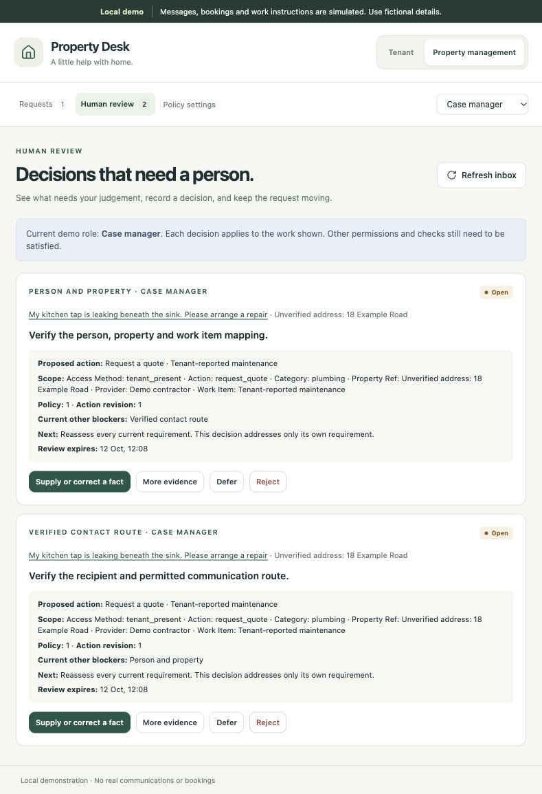](docs/screenshots/staff-review.jpg) | [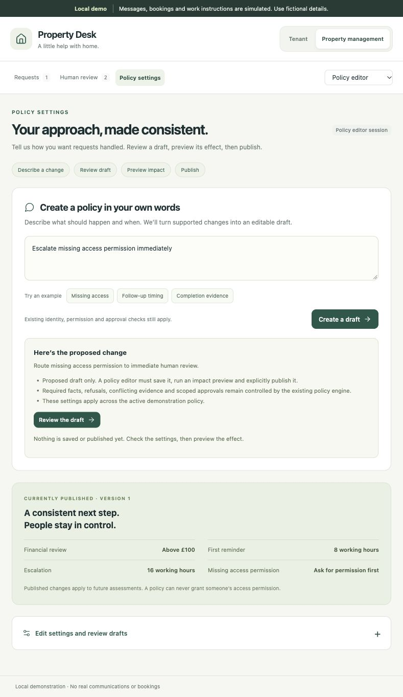](docs/screenshots/policy-settings.jpg) |
| The tenant sees their saved report and a progress message, with no booking or repair completion implied. | Each review exposes its own requirement, scope and owner while keeping the other blocker visible. | The proposed interpretation is explicitly unsaved and unpublished; version 1 is still the published policy. |

### FastAPI and authentication boundary

**Source:** [main.py](app/main.py).

FastAPI serves the static client, exposes case/evidence/proposal/review/policy APIs, starts the runtime lifespan and issues workflow wakes after service transactions commit. Pydantic request models reject unsupported fields and invalid values. Synchronous case processing runs in worker threads where used by asynchronous request handlers and workflow steps. Vite forwards `/api` to `http://127.0.0.1:8017` and rewrites the outgoing Origin to that backend for local development. That proxy behaviour is not a production cross-origin authentication design.

In demo mode, staff sessions are random, loopback-only cookies backed by an in-memory session map. In non-demo mode, the API expects server-configured bearer identities with token hashes and roles. API credentials are implemented; staff login and SSO remain unfinished. Startup requires a PostgreSQL URL and configured staff identities outside demo mode; those checks do not prove connectivity or production readiness.

### Tenant conversation bridge

**Source:** [tenant.py](app/tenant.py); [portal behaviour](docs/PORTAL_UI.md).

The tenant router keeps each conversation within its own session and exposes a filtered progress view. Before submission, Claude reads the conversation, asks for missing details and prepares a summary for the tenant to confirm. A local phrase parser handles intake if credentials are missing or the model is unavailable. The server checks extracted names, addresses and quoted problem text against the tenant's messages, ignoring differences in whitespace and case. Confirmation creates one case through `Service.intake`; later updates become evidence through `Service.evidence`. The portal records the supplied name, address, conversation and original source as `self_identification`. Entering the reserved fictional directory alias as an address does not activate that trusted mapping. Claude reads intake directly during the tenant request, outside the database transaction; later routing, case triage and tenant-question drafting run in native Workflow steps.

Self-identification is not verified identity. The default policy nevertheless accepts it for the identity and same-thread communication checks on `clarify` and `request_quote`, provided those checks are unknown rather than failed or conflicting. A correction invalidates this exception. Settings can narrow it, but cannot extend it to entry, keys, work instructions, appointments, completion or archive. Consent, authority and all other action requirements still need their own evidence.

Session hashes, conversation projections, owner indexes, pending deliveries and request receipts are stored in mutable `meta` entries. Message delivery is reserved durably before entering the separately transactional case service. Stable request keys let retries converge after an interrupted case commit. Completed reports and subsequent updates become immutable case evidence. This design does not make every pre-submission conversation field an immutable audit record.

Tenant responses expose owned conversation messages, supplied details and plain-language progress; they exclude staff evidence, internal reviews, policy controls and the shared case list. The portal projection does not currently expose the coordinator's separate tenant-question records, so a complete question-and-answer round trip between those two interfaces is not established. Tenant routes are disabled outside demo mode because production tenant identity and organisation access are not implemented.

### Jev routing, Claude interpretation and policy drafting

**Sources:** [jev.py](app/jev.py), [ai.py](app/ai.py), [service.py](app/service.py), [policy_assistant.py](app/policy_assistant.py).

The published policy selects one of three router modes: `jev` (default), `jev_shadow` or `claude`. `route_case_messages` calls TypeSafe System One through the pinned TypeSafe SDK, with `JEV_MODEL` defaulting to `jev-1.13.0`. Jev receives a bounded current-message and case context, returns route/category confidence and typed risk signals, and supplies no authority. Deterministic rules choose the next interpretation path:

| Path | When it applies | What happens |
| --- | --- | --- |
| Jev only | A permitted simple route passes the confidence and signal gates; defaults permit only `archive` and `request_quote` at confidence at least 0.8, with no relevant facts, sensitive-content signal or open question requiring Claude | Store the route reading without a Claude call. There is no factual claim extraction; the derived category remains unverified and every action still needs policy permission. |
| Jev route, Claude extraction | Jev can route, but quoted evidence, answers or further interpretation are needed; possible hazards also enter this path | Claude extracts assertions and ambiguities using the proposed route. An objection or incompatible route produces a human-review hold; a Jev hazard route is not downgraded. |
| Claude full triage | Jev is unavailable, uncertain, detects possible separate issues or system-directed instructions, or staff already selected the route | Claude reads and routes the message. Jev unavailability and the fallback reason remain in the routing record. |

In `jev_shadow`, Jev's proposal is recorded for comparison while Claude decides. In `claude`, the Jev stage is skipped. Policy settings control thresholds and permitted Jev-only routes; lowering a threshold cannot bypass action requirements. The service records model/router versions, source and attempt IDs, confidence, reasons and the chosen path before applying an interpretation.

`app.ai` calls Claude through the Anthropic Python SDK (`beta.messages.parse`, Pydantic structured output, adaptive thinking, server-side fallbacks and a cached system prompt; `CLAUDE_MODEL` defaults to `claude-opus-5`). Full triage uses `CLAUDE_TRIAGE_EFFORT` (default `medium`); extracting evidence for a Jev route uses `CLAUDE_EXTRACT_EFFORT` (default `low`). Claude names work items, can split separate problems into new cases and returns quoted assertions, ambiguities and answers to open questions. The `compose_tenant_messages` step drafts tenant questions with a send recommendation that a deterministic gate checks. Quotes absent from the source are dropped. A failed Claude reading is held for a case manager or retry; case triage has no keyword fallback. See [Claude triage](docs/CLAUDE_TRIAGE.md).

Interpretation claims remain unverified. Policy `triage_auto_accept` may accept Claude's derived category label at sufficient confidence; it does not auto-accept a Jev-only category. The fictional `DEMO-FLAT-1` directory supplies demonstration identity/route claims, and the portal has the separately scoped self-identification exception described above. None establishes real identity, consent, authority or completion.

Tenant intake can send the conversation to the Anthropic API before a case exists. Confirmed reports and later updates then enter the configured Jev/Claude path. The local intake fallback and policy parser do not make the complete tenant journey offline. Voice, telephony, email and SMS ingestion adapters are not implemented; the voice discussion remains a proposed input channel into the same case history.

The policy assistant is also deterministic: it translates a bounded vocabulary of plain-English settings and conditions into a proposed `PolicyInput`, or returns clarification/unsupported results. It can derive a conservative suggestion from a resolved review, preserving its provenance. It does not write policy, rewrite code or generalise a case-specific permission. Saving, previewing and publishing remain separate service operations.

### Case service and policy engine

**Sources:** [service.py](app/service.py), [domain.py](app/domain.py).

The service owns case revisions, action revisions, evidence, claims, reviews, approvals, policy publication and simulated action history. The pure evaluator assigns `PASS`, `FAIL`, `UNKNOWN` or `CONFLICT` to relevant facts and returns the complete blocker list. The headline outcome is the highest-priority blocker: `STOP ACTION`, `HUMAN REVIEW`, `CLARIFY` or `WAIT`; an unblocked action is `ACT`. A completed business action is subsequently reported as `NO FURTHER ACTION` for that proposal.

The default action requirements are explicit:

| Proposed action | Required facts |
| --- | --- |
| `clarify` | Identity mapping, communication route |
| `request_quote` | Identity mapping, communication route, classification |
| `confirm_appointment` | Identity mapping, communication route, access, authority, schedule |
| `supply_keys` | Identity mapping, communication route, access, key custody, authority, schedule |
| `instruct_work` | Identity mapping, communication route, access, authority, schedule, usable evidence, classification, total commitment |
| `close_item` | Identity mapping, completion, outstanding commitments resolved |
| `archive` | Identity mapping, authority |

Management-key access adds a key-custody requirement to applicable actions. Other conditions add blockers for unsupported categories, possible urgent hazards, rejected action revisions, pending policy reassessment, uncertain action results and unknown policy profiles. Work instructions above the configured demonstration threshold require financial review. Custom ALL/ANY rules can add scoped holds and routing; they cannot remove the default requirements.

Reviews identify a requirement, owner, evidence, claim IDs, current scope, policy version, action revision, expiry and other remaining blockers. A reasoned correction verifies an existing claim through its permitted role and appends a new claim that supersedes earlier claims; it preserves the original evidence. Approvals are limited to authority, financial review and configured custom human-review rules. They cannot fill arbitrary missing facts or override refusal/conflict. Approval validity depends on scope, version, expiry and a hash of the material evidence.

Policy drafts and published versions are append-only records. Publication requires the editor's current saved impact preview. Incomplete current actions are held for explicit reassessment under the new version; completed actions retain their historical decision. Only the demonstration policy profile is configured.

### Native Workflow coordinator

**Source:** [workflows.py](app/workflows.py); [runtime contract and recorded checks](docs/WORKFLOW_RUNTIME.md).

The pinned `vercel-workflow==0.11.1` registry exports `case_coordinator` as a workflow. It registers four steps with a three-retry limit each: `run_case_cycle`, `route_case_messages`, `triage_case_messages` and `compose_tenant_messages`. Pending messages hold actions while routing/reading happens; a fresh cycle follows each model step. The coordinator bounds model-step passes between waits. It claims `property-case:{case_id}` through a native typed hook before its first application step. Competing starts return the existing owner's run ID, preventing simultaneous owners from both entering initial application processing.

Hook payloads contain case ID, event ID and revision hints only. The service reads substantive evidence, current policy and authority from the application database. A fresh cycle calculates its next wake; the workflow waits on an absolute aware datetime. Clarification follow-up uses Monday to Friday, 09:00 to 17:00 Europe/London working hours, with configured holiday exclusions; approval expiry uses elapsed hours. One receiver persists across timer wakes, and an arriving event cancels a superseded timer. Timers trigger reassessment, reminders or escalation, never permission.

### Persistence and simulated adapters

**Sources:** [store.py](app/store.py), [service.py](app/service.py).

SQLAlchemy provides the application store. Local SQLite uses WAL and `BEGIN IMMEDIATE`; the PostgreSQL code path uses a shared coordination-row lock. `records` is append-only through database triggers that reject updates and deletes. `cases` and `meta` are replaceable projections and coordination state. The native SDK separately persists workflow history in its selected World.

The simulated adapter writes an intent, one provider receipt per stable business-action ID, and a succeeded or uncertain result within the application transaction. Its receipt explicitly states that no contact or charge occurred. A later reconciliation can append a successful result after reading that receipt. A real network adapter, provider idempotency/read-back contract and delivery outbox are not implemented.

### BUILD loader and replay

**Sources:** [build_data.py](app/build_data.py), [replay.py](app/replay.py).

The loader enforces a fixed allowlist, validates manifest membership and history hashes, and returns an explicitly chosen chronological prefix. It excludes later events, index summaries and all attachment bytes from interpretation. Import creates a case from that selected prefix with category and route unset. The replay command uses a temporary isolated application database and calls the service's routing, Claude reading and tenant-question functions directly; it does not run the native coordinator. Depending on policy and credentials, it can call TypeSafe and Anthropic. It performs assessments and simulated tenant-thread handling, without real operational delivery.

This command evaluates the selected prefix as its input snapshot; it is not the sequential native execution harness described below. Replay is a development diagnostic, not an accuracy score or proof of unseen evaluation. See [the complete disclosure](docs/BUILD_REPLAY_BOUNDARY.md).

### Reality Test runner

**Source:** [reality_test.py](app/reality_test.py); [configuration and run guide](docs/REALITY_TEST.md).

The separate runner accepts a versioned manifest and text-evidence inputs, then runs each case in its own Python process, SQLite database and native local Workflow World. An in-process HTTP client invokes the real FastAPI lifespan and intake/evidence endpoints. It supplies the report first, waits for the current revision and events to reach a persisted native checkpoint, and only then exposes the next evidence item. It also checks any separate cases created by the agent.

Per-case and batch deadlines bound execution. Exports include `ANSWER.md`, `REASONING.md`, stored decisions, unresolved reviews, native execution evidence, configuration and source provenance. Failures, timeouts and Jev-to-Claude fallbacks remain visible. The runner neither fabricates human responses nor advances time to manufacture a completed workflow. Official mode requires the chosen frozen commit and clean relevant sources, records hashes and checks for changes after the run.

The supplied example is fictional preparation data, not an official result. The organiser's eventual input format may need a mechanical adapter; binary attachments and audio need separate provenance-preserving extraction. A stable human wait is a valid recorded outcome, not proof of successful maintenance. The CLI can validate inputs and configuration without starting workflows or calling providers.

## Data Flow

### Evidence, human review and simulated action

A confirmed intake or evidence request first becomes durable source material. The service commits the evidence, case projection, initial assessment, `incoming_event` and `signal_outbox`. The API then starts or finds the coordinator and sends a wake. Jev routing and any required Claude reading run in separate workflow steps, outside the database transaction; the service stores their results before the next assessment. Transport acceptance and processed-event checkpoints remain separate records.

[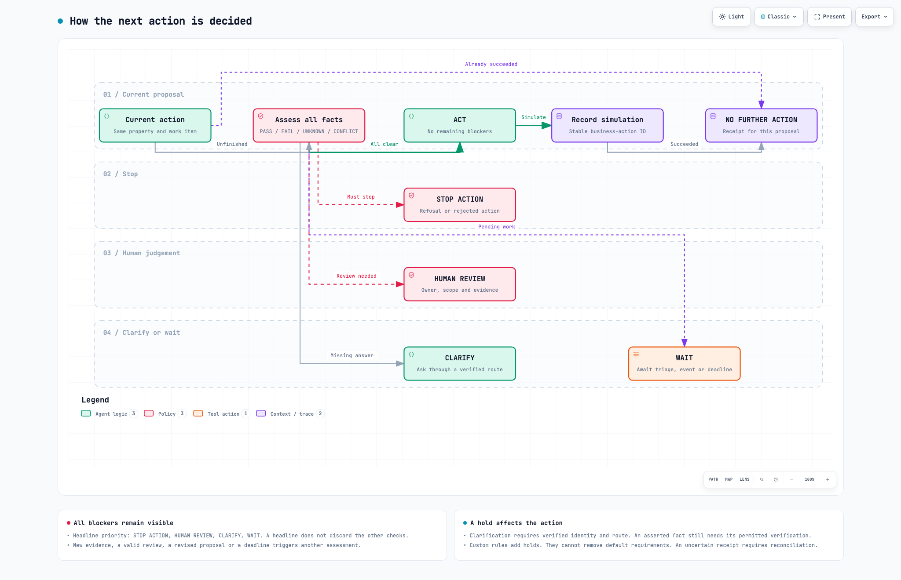](docs/diagrams/behaviour/action-decision.png)

The [decision flow](docs/diagrams/behaviour/action-decision.html) shows the permitted outcomes. A stopped action may need a revised proposal, and an uncertain receipt requires reconciliation before retry. One headline outcome does not erase the other blockers.

The request sequence is:

1. Validate input and commit source evidence, the case projection, assessment, incoming event and wake intent.
2. After commit, start or find the native coordinator and signal the event.
3. Run a fresh cycle. Route pending messages through the configured Jev/Claude path, store routing and validated interpretation results, and reassess using current evidence, policy and scope.
4. Draft tenant questions when needed. A deterministic send check decides whether to record simulated sending or ask staff to review the draft.
5. Record unresolved requirements and reviews, or an authorised simulated action and its receipt.
6. Record processed-event checkpoints and wait on the typed hook or the next deadline when no immediate work remains.

[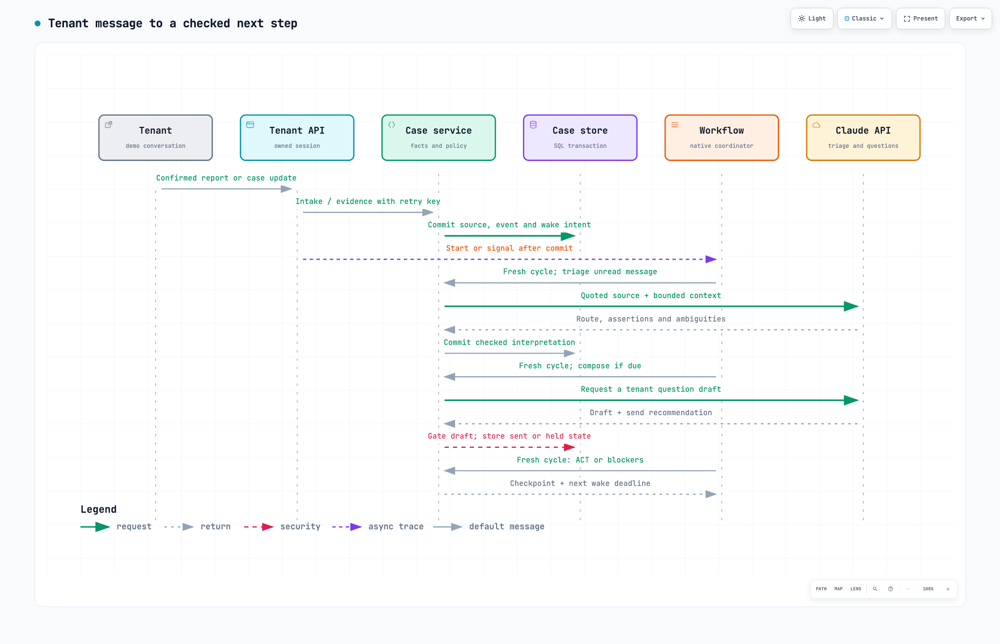](docs/diagrams/behaviour/tenant-message.png)

[Open the tenant-message sequence](docs/diagrams/behaviour/tenant-message.html). This earlier view begins at a confirmed report; the intake conversation and summary confirmation happen first. It omits the subsequently added Jev step, which now precedes Claude when configured.

The database commit completes before the workflow receives a wake. A saved request or accepted hook signal does not prove action completion. For a human response, the service checks the assigned role, scope, version, expiry and evidence before appending the response. The next cycle reassesses every remaining blocker.

[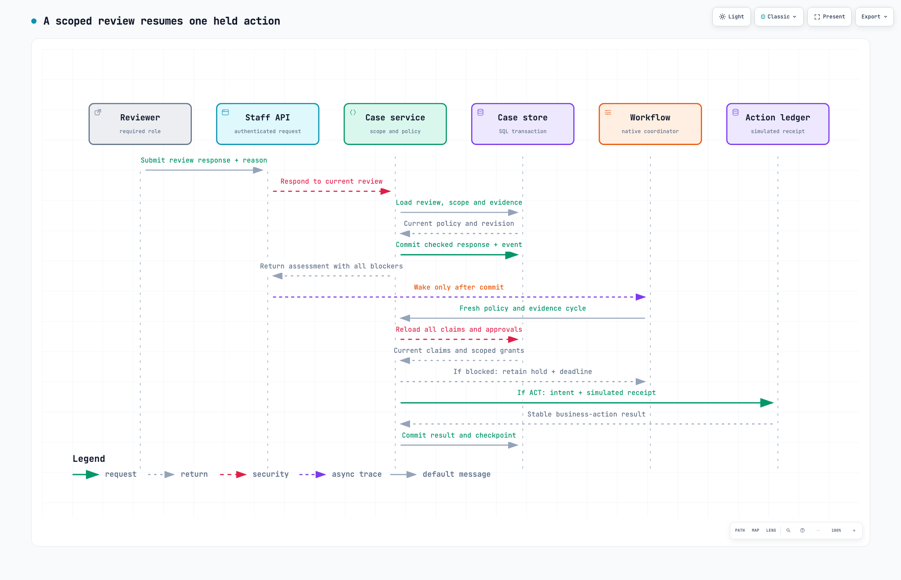](docs/diagrams/behaviour/human-review.png)

[Open the human-review sequence](docs/diagrams/behaviour/human-review.html). An approval resolves only the requirement it covers; it cannot establish unrelated access permission or completion.

### Policy change

Plain-English interpretation produces a proposed draft without saving it. A policy editor saves a version based on the current published policy, previews its effect against current case revisions and explicitly publishes it. Publication rejects a stale base or stale/missing preview. Affected incomplete actions receive a policy-reassessment hold and wake; an authorised explicit reassessment is required before the new policy can permit action. Existing decisions continue to reference their original version.

[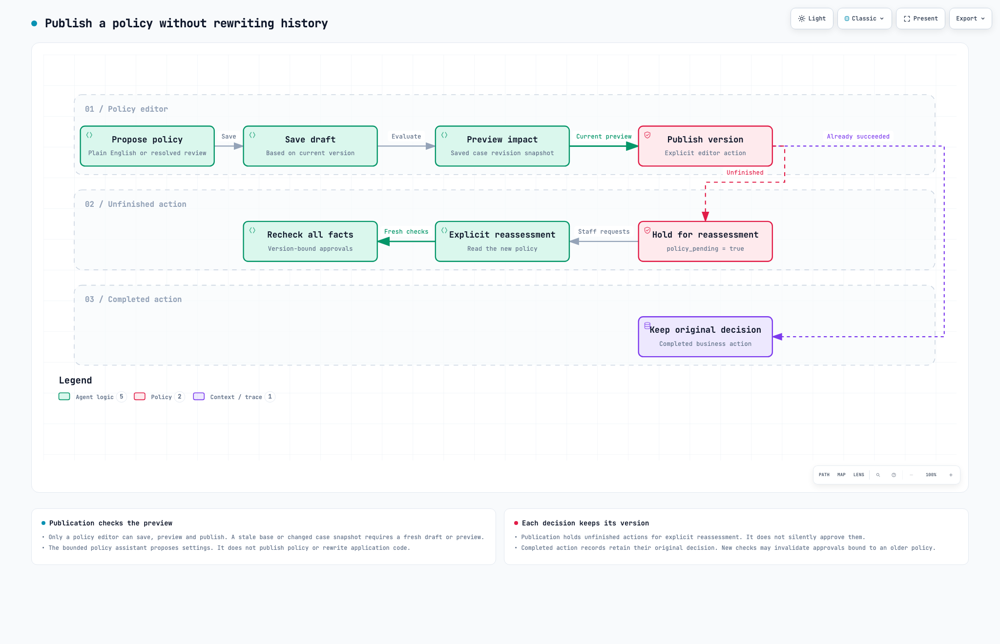](docs/diagrams/behaviour/policy-publication.png)

[Open the policy-publication flow](docs/diagrams/behaviour/policy-publication.html).

### Local restart

Startup takes an exclusive lock on the native workflow directory, opens the SDK's embedded queue and visits stored cases. It redelivers recognised unfinished native steps through the SDK executor, then starts/finds each case coordinator and sends a recovery wake. Completed steps replay from native history; a fresh service cycle reconstructs future timers. Recovery preserves SDK attempts and retry delays and does not edit workflow history or invent step completion. See [the detailed lifecycle limitations](docs/WORKFLOW_RUNTIME.md).

## Data Model (high-level)

The application has three physical SQL tables. Most domain entities are typed JSON payloads inside `records`, rather than separate relational tables.

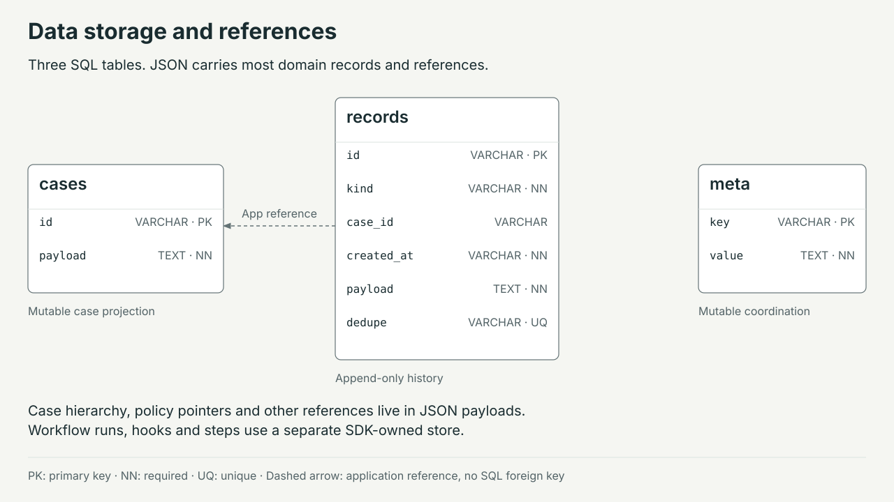

[Open the storage diagram](docs/diagrams/operations/data-storage.html).

| Store | Contents and ownership | Mutation model |
| --- | --- | --- |
| `cases` | Current case identity, property reference, category, proposal, status, owner, next step, case/action revisions and policy hold | Mutable projection owned by the case service |
| `records` | UUID, kind, optional case ID, timestamp, JSON payload and optional unique deduplication key | Append-only through update/delete rejection triggers |
| `meta` | Active-policy pointer, transaction lock, tenant session hashes, conversations, owner indexes and message/start receipts | Mutable application coordination and portal state |
| Native World storage | Workflow runs, steps, hooks, waits and replay events | Owned by the pinned SDK; local files are separate from SQL storage |
| Staff demo session map | Random cookie token to staff actor/role | Process memory; lost on restart |

The main logical entities and relationships are:

| Entity | Relationships and retained context |
| --- | --- |
| Case and proposal | A case has a current scoped proposal and separate case/action revisions; material proposal changes advance the action revision. Split issue cases refer to their parent through `payload.parent_case_id` |
| Evidence, routing and interpretation | Original source text belongs to a case; routing records bind source/attempt IDs to Jev answers, mode, confidence, metadata and fallback reason; interpretations reference evidence and routing IDs and identify the applied mode/model |
| Claim | References source evidence, exact quotation and scope; records verification, optional expiry and superseded claim IDs |
| Policy, draft and preview | Published policy references its originating draft and preview; `meta.active_policy` selects the current immutable version |
| Decision | References policy ID/version, case/action revision, canonical scope and a complete claim-ID snapshot; retains checks and all blockers |
| Review and response | Review binds to one blocker and owner; appended responses, supersession and overdue records determine its current state |
| Approval and revocation | Grant binds to evidence basis, policy/action revision, scope and expiry; revocation is a separate record |
| Question and follow-up | Question records scope and deadlines; separate reminder, closure and escalation records preserve follow-up history |
| Tenant message | A proposed message refers to question IDs; separate sent or rejected records determine its status |
| Event, outbox and checkpoint | Incoming event has a revision; outbox references its event ID; checkpoint records consumed event IDs and assessed revision. `message_routed`, `route_changed` and `triage_completed` distinguish a routing decision, proposal update and completed interpretation |
| Action and receipt | Stable business ID hashes case ID, action revision and canonical scope; intent/result records reference the decision and simulated provider receipt |
| Tenant conversation and self-identification | Conversation is owned by a tenant demonstration session and links to at most one shared case, with pending deliveries and request receipts. The case stores the portal-supplied identity source and correction state; this supports only the configured limited policy exception |

Database references inside JSON are largely enforced by service checks, rather than SQL foreign keys. The immutable ledger is not tamper-proof against an administrator who can alter schema, files or triggers.

## Infrastructure & Deployment

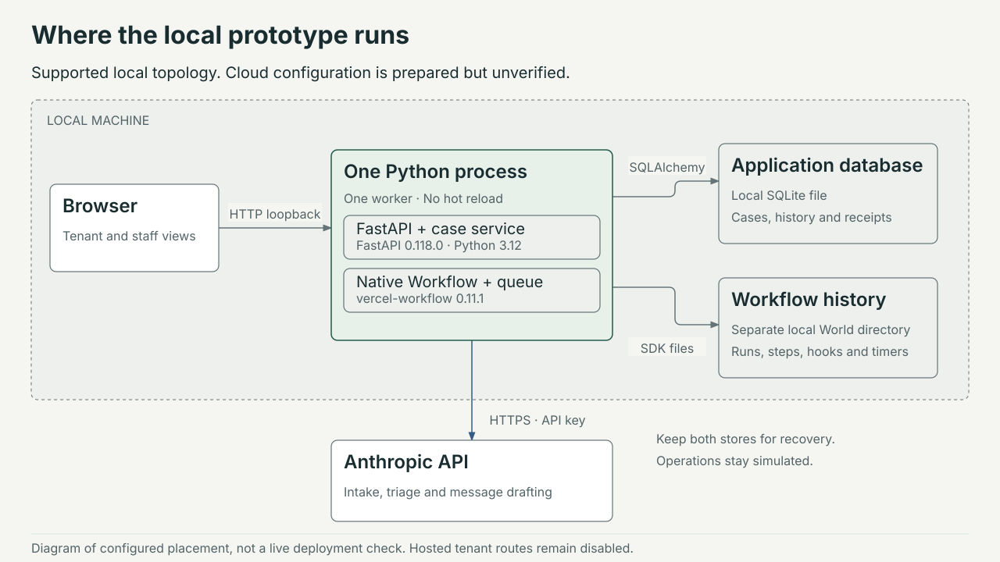

[Open the local-deployment diagram](docs/diagrams/operations/local-deployment.html).

Python dependencies are pinned in [pyproject.toml](pyproject.toml) and locked in [uv.lock](uv.lock): Python 3.12, FastAPI, Uvicorn, SQLAlchemy, Psycopg, Pydantic, HTTPX, the Anthropic and TypeSafe SDKs, and the Python Vercel Workflow SDK. The optional dashboard has a separate [Node package manifest](web/package.json) and [lockfile](web/package-lock.json) for React, TypeScript, Vite and Tailwind. [vercel.json](vercel.json) selects the FastAPI framework, and `[[tool.vercel.workflows]]` identifies `app.workflows:wf`; it does not configure deployment of the React build. There is no container, Kubernetes cluster, separate message broker or load balancer defined by this application.

| Environment or mode | Current position |
| --- | --- |
| Local `native_local` | Supported demonstration: one Python process, SQLite, the SDK local World and embedded queue; recorded native execution/restart checks exist. The optional Vite dashboard adds a separate Node process. |
| Local `manual_demo` | Policy/API demonstration without native background hooks or timers; explicit ticks run application logic |
| Staging | **Not provisioned or verified.** Intended acceptance environment for Vercel runtime identity, generated workflow routes, shared PostgreSQL and production identity integration |
| Production `native_cloud` | Deployment configuration is prepared, but hosted operation is unverified; requires a Vercel World, shared storage, staff identity configuration and further operational controls |

For an isolated local demonstration, after installing the pinned dependencies into `.venv`, run from this directory:

```sh
mkdir -p "$PWD/var"
property_demo_dir=$(mktemp -d "$PWD/var/local-demo.XXXXXX")
printf 'Keep this storage directory for restart: %s\n' "$property_demo_dir"
env -u VERCEL_QUEUE_BASE_URL \
  APP_MODE=demo \
  WORKFLOW_MODE=native_local \
  WORKFLOW_TARGET_WORLD=local \
  DATABASE_URL="sqlite:///$property_demo_dir/application.db" \
  WORKFLOW_LOCAL_DATA_DIR="$property_demo_dir/native-world" \
  .venv/bin/python -m uvicorn app.main:app \
  --host 127.0.0.1 --port 8017 --workers 1
```

This creates separate storage and leaves the shared default database untouched. For a recovery check, reuse the printed directory and both paths; do not run `mktemp` again. Set environment variables before import, omit hot reload, and retain one worker. The server can load git-ignored `.env.local`; existing environment values win, and `PROPERTY_LOCAL_ENV=off` disables that file load. Anthropic uses `ANTHROPIC_API_KEY` or `ANTHROPIC_AUTH_TOKEN`; Jev uses `TYPESAFE_API_KEY`. [.env.example](.env.example) documents settings without credentials. Port 8017 matches the current Vite proxy; this example does not establish that it is available.

The static tenant/staff/policy interface is available from the Python server. To run the additional React dashboard, use a second terminal:

```sh
cd web
npm ci
npm run dev -- --host 127.0.0.1
```

Open the local URL printed by Vite. Its proxy requires the backend on port 8017 unless [vite.config.ts](web/vite.config.ts) is changed to match. Use this only with the isolated demonstration database because dashboard bootstrap imports BUILD cases and records review rejections. `npm run build` produces a frontend bundle; serving that bundle with API routing, authentication and a production origin is separate deployment work.

**Unknown deployment details:** Vercel project/account, region, public domain, database provider and sizing, TLS/database connection policy, secret manager, attachment/object store, backup schedule, retention periods and release pipeline. These need explicit deployment decisions; this document does not assume them.

## Scalability & Reliability

- **Serialised mutations:** SQLite immediate transactions and the PostgreSQL coordination-row lock serialise this prototype's transactions. This simplifies consistency but is a contention point. Case listing, policy preview and several record lookups scan application records; no production capacity claim is supported.
- **Idempotent application effects:** Intake and evidence request keys reject reuse with different content. Tenant starts/messages have durable request receipts. An identical proposal retains its action revision. The unique simulated receipt key prevents a repeated native step from creating another receipt for the same business action.
- **Uncertain results:** An uncertain action blocks retry and scope replacement until receipt reconciliation. A stable application ID alone cannot guarantee exactly-once delivery to a future external provider.
- **Wake recovery:** `signal_outbox` records are committed with events; receipt and checkpoint records distinguish signalled from processed. These are wake intents, not a complete external delivery queue. An active coordinator's five-minute recovery heartbeat and startup recovery provide opportunities to reload committed work after a lost wake. A coordinator that never starts still needs a later successful wake or application restart.
- **Local durability limit:** Native events are persisted, but the embedded delivery queue is in memory. Closing the process stops delivery. Retaining files alone does not restart timers; the application must run its recovery lifecycle.
- **Exclusive runtime ownership:** A POSIX lock prevents multiple local processes using one workflow directory. Multiple workers and hot reload are unsupported. No high-availability deployment or automatic failover is implemented.
- **SDK coupling:** Local lifecycle and interrupted-step recovery use narrowly checked private SDK interfaces because the pinned beta SDK lacks equivalent public APIs. Version guards fail on another SDK version; upgrades require revalidation.
- **Terminal semantics:** Administrative archive ends the coordinator. Verified resolution and successful intermediate actions have distinct case states; neither a finished workflow nor a simulated receipt proves physical repair.

The [runtime document](docs/WORKFLOW_RUNTIME.md) records local native hook/timer/restart tests, real FastAPI/service integration and forced interrupted-step recovery with one simulated receipt. The [verification history](docs/VERIFICATION.md) includes the earlier 71-test baseline and later 132-test snapshots. Documentation checks do not establish current full-suite results, cloud operation, PostgreSQL behaviour or real provider delivery.

## Security & Compliance

The server checks roles for mutations and fact verification. Case managers handle identity/route/classification and proposal management; access officers verify access and key claims; approvers handle authority and financial grants; reviewers verify completion; policy editors save and publish policy. Several factual checks permit more than one explicit role, as defined in [FACT_ROLES](app/domain.py). This is a demonstration delegation map, not a legal determination of who can consent.

Demo cookies are `HttpOnly` and `SameSite=Strict`, restricted to loopback and intentionally not `Secure` for local HTTP. Tenant cookies use a separate path and persisted hashed lookup; staff demo sessions are process-local. State-changing requests with a different supplied Origin are rejected. Responses include a same-origin Content Security Policy, MIME-sniffing protection and API `no-store` caching. Client-rendered text is escaped. These controls have not undergone a production security assessment.

Production staff bearer values are compared against configured SHA-256 hashes using constant-time comparison. Production tenant authentication, organisation membership, row-level access control and a staff login interface are unimplemented. Authorised staff currently operate on the shared application case set; tenant conversation ownership checks do not prove multi-organisation tenant isolation.

Sources are treated as untrusted evidence. Model output must pass schema validation. Case-triage quotes must match the source verbatim; intake extraction checks ignore whitespace and case differences. Model readings remain distinct from verified permission and cannot publish policy. The configured routing path sends bounded source/context text to TypeSafe, and Claude intake/triage/drafting send their inputs to Anthropic. Production data use requires a deliberate data-protection decision for both providers. Voice-based role recognition and production identity verification are not implemented.

No audit certification, regulatory compliance, encryption at rest, production key management or tenant-isolation assurance is established. Property reports may contain personal data. Before real use, define lawful processing and access, retention/deletion handling, external processor arrangements and incident procedures. In particular, immutable application history and deletion obligations need a designed retention approach; the present triggers alone do not resolve that requirement.

## Observability

The static staff interface exposes evidence, claim provenance, decisions, reviews, actions and timeline records. Each decision retains the policy and claim snapshot needed to explain its result. Routing records retain Jev's proposed/applied mode, source, confidence, reasons and fallback metadata; the case projection retains the latest router and model interpretation. Workflow transport receipts, error types, startup recovery receipts and cycle checkpoints record the distinction between accepted wake, processing and simulated action outcome. Native SDK event history separately records step replay, hooks and timers. The React dashboard's progress mappings are a condensed presentation, not the complete audit record.

`GET /api/health` reports application/workflow modes, the simulated-operation flag, model configuration and Jev credential presence/router version. It is a liveness/configuration response, not a database, queue, provider or cloud-readiness probe. Uvicorn supplies ordinary server/access output; the application has no configured central log sink, metrics exporter, distributed tracing or alerting service. **Unknown:** production monitoring provider, service-level indicators, alert thresholds and on-call ownership.

## Trade-offs & Decisions

| Decision | Reason and consequence |
| --- | --- |
| Modular Python application with two browser clients | The static interface provides tenant and policy workflows; the separate React prototype adds a staff progress view using the same service and case data. Their deployment and feature coverage remain distinct. |
| Deterministic policy outside interpretation | Makes action permission inspectable and prevents model text from creating authority; factual verification remains explicit staff work |
| Jev routes first; Claude reads when needed; policy decides | Simple eligible messages can avoid a Claude reading; uncertain inputs fall back to full triage, and objections produce human review. This adds another provider and policy thresholds whose quality requires evaluation. Tenant intake still uses Claude with a deterministic completeness gate and local fallback parser. |
| Limited portal self-identification | Lets a confirmed portal report proceed to clarification or quote requests without claiming verified identity; contradictions, corrected details and more consequential actions keep their separate requirements. |
| Append-only records plus mutable projections | Preserves decisions while supporting current views; administrator tamper resistance and full relational integrity are outside this design |
| Native SDK orchestration plus application idempotency | Provides genuine replay/hooks/timers while protecting business effects from step retry; requires two persistent stores and careful recovery |
| Global transaction serialisation | Favours straightforward correctness for the prototype; constrains throughput and needs redesign before substantial parallel load |
| Simulated adapters | Allows policy, retry and review paths to be exercised without real operational effects; cannot prove delivery or physical outcomes |
| Versioned policy with explicit reassessment | Prevents a publication from silently changing the authority of an already assessed action; adds a deliberate staff checkpoint |
| Conservative BUILD-prefix replay | Preserves chronology and avoids retrospective attachment content; limits coverage and cannot establish evaluation accuracy |
| Separate native Reality Test runner | Isolates each case and records source/configuration provenance, waits and failures. Its output contract still needs checking against the organisers' actual release. |

## Future Improvements

These changes remain to be implemented:

- Validate a separate Vercel staging deployment with shared PostgreSQL, generated routes, runtime identity and recovery checks across actual hosted invocations.
- Implement staff SSO, verified tenant identity, organisation/property access rules, secure production session handling and a reviewed authorisation model.
- Complete the React dashboard's policy and specialised-review paths, align approval labels with the actual review operation, remove automatic demonstration seeding from operational use, add deliberate refresh behaviour and integrate its deployment. Define operational metrics and date filters before presenting daily resolution counts.
- Connect coordinator questions to the tenant conversation and add any future voice/email input adapter through the same evidence, identity and policy boundaries. These are not current channels.
- Add real adapters only with committed delivery intent, provider idempotency, read-back/reconciliation and an explicit operational authorisation boundary.
- Define data retention, backup/restore and recovery objectives; exercise recovery of the application database and workflow state together.
- Add versioned schema migrations and evaluate per-case locking, indexed queries and bounded history reads when measured workload justifies them.
- Integrate attachment storage and extraction with evidence provenance and temporal availability controls; retain the existing replay exclusions until that boundary is implemented.
- Evaluate live interpretation against a frozen code/policy snapshot and an explicitly governed evaluation set, preserving the existing exposure disclosure.
- Measure Jev routing, extraction disagreements, fallback rates and end-to-end policy outcomes before tuning router thresholds; keep development replays separate from held-out results.
- Add operational metrics, structured correlation across request/case/run/action IDs, readiness probes and alerts for pending wakes, failed steps and unresolved uncertain results.
- Replace private local SDK hooks with public lifecycle/recovery interfaces when available and revalidate the pinned integration before upgrades.

## Diagram sources and scope

The [diagram guide](docs/diagrams/README.md) describes the earlier source snapshot, each view's scope and the checks performed. Archify generates the four C4 maps, two sequences and two flow diagrams from editable typed JSON. Diagram Design provides the data-storage and local-deployment figures as self-contained HTML with SVG exports. Humanizer was used for the explanatory prose and labels. Those artefacts have not been regenerated for Jev, the React client or the Reality Test runner; the inline high-level flow and current prose document the additional paths.

Static previews work in GitHub Markdown. Interactive HTML must be downloaded and opened locally or served by a documentation host. The JSON, HTML, Mermaid sources and validation receipts stay beside each diagram so later changes can be reviewed and regenerated.

The diagrams document code and configuration. They do not establish cloud deployment, model accuracy, real message delivery or physical repair. Earlier figures remain in the repository as prototype snapshots; the guide links the reviewed set.
