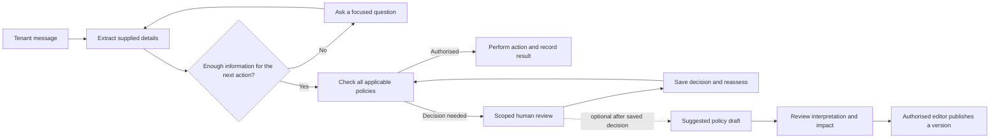

# Property Desk: tenant and property management UI brief

## Overview

Design a property maintenance service with two views of the same request. A tenant describes a problem in their own words. The agent gathers only the missing details, moves authorised work forward and keeps the tenant informed. The property management team sees which requests need a decision, why they are held and what has already been resolved.

The defining interaction is a clear handover: the agent explains what it needs, the right person answers, and the workflow checks whether it can continue. Staff can also turn a useful decision into a proposed reusable policy through a short, explicit review process.

### Authority and status

- **Status:** target design brief, prepared on 10 October 2026. This document requests design work; it does not claim the described screens are implemented.
- **Product direction:** the user's request for a tenant conversation, a management queue, editable policies in plain English, and policy suggestions after human review.
- **Working name:** Property Desk, within the Hackathon Valley repository. Final branding can change without changing these journeys.
- **Visual starting point:** the existing forest-green, warm-neutral palette and values in `static/style.css`. Front-matter values retain that source foundation. New screen layouts and interaction examples below are design proposals.
- **Terminology:** use **request** for the tenant's maintenance issue and **case** where staff need an operational term. The user's “claims” means these requests here. Reserve “source assertion” or “claim” for the underlying evidence model; do not make tenants learn those terms.
- **Scope:** design and handoff only. No application fixes, deployment, automatic policy publication or new live integrations are part of this deliverable.

### Outcomes the UI must support

| Person | They should be able to do this | The UI must make this clear |
| --- | --- | --- |
| Tenant | Describe a problem once, provide missing details and follow progress | What has been understood, what is still needed, who is doing what next |
| Property manager | Prioritise work, inspect a request, take ownership and resolve a decision | Why attention is needed, the relevant evidence, the blocked action and remaining requirements |
| Policy editor | Set conditions and thresholds, describe a rule naturally and review its effects | Exactly when a rule applies, what it permits or holds, who decides and when it takes effect |

Act in the tenant's interests: reduce repeated explanations, preserve their original words, make corrections easy, communicate uncertainty honestly and provide a visible route to a person. Do not imply that a booking, repair or payment has happened until the system has confirmation.

## Colors

Keep a warm off-white canvas, white content surfaces, dark ink text and forest-green primary actions. Use colour to direct attention to the next useful action. Tenant screens should feel spacious and approachable; management screens can be denser while sharing the same identity.

| Role | Treatment | Meaning |
| --- | --- | --- |
| Primary action and selected view | Forest green | Send, continue, save a decision; not a universal completion signal |
| Needs attention | Amber text with pale amber background | Someone needs to supply information or make a decision |
| In progress or waiting | Slate blue with pale blue background | A real task is underway or a response is awaited |
| Blocked action or conflicting information | Muted red with pale red background | This specific action cannot proceed; give the reason |
| Verified resolution | Green text with pale green background | The request has met its completion requirements |
| Quiet metadata | Muted grey-green | Time, assignee and secondary context |

Pair every status colour with a readable label and an icon or shape. A tenant's problem should not look like an error merely because they reported it. Reserve strong red emphasis for urgent attention or a meaningful stop, rather than painting the entire case red.

## Typography

Use the existing Inter/system font stack. Establish hierarchy through size, weight and spacing, with short sentence-case headings. Avoid all-capital paragraphs, tiny source text and decorative display fonts.

The retained body token is 14px. **Proposed tenant treatment:** use 16px conversation text and inputs for comfortable reading on mobile; design and verify this as a screen-specific variant. Keep staff case summaries comfortably readable at the retained body size. Evidence can be expanded to the same reading size as the conversation.

Use clear amounts such as **£100 including VAT**, explicit appointment dates and times, and local time-zone context where it affects a decision. Never substitute a confidence percentage for an explanation of missing evidence.

## Layout

### Shared shell and view switch

Use a top-level segmented switch labelled **Tenant** and **Property management** in the demonstration. Keep it visually separate from task actions. Preserve each view's context and unfinished input when switching.

In a deployed product, the switch only exposes views the signed-in person may use. Changing the visible view must not grant staff permissions or expose another tenant's requests. Real tenant identity, property matching and staff authentication are integration requirements, not behaviours created by the switch.

### Tenant composition

- Start with one welcoming prompt and a large message composer, centred in a comfortable reading column. There is no mandatory address/name form before the tenant can describe the problem.
- Once the conversation starts, move the welcome prompt into the conversation header. Keep the composer available at the bottom and show a compact request summary alongside it on wide screens.
- On mobile, place the summary behind a labelled **Request details** disclosure. Keep the newest reply, requested answer and send action visible above the keyboard.
- Include **My requests** as secondary navigation so tenants can resume an existing request instead of submitting a duplicate.

### Management composition

- Use navigation for **Requests**, **Policies** and, when needed, **Activity**. Default to Requests → Needs attention.
- On wide screens, use a searchable queue on the left and selected request details on the right. The decision card comes before the full event history.
- At narrower widths, open the selected request on its own screen with **Back to requests**. Preserve filters and scroll position.
- A staff member should see the problem, property, reason for attention, owner and next step without opening several panels.

### Responsive and access requirements

Design representative layouts at approximately 390px mobile, 768px tablet and 1440px desktop widths; verify reflow down to 320px and at 200% zoom. These are proposed QA targets, not claims about the current interface. Avoid page-wide horizontal scrolling. Turn dense tables into labelled cards or deliberate scroll regions on narrow screens.

Use visible keyboard focus, persistent form labels, logical tab order, labelled icons, accessible error summaries and announced submission/status results. Aim for touch targets of at least 44px where practical. Check rendered text contrast and keyboard journeys during delivery; token lint alone does not establish accessibility conformance.

## Elevation & Depth

Use thin borders and restrained shadows to separate a conversation, request summary or decision card from the canvas. The existing soft card shadow is a useful starting point. Avoid layered floating cards that compete with the decision being made.

Use inline expansion for evidence and a side panel for focused review. Reserve a modal for a short, bounded task such as reviewing a policy draft. Do not nest dialogs. A sticky composer or action bar must not cover the last message, validation errors or mobile safe areas.

## Shapes

Retain the 12px card radius, modestly rounded inputs/buttons and simple line icons. Pills identify a small number of statuses or filters; do not turn every value into a badge.

Use generous whitespace around the tenant's composer and tighter, consistent spacing between management rows. Add brief transitions for opening details or changing a status, and respect reduced-motion preferences. No decorative pulsing, animated completion claims or artificial “thinking” progress.

## Components

### 1. Tenant welcome and composer

**Required opening copy:** “Hey, how can I help you?”

Suggested supporting copy: “Tell us what's happening at your property. Include anything you think will help.”

Suggested placeholder: “For example: my kitchen tap is leaking…”

Provide a multiline input, a clear **Send** button and optional issue starters such as **Report a repair** or **Ask about an existing request**. Starters are shortcuts, not a required category selection. Keep technical policy settings, internal roles and dataset tools out of this view.

Preserve the draft after a failed send. Show an honest sending state and prevent a double-click from creating duplicate requests. If photos are included in the target design, include uploaded, uploading, failed and unreadable states; make the upload dependency explicit until real attachment handling exists.

### 2. Tenant clarification conversation

Extract information from the whole conversation and the tenant's verified profile, where available. Ask only for material details that remain missing, unclear or conflicting. Information already supplied must stay visible and editable.

| Input situation | Required experience |
| --- | --- |
| Tenant supplies the issue, name and clear property details in one message | Show the understood details and proceed to the appropriate next step. Do not repeat those questions or impose a duplicate form. |
| Property is missing | Ask “Which property is this about?” with matched properties where authorised, plus an address/flat entry field. |
| Building is known but the flat is ambiguous | Ask only for the flat or unit; explain why it matters. |
| Profile and message name different properties | Show the two possibilities neutrally and ask which request location is intended. Do not silently choose the latest text. |
| Entry arrangements are needed for the proposed visit | Ask about that visit and access method. Show clear options, including no permission; reporting a repair does not imply entry consent. |
| One message describes several repairs | Show the separate work items and let the tenant correct the grouping. Completion of one item must not close the others. |
| The agent cannot interpret the request or the model is unavailable | Preserve the message, explain the limitation and offer structured input or a person. Do not label a fallback as successful AI understanding. |

Ask one focused question at a time, or group two closely related fields when it avoids an unnecessary exchange. Do not send a long checklist of everything the organisation might eventually need.

**Example — incomplete report:**

> Tenant: “The kitchen tap keeps dripping.”
>
> Agent: “I can help with that. Which property and flat is this about?”
>
> Tenant: “Flat 4, Demo Court.”
>
> Agent: “Thanks. I've recorded a dripping kitchen tap at Flat 4, Demo Court.”

Any statement that a request was recorded must wait for successful persistence. Any identity/ownership verification that remains required is handled separately and explained in ordinary language. A name or address typed into chat is useful information, not proof of authorisation.

### 3. Tenant request summary and progress

Show an editable summary: issue, affected work item, property, contact preference, access preference if supplied, and any missing details. Use **Change** beside a value instead of restarting the conversation. Changing a material detail must trigger reassessment of the affected action.

Suggested tenant states: **Received**, **We need a detail**, **The team is reviewing this**, **Arranging the work**, **Visit confirmed**, **Checking the result**, **Resolved**. These are labels derived from actual workflow events, not a progress animation or a compulsory linear sequence. Cases may return to clarification or reopen.

Every state explains who is acting next. A confirmed visit includes an actual agreed date/time; an expected update is labelled as an estimate. Internal policy names and staff-only notes stay out of tenant messages. The tenant can reply, correct information or say the repair is still unresolved without losing the prior history.

### 4. Management request queue

Use **Needs attention**, **In progress**, **Waiting** and **Resolved**, plus **All requests**. Distinguish staff attention from work simply waiting on someone else.

Each row/card contains: short issue title; property; tenant display name where authorised; current stage; a plain-language attention reason; owner or **Unassigned**; last meaningful update; and a due time when known. Provide **Assign to me**, reassignment where permitted, search and filters for property, owner, category and age.

Proposed default ordering within Needs attention: approved urgent flags first, overdue decisions next, unassigned decisions next, then oldest outstanding decision. Use a stable tie-break and display the reason for priority. Do not silently change order while someone is acting on a row; surface new updates without losing selection.

Resolved requests remain searchable and distinguish **Verified repair completed**, **Administratively closed** and **Cancelled**. A completed quote request or sent message does not make the whole maintenance request resolved. Counts and filters must derive from the same states used on the detail screen.

### 5. Management request detail and human decision card

Lead with the original problem and a compact “what happens next” area. Separate the original source from the agent's interpretation. Show missing or contradictory information as a specific question, with the relevant excerpts and source dates beside it.

The human decision card must include:

| Field | User-facing purpose |
| --- | --- |
| Decision needed | One answerable question, such as “Is access confirmed for this visit?” |
| Affected action | The visit, work instruction, closure or other action currently held |
| Evidence | The smallest useful source excerpts, with a way to open the originals |
| Scope | Relevant property, work item, provider and access method; include expiry where applicable |
| Owner and due time | Who can answer and when their response is needed |
| Other requirements | What will still remain unresolved after this decision |
| Available response | A small set of valid actions for this role and decision type |

Use specific actions: **Verify this detail**, **Request more information**, **Approve this action**, **Reject this action**, **Defer until…**, or **Assign to someone else**. Show only supported options, explain why an unavailable action is unavailable, and enforce roles on the server. Generic approval cannot replace tenant consent or resolve a factual contradiction.

After submission, show the result of reassessment: **Work can continue**, **Still waiting for access confirmation**, or another precise next step. Prevent duplicate submissions. If the case changed while the reviewer was reading it, preserve their draft, explain what changed and ask them to review the current evidence before applying their response.

Provide **Conversation**, **Evidence**, **Work items** and **Activity** sections. The ordinary Activity view uses meaningful entries such as “Access requested”, “Source corrected” or “Visit confirmed”. Keep raw workflow/checkpoint records in an expandable technical log. Do not equate an internal checkpoint with business progress.

### 6. Policy library and friendly settings

Label the management area **Policies**. Start with readable policy cards grouped by purpose. Each card shows a one-sentence rule, its scope, owner, active/draft state, version and last editor. Offer **Edit**, **Duplicate as draft** and a reversible version-based retirement flow where supported; retain historical versions.

Provide guided controls for common changes and **Add a policy in plain English** for custom intent. Use currency inputs, units, dropdowns, explicit comparisons and short examples. Sliders alone are inappropriate for exact approval thresholds.

| Policy group | What staff should be able to express | Suggested control and explanation |
| --- | --- | --- |
| Repair spending | Above what full job commitment is review needed? | GBP amount, tax basis, “more than” comparison, reviewer. Explain that a review threshold does not grant spending authority. |
| Entry permission | Ask for permission first or send the missing-permission decision directly to a person? | “When permission is missing…” choice. Both options leave entry blocked until valid permission exists. |
| Identity and contact | What happens when the property, person or recipient is unverified or inconsistent? | Named owner and request/hold route; no “assume correct” option. |
| Keys and access method | Which evidence is needed before handing over or using keys? | Required custody/return checks, owner and scope. |
| Appointments | What should happen if timing is missing or messages disagree? | Clarify or review choice; show whether exact date/time comparison is actually supported. |
| Completion | Which evidence is required before each work item can close? | Required checks and reviewer, with separate treatment of unresolved commitments. |
| Supporting evidence | What happens when a requested document or photo is missing or unreadable? | Ask for replacement, wait or escalate; availability is not proof of its contents. |
| Follow-ups | When should the agent remind someone, stop reminding and escalate? | Number with business-hour/day units, reminder limit, escalation owner and holiday/calendar context. |
| Approval validity | How long does a scoped approval last? | Duration and affected action; changed scope or material evidence requires reassessment. |
| Unfamiliar or urgent situations | Who receives a case outside the supported routine process? | Explicit human route and approved procedure; never fabricate a procedure from free text. |

These are target design categories, not a claim that every control is available in the current engine. Unsupported settings must be marked **Requires workflow support** and remain unavailable for publication. The design must not disguise a decorative control as an enforced rule.

### 7. Plain-English policy creation

Use this sequence: **Describe → Review interpretation → Preview impact → Publish**.

1. **Describe:** show “What would you like the agent to do?” Accept wording such as “If access permission is missing, ask the tenant once, then send it to the property manager if they haven't replied after two working days.”
2. **Review interpretation:** convert the request into an editable sentence/card: **When** [condition], **for** [scope/action], **do** [response], **ask** [owner], **wait** [duration/limit], **continue when** [required evidence or decision]. Keep the original wording alongside the interpretation.
3. **Clarify ambiguity:** if someone writes “expensive”, “soon” or “usual contractor”, ask for the missing meaning. Do not silently invent an amount, duration, recipient or exception.
4. **Validate:** identify unsupported conditions, conflicting rules and attempts to bypass a required permission. Preserve the draft and explain the specific problem in plain English.
5. **Preview impact:** show representative BUILD/demo scenarios and a before/after view of affected pending cases. State which examples were tested and which were not. Include the combination of all matching rules, not just the new rule in isolation.
6. **Publish:** only an authorised policy editor can activate the reviewed version. Show who will be affected and whether pending cases require explicit reassessment. Completed actions keep the policy version that governed them.

Example spending interpretation: “For repair instructions at these properties, require an approver when the full job commitment is **more than £100, including VAT**.” Preview £100 and £100.01 separately. Label this as an illustrative setting, not an official organisational rule. Handle unknown cost as unknown, not £0.

Natural-language suggestions produce structured drafts. The policy engine enforces only conditions and responses it supports; an attractive explanation is not sufficient for activation. Keep advanced condition editing available behind **Show rule details**, with the same meaning and validation as the friendly editor.

### 8. Suggest a policy after human review

After a material human decision is successfully saved, offer a small, optional card: **“Should we suggest a rule for similar requests?”** Actions: **Review suggested policy** and **Not now**. Do not interrupt the live case or show this after every routine clarification.

The suggestion opens a draft containing the general condition, proposed response, scope, decision owner, supporting reason and the originating decision. Show the difference between **this one-off decision** and **the proposed recurring rule**. Do not carry a tenant's name, address, contact details or case-specific permission into a general policy by default.

Choosing **Review suggested policy** does not publish it. The draft follows the same interpretation, validation and impact-preview flow as any other policy. A staff member without policy-editing authority can submit a suggestion for an editor. Dismissing it leaves the recorded case decision intact and has no effect on the workflow.

If a similar policy already exists, show **Review an update to this policy** rather than automatically creating a duplicate. A single human correction is evidence for a suggestion, not automatic retraining, a global exception or permission to override future blockers.

### 9. Shared states and content voice

Design the default, loading, empty, success, validation-error, service-error, offline/retry, permission-denied, stale-data and partial-success states. An agent reply may stream, but a claimed booking or recorded decision must wait for the authoritative result. Preserve typed text and selections after a recoverable failure.

Use calm, direct UK English. Explain the next step without blame: “I have two different visit dates. Which one is correct?” rather than “Invalid scheduling data.” Avoid “Everything is sorted” while another work item is held. Keep simulation labels visible in the demo. Make source and outcome limitations understandable without exposing API names or runtime settings in the main journey.

## Do's and Don'ts

| Do | Don't |
| --- | --- |
| Ask only for missing or conflicting information | Repeat a tenant's supplied name/address in a compulsory form |
| Give tenants a clear route to a person | Trap them in an endless clarification loop |
| Show the exact action held and the way forward | Treat the whole request as unusable because one step is blocked |
| Preserve original evidence and link corrections to it | Silently rewrite a source to make it agree with the agent |
| Distinguish reported completion from verified completion | Close a request because an invoice or “done” message exists |
| Recheck remaining requirements after a human response | Treat one approval as approval for all actions |
| Preview a proposed rule before publication | Activate a broad rule from a chat sentence or a casual “yes” |
| Keep draft policy suggestions independent of the live case | Make resolving the tenant's problem depend on writing a reusable policy |
| Show supported capabilities and clearly labelled demo states | Imply live AI, actual delivery or supported conditions without evidence |

## Delivery and acceptance

### Design deliverables for teammates

Produce a connected prototype, a reusable component set and an annotated handoff for these screens:

| Tenant workstream | Management workstream |
| --- | --- |
| Welcome and empty composer | Needs-attention queue, filters and assignment |
| Complete first message → recorded request | Request detail with evidence and activity |
| Missing property and conflicting-detail conversations | Scoped review, success and remaining-blocker states |
| Request summary, edits and progress | Resolved view, including reopened/partial requests |
| Existing request and follow-up reply | Policy library and guided settings |
| Error/retry and human handover | Plain-English draft, clarification, preview and publication |
| Mobile conversation and keyboard layout | Decision → suggested policy → editor review |

Cover desktop and mobile layouts, components and interaction states. Attach behaviour notes where a screen depends on backend work. Use fictional examples or the permitted BUILD cases; do not use reserved evaluation cases in mockups, demos or design tuning. Do not show a full historical outcome as if the agent knew it at intake.

### Suggested division of work

- **Tenant designer/developer:** conversation, composer, request summary, progress and mobile experience.
- **Management designer/developer:** queue, ownership, evidence detail and human review.
- **Shared design owner:** shell, view switch, typography, semantic colours, status language and components.
- **Policy/design integration owner:** guided controls, plain-English drafts, preview, permissions and decision-to-policy handoff. Coordinate the supported rule vocabulary with the backend owner before treating a field as functional.

### Implementation boundaries to verify at handoff

The existing staff prototype provides a useful starting point for requests, source records, per-action checks, role-scoped reviews and versioned policy draft/preview/publication. Those concepts should survive the redesign.

The target tenant journey, real tenant identity/property isolation, conversational clarification, plain-English policy translation, richer scheduling conditions, assignment behaviour and post-review suggestions need explicit integration contracts. Their presence in a mockup does not mean they work. Source inspection during this brief found tenant/policy-assistant router references under concurrent development; their end-to-end behaviour was not verified.

Existing custom rules primarily operate on supported facts and their pass/fail/unknown/conflict states, with action/property/category filters and limited settings. Do not promise arbitrary natural-language business logic or silently add unimplemented thresholds. Define supported operators, units and responses together with the backend owner.

Keep the two views on the same underlying request and decision history. Resolve field ownership, the trusted identity source, staff permissions, public versus internal messages, attachment handling, and policy publication authority before live use. Demonstration adapters and model fallbacks must remain visibly labelled.

### Acceptance scenarios

1. **Complete report:** a tenant supplies name, property and issue in one message. The UI reuses those details, asks no redundant intake questions and accurately shows any separate verification still required.
2. **Incomplete report:** only the missing address/unit is requested; the original repair description remains intact.
3. **Conflicting details:** the UI shows what disagrees and asks a specific question without silently choosing a source.
4. **Routine permitted step:** an authorised action progresses without unnecessary staff review, and its confirmed result appears in both views.
5. **Independent blockers:** resolving a spending review leaves missing entry permission held and clearly visible.
6. **One-off decision:** a reviewer resolves the case decision and dismisses the policy suggestion; the case continues independently.
7. **Reusable policy:** a reviewer accepts the suggestion for review, edits its scope, previews effects and sends it to the authorised editor. Nothing becomes active before publication.
8. **Ambiguous or unsupported policy:** the UI asks for missing meaning or explains unsupported conditions and preserves the draft.
9. **Concurrent changes:** an outdated review or policy preview cannot apply silently; the person sees the relevant change and can reassess without losing their draft.
10. **Honest completion:** one completed subtask, an administrative closure and a verified repair have distinct labels. A tenant reporting “still broken” can reopen the appropriate work item.
11. **Access and reliability:** a tenant cannot expose staff data with the view switch; failed submissions can be retried without duplicate requests or actions.
12. **Usable on mobile and keyboard:** the composer, review controls and policy preview work without hidden fields, clipped actions or colour-only meaning.

### Decisions intentionally left to the team

Final logo/brand name, exact responsive refinements, component library, the production identity provider and communications integrations remain open. The brief's layouts and example copy give the team a starting point; they do not select a backend provider or establish operational policy. A product/policy owner must supply real thresholds, business hours, authority mappings and approved urgent-response wording.

### Document provenance and validation

This target brief is based on the user's UI direction and current local source inspection, not an implementation or a usability study. The retained tokens come from `static/style.css`; the divider expresses its existing 1px border treatment as a reusable separator. Its structure follows the [DESIGN.md format](https://github.com/google-labs-code/design.md/blob/main/docs/spec.md). Structural validation cannot establish rendered accessibility, functional enforcement or product readiness.
