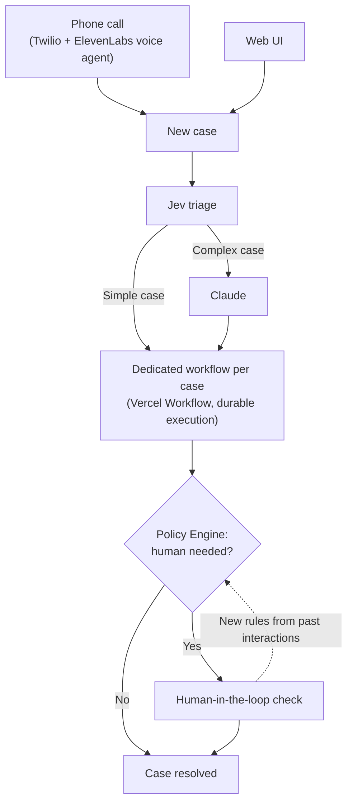

# Property Desk

Resolve property cases with AI, Durable Execution by Vercel Workflows and 11labs

**[Watch the 54-second working-product demo](docs/demo/property-desk-demo.mp4)** — the MP4 is stored in this repository.

Demo link: [property-desk-mauve.vercel.app](https://property-desk-mauve.vercel.app) 

## 1. What operational problem it solves

We want to give more time back to property management agents, tenants, landlords and contractors. 

We auto-resolve claims and only include humans when policy engines kick off human-in-the-loop checks

# Architecture

Each request comes in and:

1. Jev models triage cases with handoff to Claude for more complex cases
2. Run a dedicated workflow per case (Durable execution with Vercel Workflow)
3. Policy Engine decides if/when human-in-the-loop kicks in
  3a) we update Policy Engine with new rules based on past interactions
4. Resolve the case

To submit a case, you can call (11labs + Twilio) or use web UI

# How to run it

You can either use Demo link: [property-desk-mauve.vercel.app](https://property-desk-mauve.vercel.app) or call agent (I have demo Twilio account so only works from my phone, sorry!)

# Models, APIs and external services used

- Anthropic models for reasoning
- Jev model for routing
- Vercel Workflows for durable execution and hosting
- Twilio for phone number
- ElevenLabs for Voice agents

# Key assumptions
1. Auth is out of scope. We don't hard check who is making a claim. 
2. For demo we make HITL a bit too loose and didn't account for all edge cases (otherwise almost all cases would trigger HITL)
3. Calling to report a property problem is viable for our users.

# Known limitations
1. Contractor bookings, tenant messages and payments are simulated. A "resolved" case means the workflow finished, not that the repair was actually done.
2. Locally, one process runs all workflows with an in-memory queue. Hot reload and multiple workers aren't supported, and we haven't tested long-running timers on Vercel.

# What we'd build next
1. Auth and user management
2. I'd like to build a smarter system for contractors: see similar issues in nearby locations, route them and help maximise ROI of their time.
