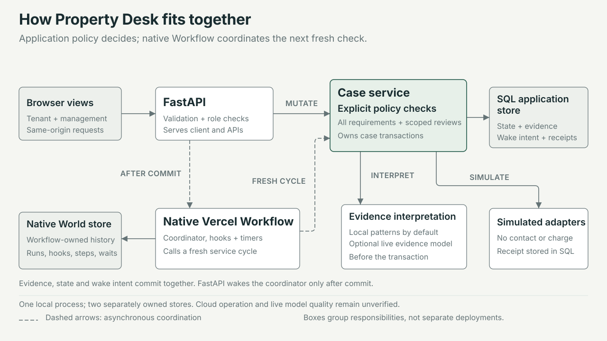
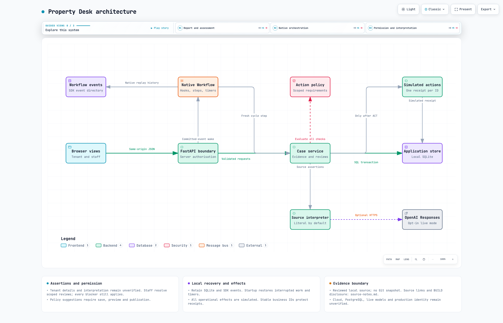

# Property Desk

Maintenance requests with explicit decisions, human review and a visible next step. Built with Python and native Vercel Workflow.

**[Watch the 54-second working-product demo](docs/demo/property-desk-demo.mp4)** — the MP4 is stored in this repository.

[](docs/demo/property-desk-demo.mp4)

The recording follows a fictional tenant report, two separate human reviews, an automatic local Workflow recheck and a simulated quote request. It also shows an unsaved policy suggestion. External actions are simulated and the repair remains unconfirmed. [Captions, recording details and editable production files](docs/demo/README.md) are included.

- [1. What operational problem it solves](#1-what-operational-problem-it-solves)
- [2. Architecture](#2-architecture)
- [3. How to run it](#3-how-to-run-it)
- [4. Models, APIs and external services used](#4-models-apis-and-external-services-used)
- [5. Key assumptions](#5-key-assumptions)
- [6. Known limitations](#6-known-limitations)
- [7. What we'd build next](#7-what-wed-build-next)

## 1. What operational problem it solves

A maintenance request can involve a tenant, property manager and contractor, each holding a different part of the history. A contractor saying the work is finished may conflict with a tenant reporting that it is still broken. An invoice does not prove completion; a spending approval does not establish permission to enter. Staff need to work out which evidence is missing, which action is safe to take, and whose decision is required.

Property Desk makes those decisions explicit. It gathers a tenant's report, proposes the next action, checks its evidence and authority, and either proceeds through a simulated adapter, asks for clarification, waits, routes a scoped decision to a person, or stops the affected action. The request can continue to gather information while that action is held. Staff see the reason and the evidence needed to resume.

**Status:** native Workflow execution is implemented and has been verified locally. Contractor contact, bookings, work instructions and payment-related actions are **simulated**. Claude (Anthropic API) reads every message, chooses the workflow route and drafts tenant questions; this has been verified locally with live calls. Hosted Vercel execution, PostgreSQL deployment and production identity integrations remain unverified. The interface is called Property Desk. The Python package is `property-workflow` and the FastAPI title is Property Workflow.

### What the prototype does

- Separate tenant conversations and a staff workspace with evidence, reviews, progress and simulated action receipts.
- Jev routing with hand-off to Claude: a fast TypeSafe Jev call routes every stored message first. Confident, simple messages are routed by Jev alone; Jev's other routes are applied while Claude extracts quotes and claims and may object (a CONFLICT for a person); unsure messages go to Claude as before. See [Jev routing](docs/JEV_ROUTING.md).
- Claude triage as native workflow steps: every message Jev hands off is read by Claude, which picks the workflow route, names the work item, splits separate problems into their own cases and extracts exact-quoted assertions that stay unverified. Unreadable, ambiguous, hazardous or disputed readings hold the action for a person; there is no keyword fallback. See [Claude triage](docs/CLAUDE_TRIAGE.md).
- Claude-drafted tenant questions: Claude recommends auto-send or staff review from the case data and policy, and a deterministic gate decides. Staff approve, edit or reject drafts; replies close answered questions. Sending is simulated.
- Per-action **PASS / FAIL / UNKNOWN / CONFLICT** checks that retain all relevant blockers and source links.
- Editable ALL/ANY rules, action/property/category filters, review ownership, thresholds and working-hour follow-ups.
- Policy draft → impact preview → publication, with explicit reassessment of pending actions and preserved historical versions.
- Role-checked factual correction, scoped approval, rejection, deferral and evidence requests. Expiry and revisions are checked before resumption.
- Supported plain-English policy instructions and resolved reviews can suggest editable drafts; neither publishes automatically nor grants general consent.
- Native Workflow steps, typed hooks, timers and startup recovery; authorised routine actions progress through simulated adapters.
- Stable action identities, duplicate handling and reconciliation of uncertain acknowledgements.
- Chronological replay of the fixed 25-case BUILD partition, with source hash checks and later material withheld.

## 2. Architecture



Both browser views share the case service and policy checks. Incoming evidence and events commit before the workflow is signalled; the coordinator reassesses current requirements before recording a simulated action. Application records and native Workflow events use separate storage, both of which are needed for local recovery.

[ARCHITECTURE.md](ARCHITECTURE.md) describes the components, data flows, deployment constraints and design decisions.

### Property Desk architecture

[](docs/diagrams/property-workflow.visual-check.2048x1320.light.png)

The map’s [editable JSON](docs/diagrams/property-workflow.architecture.json), [delivery receipt](docs/diagrams/property-workflow.delivery.json) and [source notes](docs/diagrams/source-notes.md) are kept alongside it. It describes reviewed local code; it does not represent a verified cloud deployment.

The companion [decision flow](docs/diagrams/decision-flow.html) shows how a held action returns to a fresh assessment. The [standalone system overview](docs/diagrams/system-overview.html) is the editable HTML source of the embedded figure. Both diagrams describe the implemented local system; optional live interpretation and hosted deployment are explicitly distinguished.

## 3. How to run it

### Requirements

- Python **3.12**, including `venv` and `pip` for a fresh environment.
- A POSIX environment for the native local process lock; existing verification was performed on macOS.
- This project's source and lockfile. BUILD replay additionally needs the supplied read-only `data/build/` and `handoff/BUILD_MANIFEST.json`.
- An Anthropic API key for Claude triage (without one, every message is handed to a case manager for manual triage), and optionally a TypeSafe API key for Jev routing (without one, Claude triages every message). No cloud database or Vercel credentials are needed for the local demonstration.

The [GitHub repository](https://github.com/MasteraSnackin/hackathon-valley) is private; your GitHub account needs access. For a fresh checkout:

```sh
git clone https://github.com/MasteraSnackin/hackathon-valley.git
cd hackathon-valley
python3.12 -m venv .venv
.venv/bin/python -m pip install -r requirements.lock
mkdir -p var
```

With [uv](https://docs.astral.sh/uv/), `uv sync` replaces the venv and pip steps (`uv.lock` is the exact resolved set; refresh `requirements.lock` with `uv export --no-hashes --no-emit-project -o requirements.lock`). Use an existing prepared `.venv` when dependencies are already installed.

Put the Anthropic key in the git-ignored `.env.local`, which the server, replay and tests load at startup (existing environment variables win). No other `.env` file is loaded; [`.env.example`](.env.example) documents available settings.

```sh
printf 'ANTHROPIC_API_KEY=your-key\n' > .env.local
```

### Start the native local application

From the project directory, create a separate demonstration store:

```sh
mkdir -p var
property_demo_dir=$(mktemp -d "$PWD/var/local-demo.XXXXXX")
printf 'Demo storage: %s\n' "$property_demo_dir"

env -u VERCEL_QUEUE_BASE_URL \
  APP_MODE=demo WORKFLOW_MODE=native_local WORKFLOW_TARGET_WORLD=local \
  DATABASE_URL="sqlite:///$property_demo_dir/application.db" \
  WORKFLOW_LOCAL_DATA_DIR="$property_demo_dir/native-world" \
  .venv/bin/python -m uvicorn app.main:app \
  --host 127.0.0.1 --port 8027 --workers 1
```

Open [the local interface](http://127.0.0.1:8027) or [interactive API documentation](http://127.0.0.1:8027/docs). If the port is occupied, choose another unused port and update the example URLs.

Record the printed directory. Stop with Ctrl-C; to resume, reuse the same `property_demo_dir` and run only the `env ... uvicorn` command. In a new shell, set `property_demo_dir` to that saved absolute path first. Repeating `mktemp` intentionally creates a separate empty demonstration.

Use one process without `--reload`. Local timers require a running process; startup recovery reconstructs pending work after a restart. See [the runtime guide](docs/WORKFLOW_RUNTIME.md). Do not repurpose the shared default `var/property.db` for controlled BUILD checks.

### Try the tenant and staff journeys

1. In **Tenant** view, enter the fictional report: “My name is Alex Taylor. I live at 18 Example Road. My kitchen tap is leaking.” Claude asks for anything missing, then shows a **Here's what I've got** summary. Press **Yes, send it**; nothing reaches property management before that. Without Claude, the local parser fills the summary and understands explicit `Name:`, `Address:` and `Issue:` wording.
2. Switch to **Property management** to inspect the case and outstanding requirements. Providing an address does not verify identity or grant access. The view switch is a demonstration convenience, not production login.
3. As **Case manager**, create a fictional dishwasher case at `DEMO-FLAT-1` with category `appliance`. This identifier has an explicit demo-only trusted property/contact mapping. Choose **Instruct work** to see missing requirements separately.
4. Add original evidence and exact quoted claims. Switch to the role named on a review to correct a supported fact or grant a scoped approval. Remaining blockers stay visible.
5. For routine automatic progress, propose **Request a quote** for that dishwasher. Once its smaller requirement set passes, native mode records one simulated action. Completing a quote request does not resolve the repair.
6. As **Policy editor**, change a setting or ALL/ANY rule, then save, preview, compare and publish. Explicitly reassess affected pending actions. Supported plain-English wording and **Review suggested policy** produce drafts for review.
7. Optionally import a BUILD case through a chosen event count. Interpretation receives only that chronological prefix, without later events or attachment bytes.

For manual demonstration, set `WORKFLOW_MODE=manual_demo`. Staff use **Reassess timers** and **Simulate action**; native background hooks and timers do not run. See [the portal guide](docs/PORTAL_UI.md) for both journeys.

### Configuration

#### Environment

| Variable | Purpose |
| --- | --- |
| `APP_MODE` | Defaults to `demo`; set `production` explicitly for hosted preparation. This disables demo sessions and requires database/staff configuration; `vercel.json` does not set it for you. |
| `WORKFLOW_MODE` | Defaults to `native_local`; alternatives are `manual_demo` and prepared-but-unverified `native_cloud`. |
| `WORKFLOW_TARGET_WORLD` | Set explicitly to `local` or, for hosted configuration, `vercel`. Mode/world mismatches are rejected. |
| `DATABASE_URL` | Defaults to shared `var/property.db`. Override for isolated development; the deployment path requires PostgreSQL. |
| `WORKFLOW_LOCAL_DATA_DIR` | Native local event storage. Retain it with its matching application database. |
| `VERCEL_QUEUE_BASE_URL` | Must be unset for the embedded local mode; this app does not configure an external local queue delivery route. |
| `ANTHROPIC_API_KEY` | Claude triage and tenant drafting. Keep it in `.env.local` or the hosting environment; never in source, screenshots or fixtures. Without it, messages go to manual triage. |
| `CLAUDE_MODEL` | Default `claude-opus-5`. |
| `CLAUDE_TRIAGE_EFFORT` / `CLAUDE_DRAFT_EFFORT` / `CLAUDE_INTAKE_EFFORT` / `CLAUDE_EXTRACT_EFFORT` | Adaptive-thinking effort, default `medium` / `low` / `low` / `low` (extraction runs when Jev already chose the route). |
| `TYPESAFE_API_KEY` | Jev routing. Same handling as the Anthropic key. Without it, Jev is skipped and Claude triages every message. |
| `JEV_MODEL` | Default `jev-1.13.0` (pinned; router thresholds are tuned for this version). |
| `STAFF_TOKEN_ROLES` | Production API configuration: JSON records with `id`, `role` and bearer-secret `sha256`. Does not provide browser login or organisation isolation. |

Claude reads the tenant conversation to prepare the summary the tenant confirms (the local parser is the offline fallback); plain-English policy drafting remains a local parser. Tenant messages before and after submission, and staff evidence without structured claims, are read by Claude, so those texts are sent to the Anthropic API.

#### Editable policy settings

| Setting | Demo default | Meaning |
| --- | --- | --- |
| `access_immediate_review` | `false` | Clarify missing access first; `true` routes immediately to a person. Neither grants permission. |
| `review_limit` | £100 | A verified total above this limit adds financial review; authority and other checks remain required. |
| `reminder_hours` / `escalation_hours` | 8 / 16 | Working-hour follow-up and escalation deadlines. |
| `reminder_limit` | 1 | Maximum automatic clarification reminders. |
| `approval_hours` | 48 | Upper bound used for approval expiry; grants remain scoped. |
| `deputy` | `case_manager` | Deputy escalation role. |
| `required_per_action` | Empty mapping | Additional facts by action; cannot remove baseline requirements. |
| `holiday_dates` | Empty list | `YYYY-MM-DD` exclusions from Monday to Friday, 09:00 to 17:00 Europe/London working hours. |
| `profile` | `demo` | The only configured policy profile. |
| `triage_auto_accept` | `high` | Minimum Claude confidence to accept the derived category label automatically (`high`, `medium` or `never`). Nothing else is ever accepted from the model. |
| `tenant_messages` | `claude_decides` | `claude_decides`: Claude may auto-send within the gate; `staff_approval`: every tenant message waits for a case manager; `off`: no tenant drafting. |
| `tenant_auto_send_topics` | all topics | Question topics Claude may send without staff review. |
| `tenant_max_questions` / `tenant_follow_ups` | 3 / 1 | Questions per message; narrower follow-ups after a partial answer. |
| `tenant_self_identification` | `clarify`, `request_quote` | Actions for which the name and address a tenant confirms in their own portal session satisfy identity and route. Limited to these two; corrected details fall back to the case manager. |
| `router` and `router_*` | `jev`, see [Jev routing](docs/JEV_ROUTING.md) | Jev routes first; thresholds for Jev-only, hand-off to Claude and hazard escalation. |

Rules combine supported fact states with ALL/ANY conditions, action/property/category filters, a response and an owner. The `total` fact must be the full comparable cumulative job commitment including tax; the prototype does not calculate it across invoices. Unknown is not zero. Precise appointment values, conflicting slot reconciliation and accepted-source configuration remain future work.

### BUILD replay

```sh
.venv/bin/python -m app.replay --all-first --output var/build-replay-first-events.json
.venv/bin/python -m app.replay --case 013 --events 2
```

Replay verifies the source manifest, uses temporary isolated storage, sends each selected prefix to Claude for triage and executes no adapters; drafted tenant questions stay in the simulated thread. It reports blockers, not an accuracy score. Index pages, later events and all binary attachments are excluded; see [BUILD replay boundaries](docs/BUILD_REPLAY_BOUNDARY.md), including retrospective material in BUILD 008.

### Reality Test preparation

The separate [Reality Test runner](docs/REALITY_TEST.md) accepts a versioned input manifest, runs cases in isolated native local Workflow processes and exports the required `ANSWERS/<case-id>/ANSWER.md` and `REASONING.md` with execution evidence. It retains failures and unresolved human handovers; it does not supply approvals or replace the agent's answers.

Follow the guide to validate configuration, record the frozen commit and run the organisers' newly released cases. The organiser input format has not yet been supplied, so conversion into the documented input schema may be needed. Fictional development examples verify the runner, not performance on unseen cases. Official Reality Test results have not been generated.

The [submission checklist](submission.md) collects the video path, social links, team accounts, freeze deadlines and remaining hand-in requirements.

### Checks

The test framework is **pytest**. From the prepared environment:

```sh
.venv/bin/python -m pytest -q                  # live Claude tests run when a key is configured
.venv/bin/python -m pytest -q -m "not claude"  # offline only
.venv/bin/python -m pytest tests/test_native_workflow.py tests/test_native_api.py -q
node --check static/app.js
```

Tests marked `claude` call the real Anthropic API on fictional messages (routing, clarification, issue splitting, tenant questions and replies, staff-approval policy, hazard holds, prompt injection, and triage inside the native runtime); they are skipped without a key. Offline tests use manual staff triage or no credential. Coverage also includes independent blockers, evidence conflicts, roles and revisions, policy changes during a wait, duplicate handling, tenant ownership, bounded policy interpretation, uncertain-result reconciliation and native hook/timer/restart behaviour. Tests use isolated storage; do not point them at the shared application database.

[Recorded verification](docs/VERIFICATION.md) includes the earlier baseline and later 132-test checks. It and the [runtime evidence](docs/WORKFLOW_RUNTIME.md) describe dated checks. They are historical snapshots, not a claim that subsequent revisions passed the same run. Local SDK and simulated-receipt tests do not establish cloud operation, model accuracy, message delivery or physical repairs.

## 4. Models, APIs and external services used

Claude triage needs an **Anthropic API key**; nothing else needs an external account for the local demonstration. The following table describes implemented calls and configured options, not sponsor affiliations or planned integrations.

| Component or service | Current use | Credentials and verification boundary |
| --- | --- | --- |
| Tenant intake and policy parser | Claude prepares the tenant-confirmed summary (local phrase parser as fallback); a bounded vocabulary for policy suggestions | A tenant's confirmation is not identity verification; policy publication remains explicit |
| Anthropic Claude API | Message triage (route, work item, issue split, quoted assertions, ambiguities, answers) and tenant-question drafting with a send recommendation. Python SDK `anthropic==1.13.0`, `beta.messages.parse` with structured output, adaptive thinking, server-side `fallbacks: "default"`, cached system prompt; model `CLAUDE_MODEL` (default `claude-opus-5`) | Requires `ANTHROPIC_API_KEY`; verified locally with live calls. Without it, every message goes to manual triage |
| TypeSafe Jev API | Routes each new message before Claude (route Choice with an explicit `unknown`, category Choice, five yes/no signals) in one request. Python SDK `typesafe-sdk==0.7.4`, model `jev-1.13.0` | Requires `TYPESAFE_API_KEY`; verified locally with live calls and a BUILD replay evaluation ([results](docs/evals/JEV_ROUTER_EVAL.md)). Without it, Claude triages every message |
| Python Vercel Workflow SDK | Native steps, typed hooks, timers, replay and local recovery using `vercel-workflow==0.11.1` | Local World runs without Vercel credentials; Vercel-hosted World is prepared but unverified |
| SQLite / SQLAlchemy | Application case state, evidence, decisions, policies and local tenant state | Local storage; PostgreSQL/psycopg is an unverified hosted path, not a provisioned service |
| FastAPI JSON API | Same-origin browser access to tenant conversations, case decisions and policy operations | Demo sessions locally; production staff bearer configuration is separate from a browser login |
| Operational adapters | Simulated clarification, contractor contact, bookings, work instructions and receipts | No real email, SMS, phone, contractor system or payment service is connected |
| Lucide icons | Vendored interface icons served locally | No icon CDN or runtime account dependency |

Claude's output is schema-validated and every quote must occur verbatim in the source. Its assertions stay unverified until the named role checks them, and a deterministic gate controls every tenant message. Tenant conversations, updates and unstructured staff evidence are sent to the Anthropic API; the tenant fallback parser and the policy parser remain local. No ElevenLabs integration is implemented.

### Libraries and runtime

| Layer | Implementation |
| --- | --- |
| Language | Python 3.12; project constraint `>=3.12,<3.13` |
| API and validation | FastAPI 0.118.0, Uvicorn 0.37.0, Pydantic 2.14.0 |
| Workflow | Native Python `vercel-workflow==0.11.1`; local event store and embedded queue |
| Persistence | SQLAlchemy 2.0.43; SQLite locally; unverified PostgreSQL/psycopg deployment path |
| Interface | Static HTML, CSS and vanilla JavaScript served by FastAPI; vendored Lucide icons |
| Interpretation | Claude via the Anthropic Python SDK 1.13.0, run as native Workflow steps |
| Testing | pytest 8.4.2, API checks and native Workflow subprocess tests |
| Deployment preparation | FastAPI configuration in `vercel.json`; Workflow entry point in `pyproject.toml` |

[requirements.lock](requirements.lock) pins the recorded dependencies. Serving the interface requires no frontend build; Node.js is only needed for the optional JavaScript syntax check.

### Application API

#### Minimal staff API example

With the local server running, create a demo session and submit a fictional quote request:

```sh
demo_cookie_file=$(mktemp)

curl --fail --silent --show-error \
  -c "$demo_cookie_file" -H 'Content-Type: application/json' \
  -d '{"role":"case_manager"}' \
  http://127.0.0.1:8027/api/demo-session

curl --fail --silent --show-error \
  -b "$demo_cookie_file" -H 'Content-Type: application/json' \
  -d '{"idempotency_key":"readme-quote-1","title":"Dishwasher stops mid-cycle","property_ref":"DEMO-FLAT-1","report":"The dishwasher stops during its cycle.","category":"appliance","work_item":"Kitchen dishwasher","action":"request_quote"}' \
  http://127.0.0.1:8027/api/cases

rm -f "$demo_cookie_file"
```

The response includes the case and current assessment. Native execution can advance asynchronously; reuse an intake key only for the same request.

| Endpoint | Purpose |
| --- | --- |
| `GET /api/health`, `GET /api/session` | Modes, simulation label and staff session |
| `GET/POST /api/tenant/session` | Inspect/start a separate local tenant session |
| `POST /api/tenant/conversations` | Start a report with `text` and `idempotency_key` |
| `GET /api/tenant/conversations/{id}` | Read an owned conversation and filtered progress |
| `POST /api/tenant/conversations/{id}/messages` | Continue the report and shared case |
| `GET/POST /api/cases`, `GET /api/cases/{id}` | Create/list cases; inspect sources, decisions, reviews and actions |
| `POST /api/cases/{id}/evidence` | Submit original evidence and exact quoted claims |
| `POST /api/cases/{id}/proposal` | Change the scoped action and its revision |
| `POST /api/cases/{id}/evaluate` | Explicitly reassess current requirements |
| `POST /api/cases/{id}/tenant-reply` | Simulated tenant reply `{"text": ...}`; Claude reads it in the next coordinator step |
| `POST /api/cases/{id}/triage/retry` | Retry a failed Claude reading |
| `POST /api/messages/{id}/approve`, `POST /api/messages/{id}/reject` | Send (optionally edited) or reject a Claude-drafted tenant message; `{"reason":...,"redraft":true}` asks for a new draft |
| `POST /api/reviews/{id}/respond` | Correct, approve, reject, defer or request evidence |
| `POST /api/cases/{id}/execute` | Permitted simulated action; `{"outcome":"uncertain"}` exercises lost acknowledgement |
| `POST /api/cases/{id}/reconcile`, `POST /api/cases/{id}/tick` | Reconcile a receipt; reassess actual current deadlines |
| `GET /api/policies`, `POST /api/policies/draft` | Inspect versions or save a draft |
| `POST /api/policies/{id}/preview`, `POST /api/policies/{id}/publish` | Preview impacts and publish a still-current preview |
| `POST /api/policy-assistant/interpret` | Proposed policy interpretation without saving |
| `GET /api/policy-assistant/reviews/{id}/suggestion` | Reusable draft suggestion from a resolved review |
| `GET /api/build-cases` | Fixed BUILD catalogue |
| `GET /api/build-cases/{id}/snapshot?event_count=2` | Inspect a history prefix |
| `POST /api/build-cases/{id}/import` | Import a prefix, for example `{"event_count":2}` |

Evidence fields are `text`, `source_label`, optional timezone-aware `occurred_at`, and `claims` with `key`, `value`, `source_quote` and optional `scope`. Quotes must match the submitted text. Corrections identify a claim, source and reason; approvals identify the requirement, source, scope and expiry. Hook tokens are not authorisation credentials. See `/docs` for complete request schemas.

## 5. Key assumptions

- This is a **single-organisation local demonstration**, using fictional UI reports or only the authorised BUILD partition. The view toggle and demo roles are not production authentication.
- A name, address, message, document or model assertion is evidence to assess. It does not automatically establish identity, consent, authority or completion. The policy-gated auto-acceptance of Claude's derived category label and the `DEMO-FLAT-1` directory are the only exceptions.
- Permissions and approvals apply to the relevant property, work item, action, provider and access method. Every applicable check must pass; resolving one blocker leaves the others in place.
- Demo thresholds, role mappings and Monday–Friday 09:00–17:00 Europe/London working hours are illustrative. An operational owner must supply real authority mappings, thresholds, accepted evidence and urgent-response procedures.
- A responsible staff member can verify evidence, request more information or make a scoped decision. A review can suggest a policy draft, but only an authorised editor can save, preview and publish it. The system does not rewrite its code after a human decision.
- Local native execution uses one running Python process and retains both application and Workflow storage. A recorded action, accepted wake or finished workflow is not proof of a physical repair.
- Development replay knows only the selected history prefix. Later messages, retrospective summaries and attachment contents cannot be treated as facts available at an earlier decision.

## 6. Known limitations

| Area | Present limit |
| --- | --- |
| Real operations | All external operational effects are simulated. No contractor visit, message delivery, payment or physical repair is established by a demo receipt. |
| Conversation and evidence | Local parsing supports limited wording. Claude reading quality has no labelled accuracy measurement yet; attachment ingestion, image understanding and a voice conversation are not verified or implemented as complete flows. |
| Identity and access | Production tenant login, staff SSO, organisation/property isolation and a real authority directory are unfinished. Tenant routes are disabled outside demo mode. |
| Hosted operation | Vercel cloud execution and PostgreSQL behaviour are unverified. Deployment configuration does not provision accounts, secrets, storage, authentication or a production environment. |
| Durability and scale | Local delivery uses an in-memory queue plus persisted native history and startup recovery. One process owns the Workflow directory; hot reload and multiple workers are unsupported. The prototype serialises transactions and has no production capacity or availability claim. |
| Evaluation | BUILD replay reports decisions and blockers, not accuracy. Development provenance does not support a claim of a completely blind holdout; see the disclosure below. |
| Operations and governance | Production monitoring, migrations, backup/restore objectives, retention/deletion procedures and security assessment remain work to do. The append-only ledger is not administrator-tamper-proof. |

The earlier policy audit saw the complete corpus before splitting, and a later shared-runtime UI check exposed a reserved record. That record was not used to tune the implementation, but the shared store and displayed case cannot be described as untouched evaluation material. Preserve this disclosure and use separately controlled evaluation storage.

## 7. What we'd build next

- Label acceptable outcomes and run separately controlled evaluation after freezing code and policies.
- Add production staff/tenant identity, organisation access controls and a real property/authority directory.
- Validate Vercel deployment and PostgreSQL, including migrations, backup and restore.
- Implement operational adapters with provider idempotency, read-back and transactional delivery.
- Add attachment storage/extraction with document-version availability controls.
- Extend typed scheduling, accepted-source settings, holiday feeds and cumulative budget/invoice integration.
- Label routing outcomes to measure Claude triage accuracy, and show Claude's tenant questions inside the tenant portal conversation.
- Add operational metrics, tracing, alerting and service targets.
- Extend review-derived policy suggestions with duplicate-rule checks and regression examples; retain explicit editor review and publication.
- Add a voice intake adapter that confirms missing details, preserves the transcript and calls the same case API, with a clear handover to a person.

## Project reference

### Screenshots and demo

- **Local demo:** [http://127.0.0.1:8027](http://127.0.0.1:8027), after starting the application.
- **Walkthrough:** [Tenant and property-manager journey](docs/PORTAL_UI.md).
- **Public demo URL:** `TODO: add after a hosted deployment is authorised and verified.`

No public deployment is claimed. Screenshots must not expose credentials or reserved evaluation records.

The screenshots below were captured on 10 October 2026 from a fresh, isolated local instance using fictional details. Operational actions remain simulated.

#### Animated product and architecture walkthrough


A 61-second loop covering tenant intake, staff review and policy settings, followed by the architecture. It combines an edited sequence of actual local app screens with an architecture animation. Operational actions are simulated; an action receipt does not confirm a completed repair.

Property Desk is still being built. This walkthrough is a prototype snapshot, and the interface, workflows and features are subject to frequent changes.

#### Tenant request


The tenant's report is saved for the property manager to check. The confirmation distinguishes a recorded request from a booking or completed repair.

#### Staff review


Two open reviews block the proposed quote request: person/property mapping and the verified contact route. Each review shows its scope, owner and other remaining blocker.

#### Policy settings


A plain-English instruction produces a proposed change to route missing access permission to immediate human review. The proposal is unsaved and unpublished; published version 1 remains visible below it.

### Contributing

- Read [AGENTS.md](AGENTS.md), [the architecture](ARCHITECTURE.md) and [data boundaries](docs/DATA_BOUNDARIES.md).
- Keep `handoff/` and `data/build/` read-only. Develop only against the authorised BUILD partition; do not inspect reserved cases to tune rules.
- Preserve original evidence, source links, independent blockers and exact approval scope.
- Use isolated stores and fictional UI scenarios. Add focused regressions for decision, permission or persistence changes.
- Describe changes, checks and limitations in a pull request. Local development does not imply real communications or deployment.
- Open an [issue](https://github.com/MasteraSnackin/hackathon-valley/issues) for a defect or a [pull request](https://github.com/MasteraSnackin/hackathon-valley/pulls) for a proposed change. Repository access is required.

### Licence

Property Desk's original source code and documentation are licensed under the [Apache License 2.0](LICENSE). Copyright 2026 Property Desk contributors.

Third-party libraries, datasets, models, APIs and assets retain their own licences and terms. The project licence does not relicense those materials; vendored icons include [their Lucide licence](static/vendor/LUCIDE-LICENSE).

### Maintainers and team

- [@MasteraSnackin](https://github.com/MasteraSnackin)
- [@vincentwap](https://github.com/vincentwap)
- [@oleh-vell](https://github.com/oleh-vell)
- [@Mehedi-dev-2404](https://github.com/Mehedi-dev-2404)

### Contact and support

- **Support channel:** [GitHub issues](https://github.com/MasteraSnackin/hackathon-valley/issues), for users with repository access.
- **Repository:** [MasteraSnackin/hackathon-valley](https://github.com/MasteraSnackin/hackathon-valley) (private).

For local setup, begin with [the runtime guide](docs/WORKFLOW_RUNTIME.md) and [the portal guide](docs/PORTAL_UI.md). No production support commitment is specified.
