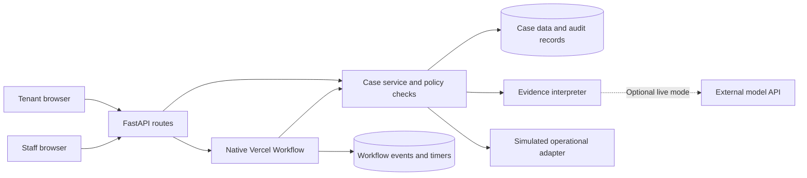

# Property Desk

Manage maintenance requests, check the evidence and involve staff when a decision needs them. Built with Python and Vercel Workflow.

## Description

Property Desk is a local prototype for tenants and property management staff. Tenants report maintenance problems through a conversation; staff see the evidence, proposed action, outstanding checks and decisions that need a person. Staff can edit the rules that let the agent act, ask for clarification, wait or escalate. Approving one requirement never clears unrelated blockers.

**Status:** native Workflow execution is implemented and has been verified locally. Contractor contact, bookings, work instructions and payment-related actions are **simulated**. Hosted Vercel execution, PostgreSQL deployment, live model calls and production identity integrations remain unverified. The interface is called Property Desk. The Python package is `property-workflow` and the FastAPI title is Property Workflow.

## Table of Contents

- [Description](#description)
- [Features](#features)
- [Tech Stack](#tech-stack)
- [Architecture Overview](#architecture-overview)
- [Installation](#installation)
- [Usage](#usage)
- [Configuration](#configuration)
- [Screenshots / Demo](#screenshots--demo)
- [API / CLI Reference](#api--cli-reference)
- [Tests](#tests)
- [Roadmap](#roadmap)
- [Contributing](#contributing)
- [License](#license)
- [Contact / Support](#contact--support)

## Features

- Separate tenant conversations and a staff workspace with evidence, reviews, progress and simulated action receipts.
- Per-action **PASS / FAIL / UNKNOWN / CONFLICT** checks that retain all relevant blockers and source links.
- Editable ALL/ANY rules, action/property/category filters, review ownership, thresholds and working-hour follow-ups.
- Policy draft → impact preview → publication, with explicit reassessment of pending actions and preserved historical versions.
- Role-checked factual correction, scoped approval, rejection, deferral and evidence requests. Expiry and revisions are checked before resumption.
- Supported plain-English policy instructions and resolved reviews can suggest editable drafts; neither publishes automatically nor grants general consent.
- Native Workflow steps, typed hooks, timers and startup recovery; authorised routine actions progress through simulated adapters.
- Stable action identities, duplicate handling and reconciliation of uncertain acknowledgements.
- Chronological replay of the fixed 25-case BUILD partition, with source hash checks and later material withheld.

## Tech Stack

| Layer | Implementation |
| --- | --- |
| Language | Python 3.12; project constraint `>=3.12,<3.13` |
| API and validation | FastAPI 0.118.0, Uvicorn 0.37.0, Pydantic 2.14.0 |
| Workflow | Native Python `vercel-workflow==0.11.1`; local event store and embedded queue |
| Persistence | SQLAlchemy 2.0.43; SQLite locally; unverified PostgreSQL/psycopg deployment path |
| Interface | Static HTML, CSS and vanilla JavaScript served by FastAPI; vendored Lucide icons |
| Interpretation | Local literal parser by default; optional HTTPX adapter to the OpenAI Responses API |
| Testing | pytest 8.4.2, API checks and native Workflow subprocess tests |
| Deployment preparation | FastAPI configuration in `vercel.json`; Workflow entry point in `pyproject.toml` |

[requirements.lock](requirements.lock) pins the recorded dependencies. Serving the interface requires no frontend build; Node.js is only needed for the optional JavaScript syntax check.

## Architecture Overview



Both browser views share the case service and policy checks. Incoming evidence and events commit before the workflow is signalled; the coordinator reassesses current requirements before recording a simulated action. Application records and native Workflow events use separate storage, both of which are needed for local recovery.

[ARCHITECTURE.md](ARCHITECTURE.md) describes the components, data flows, deployment constraints and design decisions.

Open the [interactive architecture map](docs/diagrams/property-workflow.html) to explore components and three guided views. Its [editable JSON](docs/diagrams/property-workflow.architecture.json), [delivery receipt](docs/diagrams/property-workflow.delivery.json) and [source notes](docs/diagrams/source-notes.md) are kept alongside it. The map describes reviewed local code; it does not represent a verified cloud deployment.

## Installation

### Requirements

- Python **3.12**, including `venv` and `pip` for a fresh environment.
- A POSIX environment for the native local process lock; existing verification was performed on macOS.
- This project's source and lockfile. BUILD replay additionally needs the supplied read-only `data/build/` and `handoff/BUILD_MANIFEST.json`.
- No model account, cloud database or Vercel credentials for the default local demonstration.

The [GitHub repository](https://github.com/MasteraSnackin/hackathon-valley) is private; your GitHub account needs access. For a fresh checkout:

```sh
git clone https://github.com/MasteraSnackin/hackathon-valley.git
cd hackathon-valley
python3.12 -m venv .venv
.venv/bin/python -m pip install -r requirements.lock
mkdir -p var
```

Use an existing prepared `.venv` when dependencies are already installed. The application does **not** automatically load a copied `.env` file; [`.env.example`](.env.example) documents available settings.

## Usage

### Start the native local application

From the project directory, create a separate demonstration store:

```sh
mkdir -p var
property_demo_dir=$(mktemp -d "$PWD/var/local-demo.XXXXXX")
printf 'Demo storage: %s\n' "$property_demo_dir"

env -u VERCEL_QUEUE_BASE_URL \
  APP_MODE=demo WORKFLOW_MODE=native_local WORKFLOW_TARGET_WORLD=local \
  AI_MODE=literal_demo \
  DATABASE_URL="sqlite:///$property_demo_dir/application.db" \
  WORKFLOW_LOCAL_DATA_DIR="$property_demo_dir/native-world" \
  .venv/bin/python -m uvicorn app.main:app \
  --host 127.0.0.1 --port 8027 --workers 1
```

Open [the local interface](http://127.0.0.1:8027) or [interactive API documentation](http://127.0.0.1:8027/docs). If the port is occupied, choose another unused port and update the example URLs.

Record the printed directory. Stop with Ctrl-C; to resume, reuse the same `property_demo_dir` and run only the `env ... uvicorn` command. In a new shell, set `property_demo_dir` to that saved absolute path first. Repeating `mktemp` intentionally creates a separate empty demonstration.

Use one process without `--reload`. Local timers require a running process; startup recovery reconstructs pending work after a restart. See [the runtime guide](docs/WORKFLOW_RUNTIME.md). Do not repurpose the shared default `var/property.db` for controlled BUILD checks.

### Try the tenant and staff journeys

1. In **Tenant** view, enter the fictional report: “My name is Alex Taylor. I live at 18 Example Road. My kitchen tap is leaking.” Answer any missing-detail question. Explicit `Name:`, `Address:` and `Issue:` wording is available for corrections the local parser does not understand.
2. Switch to **Property management** to inspect the case and outstanding requirements. Providing an address does not verify identity or grant access. The view switch is a demonstration convenience, not production login.
3. As **Case manager**, create a fictional dishwasher case at `DEMO-FLAT-1` with category `appliance`. This identifier has an explicit demo-only trusted property/contact mapping. Choose **Instruct work** to see missing requirements separately.
4. Add original evidence and exact quoted claims. Switch to the role named on a review to correct a supported fact or grant a scoped approval. Remaining blockers stay visible.
5. For routine automatic progress, propose **Request a quote** for that dishwasher. Once its smaller requirement set passes, native mode records one simulated action. Completing a quote request does not resolve the repair.
6. As **Policy editor**, change a setting or ALL/ANY rule, then save, preview, compare and publish. Explicitly reassess affected pending actions. Supported plain-English wording and **Make this a policy** produce drafts for review.
7. Optionally import a BUILD case through a chosen event count. Interpretation receives only that chronological prefix, without later events or attachment bytes.

For manual demonstration, set `WORKFLOW_MODE=manual_demo`. Staff use **Reassess timers** and **Simulate action**; native background hooks and timers do not run. See [the portal guide](docs/PORTAL_UI.md) for both journeys.

## Configuration

### Environment

| Variable | Purpose |
| --- | --- |
| `APP_MODE` | Defaults to `demo`; deployment configuration uses `production`, disabling demo sessions and requiring database/staff configuration. |
| `WORKFLOW_MODE` | Defaults to `native_local`; alternatives are `manual_demo` and prepared-but-unverified `native_cloud`. |
| `WORKFLOW_TARGET_WORLD` | Set explicitly to `local` or, for hosted configuration, `vercel`. Mode/world mismatches are rejected. |
| `DATABASE_URL` | Defaults to shared `var/property.db`. Override for isolated development; the deployment path requires PostgreSQL. |
| `WORKFLOW_LOCAL_DATA_DIR` | Native local event storage. Retain it with its matching application database. |
| `VERCEL_QUEUE_BASE_URL` | Must be unset for the embedded local mode; this app does not configure an external local queue delivery route. |
| `AI_MODE` | `literal_demo` makes no model requests even when a key exists. `live` explicitly enables the optional evidence-model adapter. |
| `MODEL_MODE` | Compatibility alias if `AI_MODE` is absent: `literal_demo` or `live_model`. |
| `OPENAI_API_KEY` | Required only for explicit live evidence interpretation. Never include it in source, screenshots or fixtures. |
| `OPENAI_MODEL` | Configured default `gpt-4.1-mini`; account availability has not been verified. |
| `STAFF_TOKEN_ROLES` | Production API configuration: JSON records with `id`, `role` and bearer-secret `sha256`. Does not provide browser login or organisation isolation. |

Tenant conversation extraction and plain-English policy drafting remain bounded local parsers; enabling the evidence-model adapter does not replace them.

### Editable policy settings

| Setting | Demo default | Meaning |
| --- | --- | --- |
| `access_immediate_review` | `false` | Clarify missing access first; `true` routes immediately to a person. Neither grants permission. |
| `review_limit` | £100 | A verified total above this limit adds financial review; authority and other checks remain required. |
| `reminder_hours` / `escalation_hours` | 8 / 16 | Working-hour follow-up and escalation deadlines. |
| `reminder_limit` | 1 | Maximum automatic clarification reminders. |
| `approval_hours` | 48 | Upper bound used for approval expiry; grants remain scoped. |
| `deputy` | `case_manager` | Deputy escalation role. |
| `required_per_action` | Empty mapping | Additional facts by action; cannot remove baseline requirements. |
| `holiday_dates` | Empty list | `YYYY-MM-DD` exclusions from Monday to Friday, 09:00 to 17:00 Europe/London working hours. |
| `profile` | `demo` | The only configured policy profile. |

Rules combine supported fact states with ALL/ANY conditions, action/property/category filters, a response and an owner. The `total` fact must be the full comparable cumulative job commitment including tax; the prototype does not calculate it across invoices. Unknown is not zero. Precise appointment values, conflicting slot reconciliation and accepted-source configuration remain future work.

## Screenshots / Demo

- **Local demo:** [http://127.0.0.1:8027](http://127.0.0.1:8027), after starting the application.
- **Walkthrough:** [Tenant and property-manager journey](docs/PORTAL_UI.md).
- **Public demo URL:** `TODO: add after a hosted deployment is authorised and verified.`

No public deployment is claimed. Screenshots must not expose credentials or reserved evaluation records.

The screenshots below were captured on 10 October 2026 from a fresh, isolated local instance using fictional details. Operational actions remain simulated.

### Tenant request


The tenant's report is saved for the property manager to check. The confirmation distinguishes a recorded request from a booking or completed repair.

### Staff review


Two open reviews block the proposed quote request: person/property mapping and the verified contact route. Each review shows its scope, owner and other remaining blocker.

### Policy settings


A plain-English instruction produces a proposed change to route missing access permission to immediate human review. The proposal is unsaved and unpublished; published version 1 remains visible below it.

## API / CLI Reference

### Minimal staff API example

With the local server running, create a demo session and submit a fictional quote request:

```sh
demo_cookie_file=$(mktemp)

curl --fail --silent --show-error \
  -c "$demo_cookie_file" -H 'Content-Type: application/json' \
  -d '{"role":"case_manager"}' \
  http://127.0.0.1:8027/api/demo-session

curl --fail --silent --show-error \
  -b "$demo_cookie_file" -H 'Content-Type: application/json' \
  -d '{"idempotency_key":"readme-quote-1","title":"Dishwasher stops mid-cycle","property_ref":"DEMO-FLAT-1","report":"The dishwasher stops during its cycle.","category":"appliance","work_item":"Kitchen dishwasher","action":"request_quote"}' \
  http://127.0.0.1:8027/api/cases

rm -f "$demo_cookie_file"
```

The response includes the case and current assessment. Native execution can advance asynchronously; reuse an intake key only for the same request.

| Endpoint | Purpose |
| --- | --- |
| `GET /api/health`, `GET /api/session` | Modes, simulation label and staff session |
| `GET/POST /api/tenant/session` | Inspect/start a separate local tenant session |
| `POST /api/tenant/conversations` | Start a report with `text` and `idempotency_key` |
| `GET /api/tenant/conversations/{id}` | Read an owned conversation and filtered progress |
| `POST /api/tenant/conversations/{id}/messages` | Continue the report and shared case |
| `GET/POST /api/cases`, `GET /api/cases/{id}` | Create/list cases; inspect sources, decisions, reviews and actions |
| `POST /api/cases/{id}/evidence` | Submit original evidence and exact quoted claims |
| `POST /api/cases/{id}/proposal` | Change the scoped action and its revision |
| `POST /api/cases/{id}/evaluate` | Explicitly reassess current requirements |
| `POST /api/reviews/{id}/respond` | Correct, approve, reject, defer or request evidence |
| `POST /api/cases/{id}/execute` | Permitted simulated action; `{"outcome":"uncertain"}` exercises lost acknowledgement |
| `POST /api/cases/{id}/reconcile`, `POST /api/cases/{id}/tick` | Reconcile a receipt; reassess actual current deadlines |
| `GET /api/policies`, `POST /api/policies/draft` | Inspect versions or save a draft |
| `POST /api/policies/{id}/preview`, `POST /api/policies/{id}/publish` | Preview impacts and publish a still-current preview |
| `POST /api/policy-assistant/interpret` | Proposed policy interpretation without saving |
| `GET /api/policy-assistant/reviews/{id}/suggestion` | Reusable draft suggestion from a resolved review |
| `GET /api/build-cases` | Fixed BUILD catalogue |
| `GET /api/build-cases/{id}/snapshot?event_count=2` | Inspect a history prefix |
| `POST /api/build-cases/{id}/import` | Import a prefix, for example `{"event_count":2}` |

Evidence fields are `text`, `source_label`, optional timezone-aware `occurred_at`, and `claims` with `key`, `value`, `source_quote` and optional `scope`. Quotes must match the submitted text. Corrections identify a claim, source and reason; approvals identify the requirement, source, scope and expiry. Hook tokens are not authorisation credentials. See `/docs` for complete request schemas.

### BUILD replay

```sh
.venv/bin/python -m app.replay --all-first --output var/build-replay-first-events.json
.venv/bin/python -m app.replay --case 013 --events 2
```

Replay verifies the source manifest, uses temporary isolated storage, disables live models and executes no adapters. It reports blockers, not an accuracy score. Index pages, later events and all binary attachments are excluded; see [BUILD replay boundaries](docs/BUILD_REPLAY_BOUNDARY.md), including retrospective material in BUILD 008.

The earlier policy audit saw the complete corpus before splitting, and a later shared-runtime UI check exposed a reserved record. That record was not used to tune the implementation, but the shared store and displayed case cannot be described as untouched evaluation material. Preserve this disclosure and use separately controlled evaluation storage.

## Tests

The test framework is **pytest**. From the prepared environment:

```sh
.venv/bin/python -m pytest -q
.venv/bin/python -m pytest tests/test_native_workflow.py tests/test_native_api.py -q
node --check static/app.js
```

Coverage includes independent blockers, evidence conflicts, roles and revisions, policy changes during a wait, duplicate handling, tenant ownership, bounded policy interpretation, uncertain-result reconciliation and native hook/timer/restart behaviour. Tests use isolated storage; do not point them at the shared application database.

[Recorded verification](docs/VERIFICATION.md) and [runtime evidence](docs/WORKFLOW_RUNTIME.md) describe dated checks. They are historical snapshots, not a claim that subsequent revisions passed the same run. Local SDK and simulated-receipt tests do not establish cloud operation, model accuracy, message delivery or physical repairs.

## Roadmap

- Label acceptable outcomes and run separately controlled evaluation after freezing code and policies.
- Add production staff/tenant identity, organisation access controls and a real property/authority directory.
- Validate Vercel deployment and PostgreSQL, including migrations, backup and restore.
- Implement operational adapters with provider idempotency, read-back and transactional delivery.
- Add attachment storage/extraction with document-version availability controls.
- Extend typed scheduling, accepted-source settings, holiday feeds and cumulative budget/invoice integration.
- Validate live model interpretation and broader conversation understanding.
- Add operational metrics, tracing, alerting and service targets.

## Contributing

- Read [AGENTS.md](AGENTS.md), [the architecture](ARCHITECTURE.md) and [data boundaries](docs/DATA_BOUNDARIES.md).
- Keep `handoff/` and `data/build/` read-only. Develop only against the authorised BUILD partition; do not inspect reserved cases to tune rules.
- Preserve original evidence, source links, independent blockers and exact approval scope.
- Use isolated stores and fictional UI scenarios. Add focused regressions for decision, permission or persistence changes.
- Describe changes, checks and limitations in a pull request. Local development does not imply real communications or deployment.
- Open an [issue](https://github.com/MasteraSnackin/hackathon-valley/issues) for a defect or a [pull request](https://github.com/MasteraSnackin/hackathon-valley/pulls) for a proposed change. Repository access is required.

## License

**Project licence: not specified.** No project-wide `LICENSE` file is present; this README does not grant or choose one on the maintainer's behalf.

`TODO: choose the project licence and add a root LICENSE file before public reuse.` Third-party assets retain their own terms; vendored icons include [their Lucide licence](static/vendor/LUCIDE-LICENSE).

## Contact / Support

- **Maintainer:** `TODO: add maintainer or team name.`
- **Support channel:** [GitHub issues](https://github.com/MasteraSnackin/hackathon-valley/issues), for users with repository access.
- **Repository:** [MasteraSnackin/hackathon-valley](https://github.com/MasteraSnackin/hackathon-valley) (private).

For local setup, begin with [the runtime guide](docs/WORKFLOW_RUNTIME.md) and [the portal guide](docs/PORTAL_UI.md). No production support commitment is specified.
