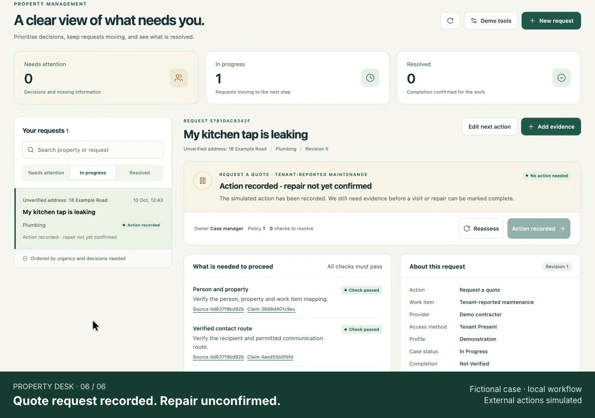
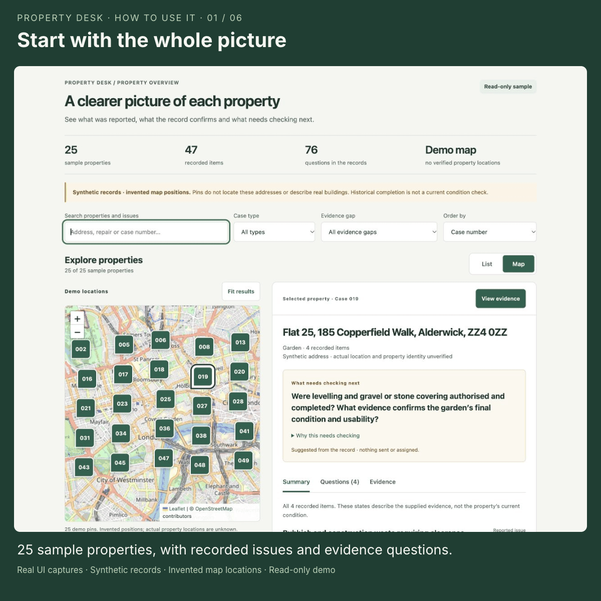
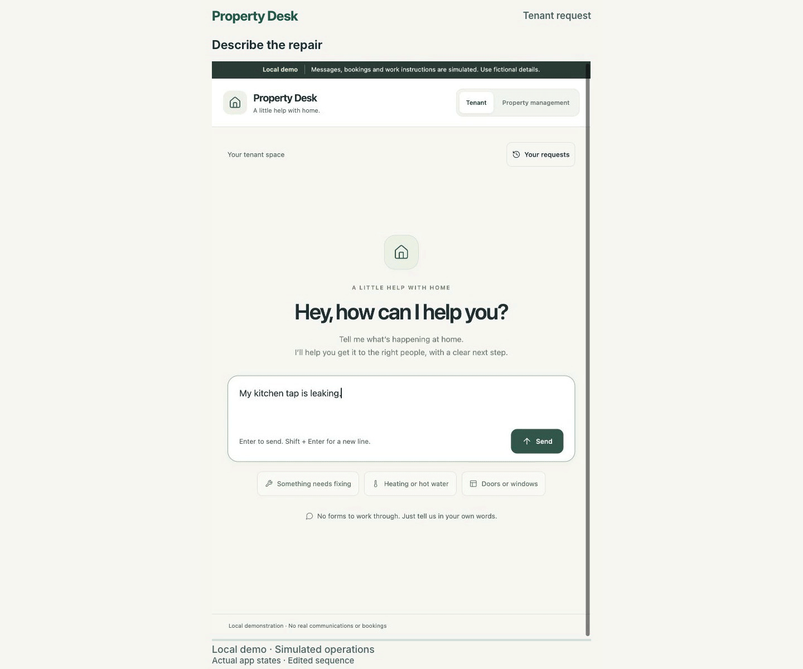

# Property Desk

Maintenance requests with explicit decisions, human review and a visible next step. Built with Python and native Vercel Workflow.

**[Watch the 54-second working-product demo](docs/demo/property-desk-demo.mp4)** — the MP4 is stored in this repository.

[](docs/demo/property-desk-demo.mp4)

The recording follows a fictional tenant report, two separate human reviews, an automatic local Workflow recheck and a simulated quote request. It also shows an unsaved policy suggestion. External actions are simulated and the repair remains unconfirmed. [Captions, recording details and editable production files](docs/demo/README.md) are included.

- [1. What operational problem it solves](#1-what-operational-problem-it-solves)
- [2. Architecture](#2-architecture)
- [3. How to run it](#3-how-to-run-it)
- [4. Models, APIs and external services used](#4-models-apis-and-external-services-used)
- [5. Key assumptions](#5-key-assumptions)
- [6. Known limitations](#6-known-limitations)
- [7. What we'd build next](#7-what-wed-build-next)
- [Property overview: map, recorded items and evidence](#property-overview-map-recorded-items-and-evidence)

## 1. What operational problem it solves

A maintenance request can involve a tenant, property manager and contractor, each holding a different part of the history. A contractor saying the work is finished may conflict with a tenant reporting that it is still broken. An invoice does not prove completion; a spending approval does not establish permission to enter. Staff need to work out which evidence is missing, which action is safe to take, and whose decision is required.

Property Desk makes those decisions explicit. It gathers a tenant's report, proposes the next action, checks its evidence and authority, and either proceeds through a simulated adapter, asks for clarification, waits, routes a scoped decision to a person, or stops the affected action. The request can continue to gather information while that action is held. Staff see the reason and the evidence needed to resume.

**Status:** this is an actively changing prototype. Native Workflow execution is implemented and has been verified locally. Contractor contact, bookings, work instructions and payment-related actions are **simulated**. The current case pipeline uses Jev for initial routing, with Claude handling uncertainty, detailed interpretation and tenant questions. A separate React staff dashboard now sits alongside the original tenant/staff interface. Earlier recordings and verification reports describe their recorded revision, not every later change. Hosted Vercel execution, PostgreSQL deployment and production identity integrations remain unverified. The interface is called Property Desk. The Python package is `property-workflow` and the FastAPI title is Property Workflow.

### Property overview: map, recorded items and evidence

The standalone [property overview](docs/property-overview/README.md) lets staff browse 25 synthetic BUILD properties and their 47 recorded issue, work or follow-up items. Map and List select the same property panel, with Summary, Questions and Evidence tabs. Search, case-type and evidence-gap filters help find records that need a particular check.

Each item has its own source-backed evidence state: reported complete, planned, reported, unconfirmed or disputed. The panel proposes a next check and shows why it is needed, with links to the relevant quotations. Historical case closure stays separate from item-level evidence; none of the items is labelled independently verified.



The loop uses real screens from the read-only overview. To try the same walkthrough after [starting the local page](#open-the-standalone-property-overview):

1. Choose **Garden** in the case-type filter, then select **case 019** on the map or in the list.
2. Read the **Summary** and the proposed next check. Garden clearance is reported complete; that does not confirm the levelling, gravel or final usability.
3. Select **View evidence** beside an item to inspect its supporting quotation. Use **Questions** to see the gaps that still need checking.
4. Switch between **Map** and **List** to browse the same records. Clear the filters to return to all 25 properties.

[Static map preview](docs/property-overview/updated-map.jpg) · [Source and coverage notes](docs/property-overview/README.md) · [Recorded interaction checks](docs/property-overview/interaction-checks-2026-10-10.json)

The overview reads complete historical BUILD records and is separate from the running application. It does not show a live portfolio, assign owners or deadlines, send messages or execute repairs. Its central London pins are invented demo positions, with no geocoding or verified property locations. The prototype is still changing; the walkthrough records one version of the interface.

### What the prototype does

- Separate tenant conversations and a staff workspace with evidence, reviews, progress and simulated action receipts. The React dashboard at `/dashboard` provides a searchable staff queue, current-action progress, evidence review, message-draft review and versioned policy settings. The original interface retains tenant intake and the full specialist review controls.
- Jev routing before Claude: configurable confidence and risk checks select a Jev-only route, Jev routing with Claude extraction, or full Claude triage. Missing Jev credentials or a failed Jev call fall back to Claude. Jev-only handling is restricted to configured quote-request and archive routes; it does not manufacture verified facts or permissions. See [Jev routing](docs/JEV_ROUTING.md).
- Claude triage as native workflow steps where needed: it names work items, splits separate problems into their own cases and extracts exact-quoted assertions that stay unverified. Jev/Claude route disagreement, hazards and unresolved interpretation can hold actions for human review. If Claude is needed but unavailable, the reading fails and needs staff triage. See [Claude triage](docs/CLAUDE_TRIAGE.md) for the earlier Claude integration and the current routing settings below.
- Phone intake: an ElevenLabs voice agent on a Twilio number asks for the caller's name, address and problems, reads the summary back and, after a clear yes, sends it in as an unverified report that follows the same Jev/Claude routing and triage path. See [Phone intake](docs/VOICE_PHONE.md).
- Claude-drafted tenant questions: Claude recommends auto-send or staff review from the case data and policy, and a deterministic gate decides. Staff approve, edit or reject drafts; replies close answered questions. Sending is simulated.
- Voice intake for every party: `POST /api/inbound` identifies the caller (tenant, landlord, letting agency, contractor or unknown) from a fictional directory, attaches the call to the right case, answers status questions filtered for that caller, and sends questions to the landlord or contractor where they own the answer. Only the right party's word counts for each fact; an approver still verifies any approval. See [Voice intake](docs/VOICE_INTAKE.md).
- Per-action **PASS / FAIL / UNKNOWN / CONFLICT** checks that retain all relevant blockers and source links.
- Editable ALL/ANY rules, action/property/category filters, review ownership, thresholds and working-hour follow-ups.
- Policy draft → impact preview → publication, with explicit reassessment of pending actions and preserved historical versions.
- Role-checked factual correction, scoped approval, rejection, deferral and evidence requests. Expiry and revisions are checked before resumption.
- Supported plain-English policy instructions and resolved reviews can suggest editable drafts; neither publishes automatically nor grants general consent.
- Native Workflow steps, typed hooks, timers and startup recovery; authorised routine actions progress through simulated adapters.
- Stable action identities, duplicate handling and reconciliation of uncertain acknowledgements.
- Chronological replay of the fixed 25-case BUILD partition, with source hash checks and later material withheld.

## 2. Architecture

[](docs/diagrams/c4/c2-containers.png)

Both interfaces use the same Python application. FastAPI serves the original tenant/staff interface at `/` and the built React staff dashboard at `/dashboard`; during frontend development the dashboard can also run through Vite, which proxies API requests to FastAPI. The case service, policy evaluator and native Workflow runtime share the Python process. Jev proposes a route; Claude handles the readings and questions that need it. Explicit policy checks decide whether an action can proceed. Application records and Workflow history use separate stores, both of which are needed for local recovery.

The [standalone property overview](docs/property-overview/) is a separate static page with an embedded BUILD inventory. It has no connection to the case API, application database or Workflow runtime. Its reviewed evidence states and proposed checks are historical interpretations, not operational policies. [ARCHITECTURE.md](ARCHITECTURE.md) describes this boundary and the work needed for a live property view.

### Choose a diagram

| Question | Diagram |
| --- | --- |
| Who uses Property Desk, and which external service does it call? | [C1: system context](docs/diagrams/README.md#c1-system-context) |
| What runs in the application, and where is data stored? | [C2: containers](docs/diagrams/README.md#c2-containers) |
| Which modules own each responsibility? | [C3: components](docs/diagrams/README.md#c3-components) |
| Which functions decide whether an action is allowed? | [C4: code](docs/diagrams/README.md#c4-code) |
| What happens after a tenant confirms a report? | [Tenant-message sequence](docs/diagrams/README.md#tenant-message-sequence) |
| What happens after staff resolve a review? | [Human-review sequence](docs/diagrams/README.md#human-review-sequence) |
| How does the agent choose act, clarify, wait or review? | [Action-decision flow](docs/diagrams/README.md#action-decision-flow) |
| How does a draft policy affect an existing case? | [Policy-publication flow](docs/diagrams/README.md#policy-publication-flow) |
| Which records are durable, mutable or held in JSON? | [Data storage](docs/diagrams/README.md#data-storage) |
| Where does the local prototype run? | [Local deployment](docs/diagrams/README.md#local-deployment) |

[The diagram guide](docs/diagrams/README.md) includes all ten previews, interactive maps and editable sources. [ARCHITECTURE.md](ARCHITECTURE.md) explains the implementation and its limits. On GitHub, the images render inline; download an interactive HTML file and open it locally to use search, focus and guided views.

The rendered diagrams describe an earlier reviewed source snapshot and do not yet include the React dashboard, Jev routing or the current self-identification allowance. The current implementation is described in the text here and in [ARCHITECTURE.md](ARCHITECTURE.md). Operational actions remain simulated, and hosted Vercel and PostgreSQL operation remain unverified.

## 3. How to run it

### Open the standalone property overview

From the repository root, serve the committed files with Python 3:

```sh
python3 -m http.server 54037 --bind 127.0.0.1 --directory docs/property-overview
```

Open [the local property overview](http://127.0.0.1:54037/index.html). This starts only a local static server; it needs no application setup, API keys or model calls. The street-map background needs internet access for visible OpenStreetMap tiles. The property list and recorded evidence remain available if tiles fail.

To rebuild after editing the reviewed overview data, run the following from the repository root. This requires the authorised read-only `data/build/` and `handoff/BUILD_MANIFEST.json`; the assembler checks source hashes and exact quotations before writing the generated files.

```sh
python3 docs/property-overview/assemble.py
```

The [overview guide](docs/property-overview/README.md) describes its files and review rules. The application instructions below are separate.

### Requirements

- Python **3.12**, including `venv` and `pip` for a fresh environment.
- Only to change the React staff dashboard: Node.js **22.12 or later** and npm (the dependencies also accept Node 20 from 20.19). Both interfaces are served by FastAPI without a frontend build.
- A POSIX environment for the native local process lock; existing verification was performed on macOS.
- This project's source and lockfile. BUILD replay additionally needs the supplied read-only `data/build/` and `handoff/BUILD_MANIFEST.json`.
- An Anthropic credential (`ANTHROPIC_API_KEY` or `ANTHROPIC_AUTH_TOKEN`) for Claude intake, interpretation and question drafting. A TypeSafe API key additionally enables Jev routing; without it the case pipeline falls back to Claude. Without Claude, intake uses a local parser and any case reading that requires Claude needs manual triage. No cloud database or Vercel credentials are needed for the local demonstration.

The [GitHub repository](https://github.com/MasteraSnackin/hackathon-valley) is private; your GitHub account needs access. For a fresh checkout:

```sh
git clone https://github.com/MasteraSnackin/hackathon-valley.git
cd hackathon-valley
python3.12 -m venv .venv
.venv/bin/python -m pip install -r requirements.lock
mkdir -p var
```

With [uv](https://docs.astral.sh/uv/), `uv sync --frozen` replaces the venv and pip steps (`uv.lock` is the exact resolved set; refresh `requirements.lock` with `uv export --no-hashes --no-emit-project -o requirements.lock`). Use an existing prepared `.venv` when dependencies are already installed.

Put model credentials in the git-ignored `.env.local`, which the server, replay and tests load at startup (existing environment variables win). No other `.env` file is loaded; [`.env.example`](.env.example) documents available settings. These example values are placeholders:

```dotenv
ANTHROPIC_API_KEY=your-anthropic-key
TYPESAFE_API_KEY=your-typesafe-key
```

### Start the native local application

From the project directory, create a separate demonstration store:

```sh
mkdir -p var
property_demo_dir=$(mktemp -d "$PWD/var/local-demo.XXXXXX")
printf 'Demo storage: %s\n' "$property_demo_dir"

env -u VERCEL_QUEUE_BASE_URL \
  APP_MODE=demo WORKFLOW_MODE=native_local WORKFLOW_TARGET_WORLD=local \
  DATABASE_URL="sqlite:///$property_demo_dir/application.db" \
  WORKFLOW_LOCAL_DATA_DIR="$property_demo_dir/native-world" \
  .venv/bin/python -m uvicorn app.main:app \
  --host 127.0.0.1 --port 8027 --workers 1
```

Open [the local interface](http://127.0.0.1:8027) or [interactive API documentation](http://127.0.0.1:8027/docs). If the port is occupied, choose another unused port and update the example URLs.

Record the printed directory. Stop with Ctrl-C; to resume, reuse the same `property_demo_dir` and run only the `env ... uvicorn` command. In a new shell, set `property_demo_dir` to that saved absolute path first. Repeating `mktemp` intentionally creates a separate empty demonstration.

Use one process without `--reload`. Local timers require a running process; startup recovery reconstructs pending work after a restart. See [the runtime guide](docs/WORKFLOW_RUNTIME.md). Do not repurpose the shared default `var/property.db` for controlled BUILD checks.

### Open the React staff dashboard

FastAPI serves the committed React build at **`/dashboard`** on the same origin as the API. With the server above running, open [the staff dashboard](http://127.0.0.1:8027/dashboard); no Node process is needed. Tenant intake remains at `/`.

To change the frontend, start an isolated Python instance on **port 8017**, the Vite proxy target. In a second terminal, from the repository root:

```sh
cd web
npm ci
npm run dev -- --host 127.0.0.1 --port 5173   # hot reload against the backend
npm run build                                 # rewrites static/dashboard/ for FastAPI
```

Open [the React staff dashboard](http://127.0.0.1:5173). The original tenant/staff interface for that same backend is at [http://127.0.0.1:8017](http://127.0.0.1:8017). The Vite proxy rewrites the request origin for local development so the backend's same-origin mutation check can pass. `npm run build` writes `static/dashboard/`, which FastAPI serves at `/dashboard`. Commit the rebuilt bundle alongside frontend source changes so the served interface stays current. This integration does not establish a hosted Vercel deployment.

Opening the dashboard reads existing cases and creates a case-manager session only when no demo session exists. **Load demo cases** explicitly imports nine authorised BUILD prefixes; it never answers or rejects reviews automatically. Use a disposable isolated store with the supplied BUILD files. Review responses and policy publication are real mutations of that local store, while external operational actions remain simulated.

Search and filter the queue, inspect all blockers and expand the source evidence before recording a response. The form requires a reason and the assigned role; source verification requires an explicitly selected assertion. Authority, finance and custom scoped approvals still use the original staff workspace. Refresh runs every 20 seconds while the page is visible, pauses after repeated failures, and retains the last loaded case. Switching between Cases and Policies preserves unfinished page state. Held message drafts can be edited and approved, or rejected with an optional redraft; delivery remains simulated. Explicit timer checks use the existing workflow service. Demo-role changes replace the shared staff cookie and also affect the original workspace in the same browser.

The policy panel reads the published version from the backend. Supported plain-English requests become proposed drafts; unclear wording is returned for revision. An explicitly selected **Policy editor** demo role can save a draft, compare its effect on current cases and publish after confirming the preview. Changes invalidate the preview. Published policies do not remove independent permission checks. Affected cases show **Reassess with current policy**; this rechecks the action and reports any remaining blockers. See [the frontend guide](web/README.md) for setup and boundaries.


### Try the tenant and staff journeys

1. In **Tenant** view, enter the fictional report: “My name is Alex Taylor. I live at 18 Example Road. My kitchen tap is leaking.” Claude asks for anything missing, then shows a **Here's what I've got** summary. Press **Yes, send it**; nothing reaches property management before that. Without Claude, the local parser fills the summary and understands explicit `Name:`, `Address:` and `Issue:` wording.
2. Switch to **Property management** in the original interface to inspect the case and outstanding requirements. The default policy lets a tenant's confirmed name/address and same conversation satisfy otherwise unknown identity and contact-route checks for **Clarify** and **Request a quote** only. This is a limited policy allowance, not independent identity verification or permission to enter. The view switch is a demonstration convenience, not production login.
3. As **Case manager**, create a fictional dishwasher case at `DEMO-FLAT-1` with category `appliance`. This identifier has an explicit demo-only trusted property/contact mapping. Choose **Instruct work** to see missing requirements separately.
4. Add original evidence and exact quoted claims. Switch to the role named on a review to correct a supported fact or grant a scoped approval. Remaining blockers stay visible.
5. For routine automatic progress, propose **Request a quote** for that dishwasher. Once its smaller requirement set passes, native mode records one simulated action. Completing a quote request does not resolve the repair.
6. As **Policy editor**, change a setting or ALL/ANY rule, then save, preview, compare and publish. Explicitly reassess affected pending actions. Supported plain-English wording and **Review suggested policy** produce drafts for review.
7. Optionally import a BUILD case through a chosen event count. Interpretation receives only that chronological prefix, without later events or attachment bytes.

For manual demonstration, set `WORKFLOW_MODE=manual_demo`. Staff use **Reassess timers** and **Simulate action**; native background hooks and timers do not run. See [the portal guide](docs/PORTAL_UI.md) for both journeys.

### Configuration

#### Environment

| Variable | Purpose |
| --- | --- |
| `APP_MODE` | Defaults to `demo` (loopback only). `hosted_demo` keeps the labelled demo roles and tenant sessions open to anyone with the link and requires PostgreSQL; the Vercel project `property-desk` uses it. `production` disables demo sessions and requires database/staff configuration; `vercel.json` does not set either for you. |
| `WORKFLOW_MODE` | Defaults to `native_local`; alternatives are `manual_demo` and prepared-but-unverified `native_cloud`. |
| `WORKFLOW_TARGET_WORLD` | Set explicitly to `local` or, for hosted configuration, `vercel`. Mode/world mismatches are rejected. |
| `DATABASE_URL` | Defaults to shared `var/property.db`. Override for isolated development; the deployment path requires PostgreSQL. |
| `WORKFLOW_LOCAL_DATA_DIR` | Native local event storage. Retain it with its matching application database. |
| `VERCEL_QUEUE_BASE_URL` | Must be unset for the embedded local mode; this app does not configure an external local queue delivery route. |
| `ANTHROPIC_API_KEY` / `ANTHROPIC_AUTH_TOKEN` | Either credential enables Claude intake, triage, extraction and tenant drafting. Keep credentials in `.env.local` or the hosting environment; never in source, screenshots or fixtures. Without either, intake uses a local parser and any case reading requiring Claude needs manual triage. |
| `TYPESAFE_API_KEY` | Enables Jev routing. Without it, or if Jev fails, the case pipeline falls back to Claude. |
| `JEV_MODEL` | Default `jev-1.13.0`; the routing model version is recorded with decisions. |
| `CLAUDE_MODEL` | Default `claude-opus-5`. |
| `CLAUDE_TRIAGE_EFFORT` / `CLAUDE_DRAFT_EFFORT` / `CLAUDE_INTAKE_EFFORT` / `CLAUDE_EXTRACT_EFFORT` | Adaptive-thinking effort, default `medium` / `low` / `low` / `low`. |
| `PROPERTY_LOCAL_ENV` | Set to `off` to prevent `.env.local` loading, including for offline checks. Already exported environment variables still apply. |
| `STAFF_TOKEN_ROLES` | Production API configuration: JSON records with `id`, `role` and bearer-secret `sha256`. Does not provide browser login or organisation isolation. |

Claude reads the tenant conversation to prepare the summary the tenant confirms; the local parser is the intake fallback. After submission, Jev receives case-message text and bounded recent context when enabled. Depending on the routing decision, Claude may also receive the message and case context for interpretation; Claude drafts follow-up questions separately. Those paths send data to TypeSafe and Anthropic respectively. Plain-English policy drafting remains local.

#### Editable policy settings

| Setting | Demo default | Meaning |
| --- | --- | --- |
| `access_immediate_review` | `false` | Clarify missing access first; `true` routes immediately to a person. Neither grants permission. |
| `review_limit` | £100 | A verified total above this limit adds financial review; authority and other checks remain required. |
| `reminder_hours` / `escalation_hours` | 8 / 16 | Working-hour follow-up and escalation deadlines. |
| `reminder_limit` | 1 | Maximum automatic clarification reminders. |
| `approval_hours` | 48 | Upper bound used for approval expiry; grants remain scoped. |
| `deputy` | `case_manager` | Deputy escalation role. |
| `required_per_action` | Empty mapping | Additional facts by action; cannot remove baseline requirements. |
| `holiday_dates` | Empty list | `YYYY-MM-DD` exclusions from Monday to Friday, 09:00 to 17:00 Europe/London working hours. |
| `profile` | `demo` | The only configured policy profile. |
| `triage_auto_accept` | `high` | Minimum Claude confidence to accept the derived category label automatically (`high`, `medium` or `never`). Nothing else is ever accepted from the model. |
| `router` | `jev` | `jev`: route first with Jev; `jev_shadow`: record Jev's suggestion but use Claude; `claude`: bypass Jev. |
| `router_min_confidence` / `router_jev_only_confidence` | 0.5 / 0.8 | Minimum Jev routing confidence and the higher threshold for handling a permitted route without Claude. Other risk and context checks still apply. |
| `router_jev_only_routes` | `archive`, `request_quote` | The only routes permitted to skip Claude. Jev-only classification is not automatically verified. |
| `router_hazard_threshold` / `router_signal_threshold` | 0.3 / 0.35 | Thresholds for a possible hazard and signals such as multiple issues, stated facts or sensitivity. These affect human escalation or whether Claude is required. |
| `tenant_self_identification` | `clarify`, `request_quote` | Lets confirmed tenant details satisfy otherwise unknown identity/route checks for these actions. It cannot cover other actions or override failed/conflicting checks; correcting identity invalidates it. |
| `tenant_messages` | `claude_decides` | `claude_decides`: Claude may auto-send within the gate; `staff_approval`: every tenant message waits for a case manager; `off`: no tenant drafting. |
| `tenant_auto_send_topics` | all topics | Question topics Claude may send without staff review. |
| `tenant_max_questions` / `tenant_follow_ups` | 3 / 1 | Questions per message; narrower follow-ups after a partial answer. |

Rules combine supported fact states with ALL/ANY conditions, action/property/category filters, a response and an owner. The `total` fact must be the full comparable cumulative job commitment including tax; the prototype does not calculate it across invoices. Unknown is not zero. Precise appointment values, conflicting slot reconciliation and accepted-source configuration remain future work.

### BUILD replay

```sh
.venv/bin/python -m app.replay --all-first --output var/build-replay-first-events.json
.venv/bin/python -m app.replay --case 013 --events 2
```

Replay verifies the source manifest, uses temporary isolated storage and runs routing, any required interpretation and question drafting on the selected prefix. Jev and Claude calls depend on the configured policy and credentials. It executes no operational adapters; drafted tenant questions stay in the simulated thread. It reports blockers, not an accuracy score. Index pages, later events and all binary attachments are excluded; see [BUILD replay boundaries](docs/BUILD_REPLAY_BOUNDARY.md), including retrospective material in BUILD 008.

### Reality Test preparation

The separate [Reality Test runner](docs/REALITY_TEST.md) accepts a versioned input manifest, runs cases in isolated native local Workflow processes and exports the required `ANSWERS/<case-id>/ANSWER.md` and `REASONING.md` with execution evidence. It retains failures and unresolved human handovers; it does not supply approvals or replace the agent's answers.

Follow the guide to validate configuration, record the frozen commit and run the organisers' newly released cases. The organiser input format has not yet been supplied, so conversion into the documented input schema may be needed. Fictional development examples verify the runner, not performance on unseen cases. Official Reality Test results have not been generated.

The [submission checklist](submission.md) collects the video path, social links, team accounts, freeze deadlines and remaining hand-in requirements.

### Checks

The test framework is **pytest**. From the prepared environment:

```sh
PROPERTY_LOCAL_ENV=off ANTHROPIC_API_KEY= ANTHROPIC_AUTH_TOKEN= TYPESAFE_API_KEY= \
  .venv/bin/python -m pytest -q -m "not claude and not jev"
node --check static/app.js
cd web
npm run build
npm run lint
```

Tests marked `claude` call the real Anthropic API; those also marked `jev` call TypeSafe as well. They use fictional messages and are skipped without the required credentials. Running `.venv/bin/python -m pytest -q` from the repository root with credentials configured includes those live calls. The offline command above disables local credential loading and both providers. Coverage includes routing and fallback, independent blockers, evidence conflicts, roles and revisions, policy changes during a wait, duplicate handling, tenant ownership and self-identification, bounded policy interpretation, uncertain-result reconciliation and native hook/timer/restart behaviour. Tests use isolated storage; do not point them at the shared application database. A successful frontend build or lint run does not verify a browser journey.

[Recorded verification](docs/VERIFICATION.md) includes the earlier baseline and later 132-test checks. It and the [runtime evidence](docs/WORKFLOW_RUNTIME.md) describe dated checks. They are historical snapshots, not a claim that subsequent revisions passed the same run. Local SDK and simulated-receipt tests do not establish cloud operation, model accuracy, message delivery or physical repairs.

During the React usability refresh, the frontend build, lint and six semantic tests passed. A further 57 existing offline policy/API tests passed. Browser checks used an isolated manual-demo backend with model credentials disabled: empty startup, explicit BUILD imports, a human information request, unsupported policy wording, role selection, draft preview and explicit local publication were exercised. These checks do not establish native runtime recovery, model quality, production authentication or real message delivery. Run frontend checks as described in [web/README.md](web/README.md). The later merge with voice intake and FastAPI dashboard serving passed 196 offline backend tests (13 live-provider tests excluded), the frontend build and lint, and seven frontend semantic tests. The exact staged frontend was checked in an isolated directory to exclude another local workstream’s unfinished files. The rebuilt `/dashboard` loaded its case queue and policy settings without browser-console errors against the isolated manual-demo backend.

## 4. Models, APIs and external services used

Claude intake, interpretation and question drafting need **`ANTHROPIC_API_KEY` or `ANTHROPIC_AUTH_TOKEN`**. Jev routing additionally needs a **TypeSafe API key**; the app falls back to Claude when Jev is unavailable. The following table describes implemented calls and configured options, not sponsor affiliations or planned integrations.

| Component or service | Current use | Credentials and verification boundary |
| --- | --- | --- |
| Tenant intake and policy parser | Claude prepares the tenant-confirmed summary (local phrase parser as fallback); a bounded vocabulary for policy suggestions | A tenant's confirmation is not identity verification; policy publication remains explicit |
| Anthropic Claude API | Message triage (route, work item, issue split, quoted assertions, ambiguities, answers) and tenant-question drafting with a send recommendation. Python SDK `anthropic==1.13.0`, `beta.messages.parse` with structured output, adaptive thinking, server-side `fallbacks: "default"`, cached system prompt; model `CLAUDE_MODEL` (default `claude-opus-5`) | Requires `ANTHROPIC_API_KEY` or `ANTHROPIC_AUTH_TOKEN`; earlier local checks used live calls. Without either, intake uses a local parser and case messages needing interpretation require manual triage |
| TypeSafe Jev API | Typed route/category choices and risk signals through `typesafe-sdk==0.7.4`; default model `jev-1.13.0`. Deterministic thresholds choose Jev-only, Jev-plus-Claude or Claude handling | Requires `TYPESAFE_API_KEY`. Routing and fallbacks are recorded; no accuracy or cost-saving claim is established by the integration |
| Python Vercel Workflow SDK | Native steps, typed hooks, timers, replay and local recovery using `vercel-workflow==0.11.1` | Local World runs without Vercel credentials; Vercel-hosted World is prepared but unverified |
| SQLite / SQLAlchemy | Application case state, evidence, decisions, policies and local tenant state | Local storage; PostgreSQL/psycopg is an unverified hosted path, not a provisioned service |
| FastAPI JSON API | Same-origin browser access to tenant conversations, case decisions and policy operations | Demo sessions locally; production staff bearer configuration is separate from a browser login |
| Operational adapters | Simulated clarification, contractor contact, bookings, work instructions and receipts | No real outbound email, SMS, contractor system or payment service is connected |
| ElevenLabs / Twilio intake | Voice-agent configuration, confirmed report webhook and signed post-call transcript endpoint; a separate inbound bridge supports fictional caller roles | Requires configured voice secrets and external agent/number setup. [Recorded phone checks](docs/VOICE_PHONE.md) do not establish a real Twilio call or a working post-call webhook |
| Lucide icons | Vendored interface icons served locally | No icon CDN or runtime account dependency |
| Property overview map | Vendored Leaflet 1.9.4 displays invented demo pins; OpenStreetMap supplies only visible background tiles over HTTPS | No API key, model call or geocoder. Tile requests use map coordinates, not property addresses or case descriptions; internet access is needed for the background |

Claude's output is schema-validated. Case-triage quotes must occur verbatim in the source; tenant intake checks normalise whitespace and case. Assertions stay unverified until the named role checks them, apart from the configurable derived category label. Jev proposes routes without creating verified authority. A deterministic gate controls case follow-up messages; intake replies use the separate conversation route. Enabled model paths send relevant text and bounded context to their provider; the tenant fallback parser and the policy parser remain local. Voice intake adapters and ElevenLabs configuration are implemented; [the phone guide](docs/VOICE_PHONE.md) distinguishes recorded simulator/HTTP checks from unverified real calls and post-call delivery.

### Libraries and runtime

| Layer | Implementation |
| --- | --- |
| Language | Python 3.12; project constraint `>=3.12,<3.13` |
| API and validation | FastAPI 0.118.0, Uvicorn 0.37.0, Pydantic 2.14.0 |
| Workflow | Native Python `vercel-workflow==0.11.1`; local event store and embedded queue |
| Persistence | SQLAlchemy 2.0.43; SQLite locally; unverified PostgreSQL/psycopg deployment path |
| Original interface | Static HTML, CSS and vanilla JavaScript served by FastAPI; tenant/staff switch, policy editor and vendored Lucide icons |
| React staff dashboard | React 19, TypeScript 6, Vite 8 and Tailwind CSS 4 in `web/`; built into `static/dashboard/` and served by FastAPI, with a Vite development server and API proxy for changes |
| Routing and interpretation | Jev via TypeSafe SDK 0.7.4, then Claude via Anthropic SDK 1.13.0 where needed; tenant intake runs during the request, while case routing, triage and question drafting run as native Workflow steps |
| Testing | pytest 8.4.2, API checks and native Workflow subprocess tests |
| Deployment preparation | FastAPI configuration in `vercel.json`; Workflow entry point in `pyproject.toml` |

[requirements.lock](requirements.lock) and [uv.lock](uv.lock) record Python dependencies. [web/package-lock.json](web/package-lock.json) locks the separate React frontend. Serving either interface requires no frontend build; changing and rebuilding the React dashboard requires Node.js and npm.

### Application API

#### Minimal staff API example

With the local server running, create a demo session and submit a fictional quote request:

```sh
demo_cookie_file=$(mktemp)

curl --fail --silent --show-error \
  -c "$demo_cookie_file" -H 'Content-Type: application/json' \
  -d '{"role":"case_manager"}' \
  http://127.0.0.1:8027/api/demo-session

curl --fail --silent --show-error \
  -b "$demo_cookie_file" -H 'Content-Type: application/json' \
  -d '{"idempotency_key":"readme-quote-1","title":"Dishwasher stops mid-cycle","property_ref":"DEMO-FLAT-1","report":"The dishwasher stops during its cycle.","category":"appliance","work_item":"Kitchen dishwasher","action":"request_quote"}' \
  http://127.0.0.1:8027/api/cases

rm -f "$demo_cookie_file"
```

The response includes the case and current assessment. Native execution can advance asynchronously; reuse an intake key only for the same request.

| Endpoint | Purpose |
| --- | --- |
| `GET /api/health`, `GET /api/session` | Modes, simulation label and staff session |
| `GET/POST /api/tenant/session` | Inspect/start a separate local tenant session |
| `POST /api/tenant/conversations` | Start a report with `text` and `idempotency_key` |
| `GET /api/tenant/conversations/{id}` | Read an owned conversation and filtered progress |
| `POST /api/tenant/conversations/{id}/messages` | Continue the report and shared case |
| `POST /api/tenant/conversations/{id}/confirm` | Confirm the checked summary and create the shared case |
| `GET/POST /api/cases`, `GET /api/cases/{id}` | Create/list cases; inspect sources, decisions, reviews and actions |
| `POST /api/cases/{id}/evidence` | Submit original evidence and exact quoted claims |
| `POST /api/cases/{id}/proposal` | Change the scoped action and its revision |
| `POST /api/cases/{id}/evaluate` | Explicitly reassess current requirements |
| `POST /api/cases/{id}/tenant-reply` | Simulated tenant reply `{"text": ...}`; Claude reads it in the next coordinator step |
| `POST /api/cases/{id}/triage/retry` | Retry a failed Claude reading |
| `POST /api/messages/{id}/approve`, `POST /api/messages/{id}/reject` | Send (optionally edited) or reject a Claude-drafted tenant message; `{"reason":...,"redraft":true}` asks for a new draft |
| `POST /api/reviews/{id}/respond` | Correct, approve, reject, defer or request evidence |
| `POST /api/cases/{id}/execute` | Permitted simulated action; `{"outcome":"uncertain"}` exercises lost acknowledgement |
| `POST /api/cases/{id}/reconcile`, `POST /api/cases/{id}/tick` | Reconcile a receipt; reassess actual current deadlines |
| `GET /api/policies`, `POST /api/policies/draft` | Inspect versions or save a draft |
| `POST /api/policies/{id}/preview`, `POST /api/policies/{id}/publish` | Preview impacts and publish a still-current preview |
| `POST /api/policy-assistant/interpret` | Proposed policy interpretation without saving |
| `GET /api/policy-assistant/reviews/{id}/suggestion` | Reusable draft suggestion from a resolved review |
| `GET /api/build-cases` | Fixed BUILD catalogue |
| `GET /api/build-cases/{id}/snapshot?event_count=2` | Inspect a history prefix |
| `POST /api/build-cases/{id}/import` | Import a prefix, for example `{"event_count":2}` |

Evidence fields are `text`, `source_label`, optional timezone-aware `occurred_at`, and `claims` with `key`, `value`, `source_quote` and optional `scope`. Quotes must match the submitted text. Corrections identify a claim, source and reason; approvals identify the requirement, source, scope and expiry. Hook tokens are not authorisation credentials. See `/docs` for complete request schemas.

## 5. Key assumptions

- This is a **single-organisation local demonstration**, using fictional UI reports or only the authorised BUILD partition. The view toggle and demo roles are not production authentication.
- A name, address, message, document or model assertion is evidence to assess. It does not automatically establish consent, authority or completion. The default policy accepts tenant self-identification only for otherwise unknown identity/contact-route checks on clarification and quote requests. Other explicit allowances are the policy-gated derived category label and the fictional `DEMO-FLAT-1` directory; none is a production identity integration.
- Permissions and approvals apply to the relevant property, work item, action, provider and access method. Every applicable check must pass; resolving one blocker leaves the others in place.
- Demo thresholds, role mappings and Monday–Friday 09:00–17:00 Europe/London working hours are illustrative. An operational owner must supply real authority mappings, thresholds, accepted evidence and urgent-response procedures.
- A responsible staff member can verify evidence, request more information or make a scoped decision. A review can suggest a policy draft, but only an authorised editor can save, preview and publish it. The system does not rewrite its code after a human decision.
- Local native execution uses one running Python process and retains both application and Workflow storage. A recorded action, accepted wake or finished workflow is not proof of a physical repair.
- Development replay knows only the selected history prefix. Later messages, retrospective summaries and attachment contents cannot be treated as facts available at an earlier decision.
- The standalone property overview uses complete historical records, including retrospective summaries. Its 25 synthetic address labels are not verified property identities, and its 47 entries are not a count of unique active defects. This material must stay outside decision-time replay.

## 6. Known limitations

| Area | Present limit |
| --- | --- |
| Real operations | All external operational effects are simulated. No contractor visit, message delivery, payment or physical repair is established by a demo receipt. |
| Conversation and evidence | The local intake fallback and policy parser support limited wording. Claude reading quality has no labelled accuracy measurement yet; attachment ingestion and image understanding remain incomplete. Voice adapters exist, but the documented real-call and post-call webhook checks are still outstanding. |
| Identity and access | Production tenant login, staff SSO, organisation/property isolation and a real authority directory are unfinished. Tenant routes are disabled outside demo mode. |
| React dashboard | A local staff interface with explicit demo loading, periodic case refresh, evidence review and a backend policy editor. Tenant intake and specialist approvals remain in the original workspace. FastAPI serves the built dashboard; production login and hosted Vercel verification remain unfinished. |
| Dashboard outcomes | Counts and progress describe the current proposed action. A successful simulated receipt does not establish a completed repair or actual contractor contact. Review-derived policy suggestions carry the review ID into interpretation and retain provenance in the editable draft reason; there is no separate structured source-review field on the published policy. |
| Property overview | A read-only historical BUILD view with invented map positions. It does not establish present property condition, occupancy or repair status, and has no live backend integration, owners, deadlines or operational actions. Recorded browser checks are focused checks, not a full accessibility audit. |
| Hosted operation | Vercel cloud execution and PostgreSQL behaviour are unverified. Deployment configuration does not provision accounts, secrets, storage, authentication or a production environment. |
| Durability and scale | Local delivery uses an in-memory queue plus persisted native history and startup recovery. One process owns the Workflow directory; hot reload and multiple workers are unsupported. The prototype serialises transactions and has no production capacity or availability claim. |
| Evaluation | BUILD replay reports decisions and blockers, not accuracy. Development provenance does not support a claim of a completely blind holdout; see the disclosure below. |
| Operations and governance | Production monitoring, migrations, backup/restore objectives, retention/deletion procedures and security assessment remain work to do. The append-only ledger is not administrator-tamper-proof. |

The earlier policy audit saw the complete corpus before splitting, and a later shared-runtime UI check exposed a reserved record. That record was not used to tune the implementation, but the shared store and displayed case cannot be described as untouched evaluation material. Preserve this disclosure and use separately controlled evaluation storage.

## 7. What we'd build next

- Label acceptable outcomes and run separately controlled evaluation after freezing code and policies.
- Add production staff/tenant identity, organisation access controls and a real property/authority directory.
- Validate Vercel deployment and PostgreSQL, including migrations, backup and restore.
- Implement operational adapters with provider idempotency, read-back and transactional delivery.
- Add attachment storage/extraction with document-version availability controls.
- Extend typed scheduling, accepted-source settings, holiday feeds and cumulative budget/invoice integration.
- Label routing outcomes to compare Jev-only, Jev-plus-Claude and Claude handling, including missed hazards, unnecessary reviews and provider failures.
- Complete specialist approval forms, add a structured source-review link to published policies, and decide whether to bring tenant intake into the React client.
- Connect the property overview to a reviewed property register with stable IDs, reconciled address aliases and verified coordinates. Preserve evidence availability and chronology, keep unresolved identity conflicts visible, and avoid counting a parent report and its split issues twice.
- Add operational metrics, tracing, alerting and service targets.
- Extend review-derived policy suggestions with duplicate-rule checks and regression examples; retain explicit editor review and publication.
- Verify a real phone call and the signed post-call webhook, strengthen production caller identity, and complete a clear handover to a person.

## Project reference

### Screenshots and demo

- **Local demo:** [http://127.0.0.1:8027](http://127.0.0.1:8027), after starting the application.
- **Walkthrough:** [Tenant and property-manager journey](docs/PORTAL_UI.md).
- **Public demo URL:** [property-desk-mauve.vercel.app](https://property-desk-mauve.vercel.app) (`APP_MODE=hosted_demo` on Vercel with native Python Workflow and Neon PostgreSQL; anyone with the link can act as any demo role, and all external operations are simulated).

Hosted demo verified on 10 October 2026: a BUILD 002 import completed native Workflow cycles on Vercel, and a tenant message was read by Claude. Long-running timers and phone intake have not been verified on the hosted deployment. Screenshots must not expose credentials or reserved evaluation records.

The screenshots below were captured on 10 October 2026 from a fresh, isolated local instance using fictional details. They show an earlier version of the original interface, before the React dashboard and current self-identification allowance. Operational actions remain simulated.

#### Animated product and architecture walkthrough



A 61-second loop covering tenant intake, staff review and policy settings, followed by the architecture. It combines an edited sequence of actual local app screens with an architecture animation. Operational actions are simulated; an action receipt does not confirm a completed repair.

Property Desk is still being built. This walkthrough is a prototype snapshot, and the interface, workflows and features are subject to frequent changes.

#### Tenant request


The tenant's report is saved for the property manager to check. The confirmation distinguishes a recorded request from a booking or completed repair.

#### Staff review


In this recorded revision, two open reviews block the proposed quote request: person/property mapping and the verified contact route. Each review shows its scope, owner and other remaining blocker. Under the current default policy, a confirmed tenant-portal report can satisfy those otherwise unknown checks for quote requests through its limited self-identification allowance.

#### Policy settings


A plain-English instruction produces a proposed change to route missing access permission to immediate human review. The proposal is unsaved and unpublished; published version 1 remains visible below it.

### Contributing

- Read [AGENTS.md](AGENTS.md), [the architecture](ARCHITECTURE.md) and [data boundaries](docs/DATA_BOUNDARIES.md).
- Keep `handoff/` and `data/build/` read-only. Develop only against the authorised BUILD partition; do not inspect reserved cases to tune rules.
- Preserve original evidence, source links, independent blockers and exact approval scope.
- Use isolated stores and fictional UI scenarios. Add focused regressions for decision, permission or persistence changes.
- Describe changes, checks and limitations in a pull request. Local development does not imply real communications or deployment.
- Open an [issue](https://github.com/MasteraSnackin/hackathon-valley/issues) for a defect or a [pull request](https://github.com/MasteraSnackin/hackathon-valley/pulls) for a proposed change. Repository access is required.

### Licence

Property Desk's original source code and documentation are licensed under the [Apache License 2.0](LICENSE). Copyright 2026 Property Desk contributors.

Third-party libraries, datasets, models, APIs and assets retain their own licences and terms. The project licence does not relicense those materials; vendored icons include [their Lucide licence](static/vendor/LUCIDE-LICENSE).

### Maintainers and team

- [@MasteraSnackin](https://github.com/MasteraSnackin)
- [@vincentwap](https://github.com/vincentwap)
- [@oleh-vell](https://github.com/oleh-vell)
- [@Mehedi-dev-2404](https://github.com/Mehedi-dev-2404)

### Contact and support

- **Support channel:** [GitHub issues](https://github.com/MasteraSnackin/hackathon-valley/issues), for users with repository access.
- **Repository:** [MasteraSnackin/hackathon-valley](https://github.com/MasteraSnackin/hackathon-valley) (private).

For local setup, begin with [the runtime guide](docs/WORKFLOW_RUNTIME.md) and [the portal guide](docs/PORTAL_UI.md). No production support commitment is specified.
