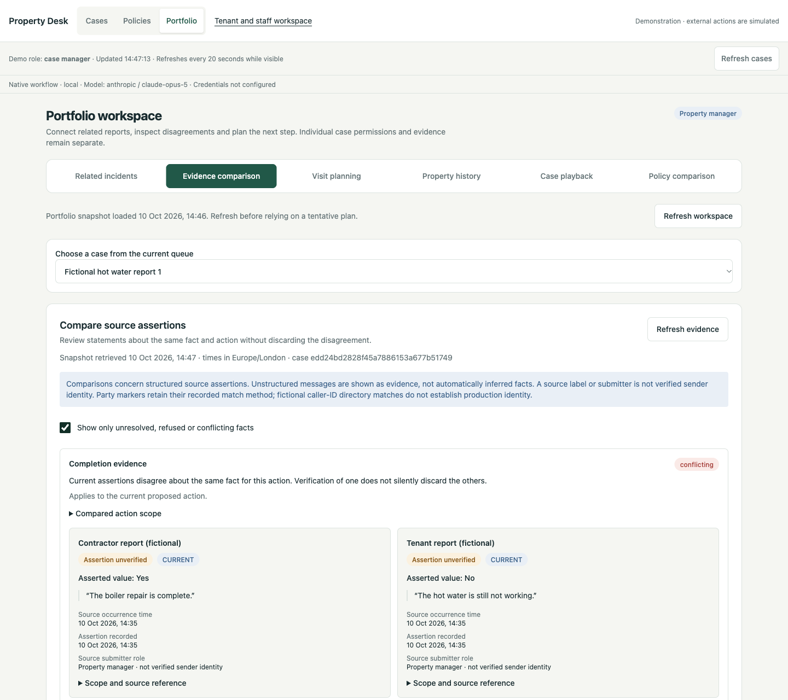
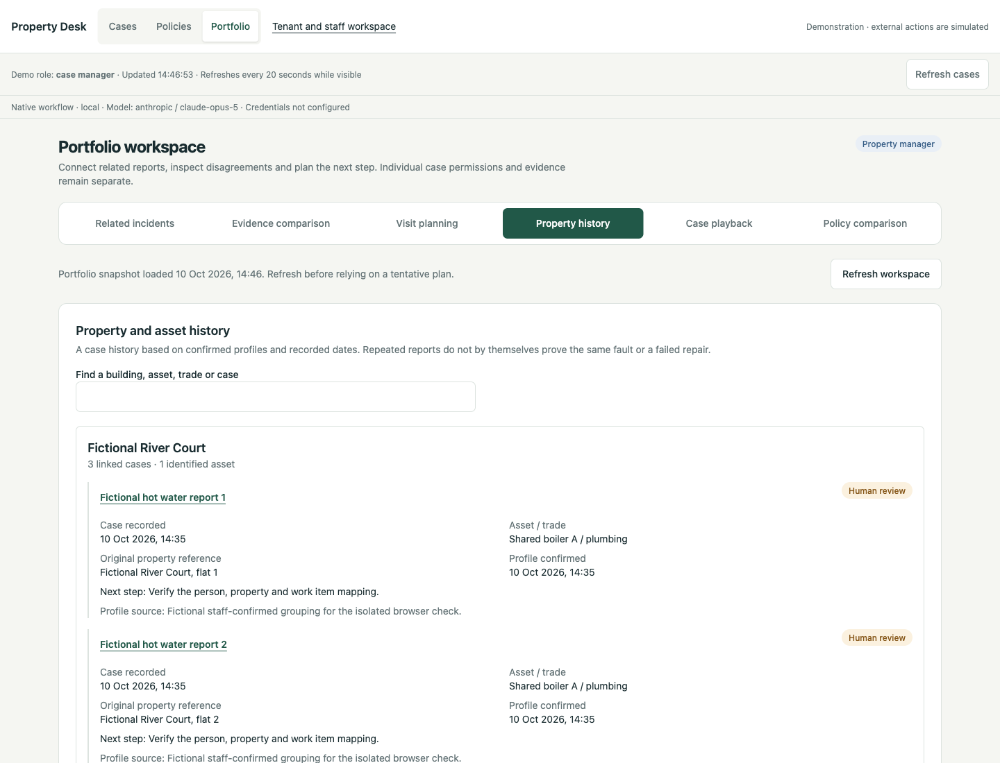

# Portfolio verification — 10 October 2026

This record covers the six Portfolio tools added to the live React staff dashboard. Checks used fictional fixtures and a separate local database and native Workflow directory. No reserved evaluation cases, external model calls, contractor messages, bookings or payments were used.

## Automated checks

From the repository root:

```sh
PROPERTY_LOCAL_ENV=off ANTHROPIC_API_KEY= ANTHROPIC_AUTH_TOKEN= TYPESAFE_API_KEY= \
  .venv/bin/python -m pytest -q -m 'not claude and not jev'
```

Result: **237 passed, 13 deselected**. The deselected tests require live Claude or Jev access. One existing Starlette/AnyIO deprecation warning remains. The new feature suites account for 41 tests: 25 portfolio tests, 13 insight tests and three HTTP integration tests.

From `web/`:

```sh
npm run build
npm run lint
node --experimental-strip-types --test src/lib/pipeline.test.ts src/lib/portfolio-api.test.ts src/lib/portfolio-presentation.test.ts
```

Result: TypeScript/build and lint passed; **15 frontend tests passed**. The final frontend build was made from an isolated copy of the committed base plus this feature, keeping another task's concurrent wording changes out of the feature commit.

## Browser checks

The FastAPI-served production bundle at `/dashboard` was checked in a real Chromium browser with three fictional hot-water reports for a shared building and boiler. The browser session used the labelled demo staff roles.

| Flow | Observed result |
| --- | --- |
| Related incidents | Dismissed a suggestion with a reason, refreshed, then confirmed another grouping. The confirmed incident was still present after the local server restarted. |
| Evidence comparison | The contractor's completion assertion and tenant's opposing report remained visible with their original quotes and unverified labels. Filtering unresolved facts retained the disagreement. |
| Recorded playback | The earliest decision excluded the later contractor report. The last frame included it; rewinding removed it again. Keyboard Home/End controlled the timeline. |
| Visit planning | Saved a tentative visit for two cases. An overlapping contractor slot returned a visible conflict. Cancelling the first plan saved the cancelled state, which survived restart. Case permissions remained outstanding. |
| Property history | The building showed three linked cases and one asset. Opening a history link selected the original case in the case workspace. |
| Policy comparison | Compared a saved draft against three cases as a policy editor. The preview identified changed requirements; the published policy remained version 1. The final build showed readable Before/After fields instead of raw JSON. |
| Responsive layout | All six tabs were checked at 390px and 320px widths without document-level horizontal overflow. Desktop and mobile captures were inspected. |

The browser console recorded the expected HTTP 409 from the deliberately overlapping visit. No unexpected JavaScript errors were observed in this session.

## Screenshots

These captures show the working local product with fictional records. They are not hosted-production or live-model evidence.

| Evidence disagreement | Property history |
| --- | --- |
| [](screenshots/portfolio/evidence-comparison.png) | [](screenshots/portfolio/property-history.png) |

[Policy comparison](screenshots/portfolio/policy-comparison.png) · [Mobile property history](screenshots/portfolio/property-history-mobile.png)

## Limits

This demonstrates the local implementation and its checked boundaries. It does not establish hosted Vercel operation for these features, PostgreSQL concurrency, production staff identity, real contractor availability, travel feasibility, repair completion or external delivery. Saved plans remain tentative; policy comparisons and playback do not mutate operational decisions.
