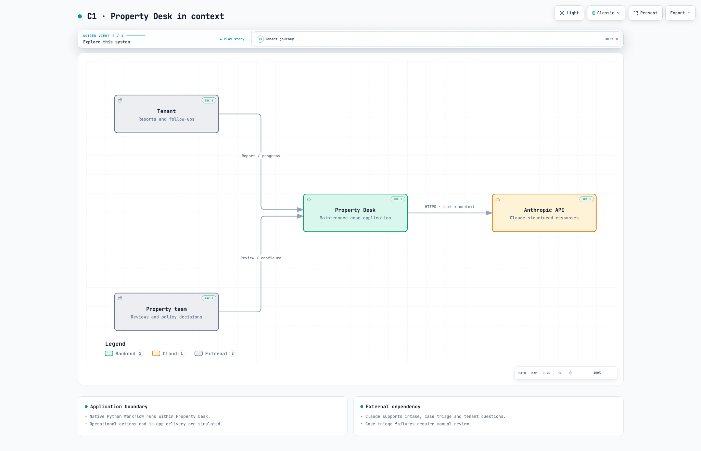
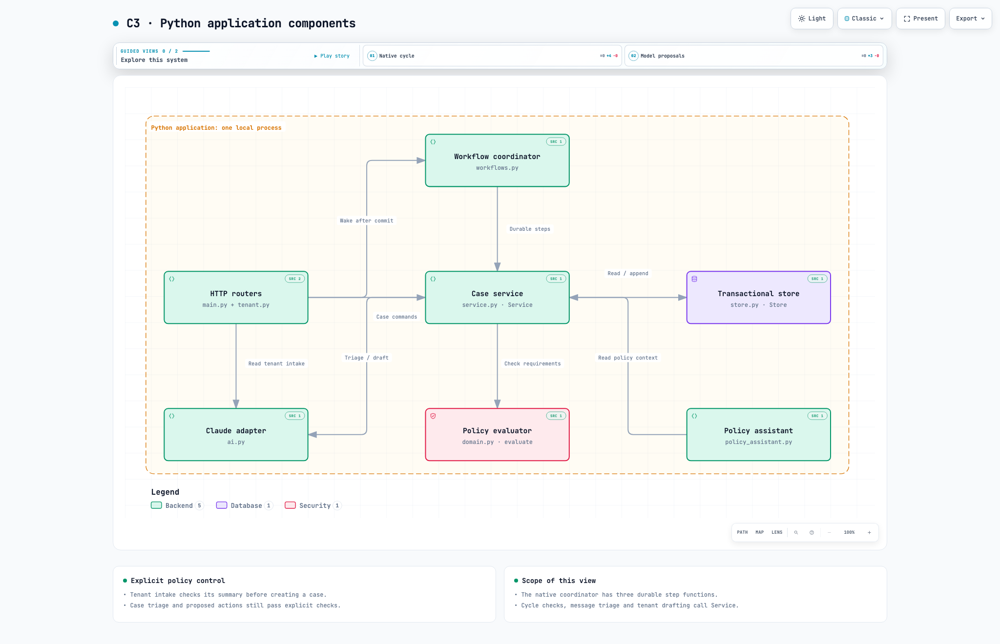
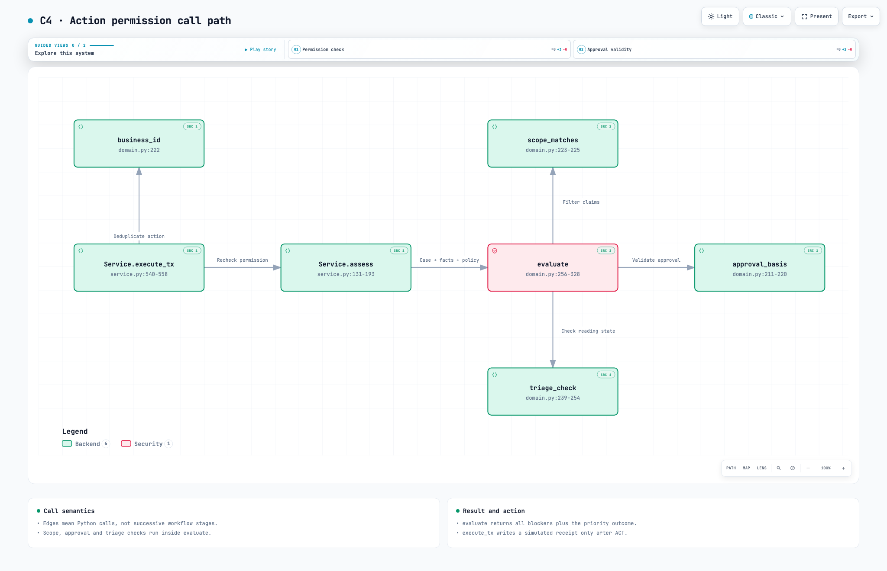

# Property Desk diagram guide

Start with C1 for the product boundary, C2 for the application shape, then C3 and C4 for the implementation. Use the sequences to follow a request and the flows to inspect decisions.

The diagrams describe source at [2732af6](https://github.com/MasteraSnackin/hackathon-valley/tree/2732af60a920d0f9a88be18a36e078aa22fbfa6d), reviewed on 10 October 2026. Property Desk is still being built, so later code changes may need diagram updates. They document code and configuration, not a new application test run, cloud deployment or real maintenance outcome.

This snapshot predates Jev routing, the separate React operations dashboard and the Reality Test runner. Read the [current architecture guide](../../ARCHITECTURE.md) for those paths. The diagrams below retain their original source revision and validation receipts.

The four structural levels follow the [C4 model](https://c4model.com/diagrams): context, containers, components and code. The [code view](https://c4model.com/diagrams/code) is deliberately limited to the policy decision component. It is not an exhaustive class diagram.

The [local gallery](index.html) provides one page for opening all ten diagrams. GitHub displays the static images below. Click a preview to inspect its full size. Download an interactive HTML file and open it locally to use Archify's search, focus and guided views. JSON is the source of truth for Archify maps; HTML is the source for the two Diagram Design figures. Mermaid files are alternative editable representations, not the source of the delivered Archify HTML.

| View | Read it when you need to understand |
| --- | --- |
| [C1: system context](#c1-system-context) | Who uses Property Desk and which external service it calls. |
| [C2: containers](#c2-containers) | The browser, one Python application and two distinct persistent stores. A C4 container is a software or data boundary, not necessarily a Docker container. |
| [C3: components](#c3-components) | The modules inside the Python application and their calls. Tenant intake calls Claude before submission; case triage and follow-up drafting use Workflow steps. |
| [C4: code](#c4-code) | The actual policy decision call graph: execute_tx, assess, evaluate and the relevant helpers. Arrows mean calls, not time order. |
| [Tenant-message sequence](#tenant-message-sequence) | A confirmed report or later case update is stored before the workflow is woken. Claude triage and question drafting run as separate steps. Pre-submission intake and tenant confirmation are outside this sequence. |
| [Human-review sequence](#human-review-sequence) | A response resolves a scoped review, commits, wakes the workflow and triggers fresh checks. Remaining blockers continue to hold the proposed action. |
| [Action-decision flow](#action-decision-flow) | The actual outcomes: ACT, STOP ACTION, HUMAN REVIEW, CLARIFY, WAIT and NO FURTHER ACTION. The headline outcome preserves the full blocker list. |
| [Policy-publication flow](#policy-publication-flow) | A draft needs a current impact preview and explicit publication. Pending cases require explicit reassessment; old decisions retain their policy version. |
| [Data storage](#data-storage) | The three physical SQL tables, their fields and the difference between application references and database constraints. |
| [Local deployment](#local-deployment) | The supported local process and storage placement. Anthropic is external; operational actions remain simulated. Cloud configuration is not shown as a verified deployment. |

## C1: system context

Who uses Property Desk and which external service it calls.

[Interactive HTML](c4/c1-context.html) · [Editable JSON](c4/c1-context.architecture.json) · [Mermaid source](c4/c1-context.mmd) · [Delivery receipt](c4/c1-context.delivery.json)

## C2: containers

The browser, one Python application and two distinct persistent stores. A C4 container is a software or data boundary, not necessarily a Docker container.

[Interactive HTML](c4/c2-containers.html) · [Editable JSON](c4/c2-containers.architecture.json) · [Mermaid source](c4/c2-containers.mmd) · [Delivery receipt](c4/c2-containers.delivery.json)

## C3: components

The modules inside the Python application and their calls. Tenant intake calls Claude before submission; case triage and follow-up drafting use Workflow steps.

[Interactive HTML](c4/c3-components.html) · [Editable JSON](c4/c3-components.architecture.json) · [Mermaid source](c4/c3-components.mmd) · [Delivery receipt](c4/c3-components.delivery.json)

## C4: code

The actual policy decision call graph: execute_tx, assess, evaluate and the relevant helpers. Arrows mean calls, not time order.

[Interactive HTML](c4/c4-code.html) · [Editable JSON](c4/c4-code.architecture.json) · [Mermaid source](c4/c4-code.mmd) · [Delivery receipt](c4/c4-code.delivery.json)

## Tenant-message sequence

A confirmed report or later case update is stored before the workflow is woken. Claude triage and question drafting run as separate steps. Pre-submission intake and tenant confirmation are outside this sequence.

[Interactive HTML](behaviour/tenant-message.html) · [Editable JSON](behaviour/tenant-message.sequence.json) · [Mermaid source](behaviour/tenant-message.mmd) · [Delivery receipt](behaviour/tenant-message.delivery.json)

## Human-review sequence

A response resolves a scoped review, commits, wakes the workflow and triggers fresh checks. Remaining blockers continue to hold the proposed action.

[Interactive HTML](behaviour/human-review.html) · [Editable JSON](behaviour/human-review.sequence.json) · [Mermaid source](behaviour/human-review.mmd) · [Delivery receipt](behaviour/human-review.delivery.json)

## Action-decision flow

The actual outcomes: ACT, STOP ACTION, HUMAN REVIEW, CLARIFY, WAIT and NO FURTHER ACTION. The headline outcome preserves the full blocker list.

[Interactive HTML](behaviour/action-decision.html) · [Editable JSON](behaviour/action-decision.workflow.json) · [Mermaid source](behaviour/action-decision.mmd) · [Delivery receipt](behaviour/action-decision.delivery.json)

## Policy-publication flow

A draft needs a current impact preview and explicit publication. Pending cases require explicit reassessment; old decisions retain their policy version.

[Interactive HTML](behaviour/policy-publication.html) · [Editable JSON](behaviour/policy-publication.workflow.json) · [Mermaid source](behaviour/policy-publication.mmd) · [Delivery receipt](behaviour/policy-publication.delivery.json)

## Data storage

The three physical SQL tables, their fields and the difference between application references and database constraints.

[HTML](operations/data-storage.html) · [SVG](operations/data-storage.svg) · [Mermaid source](operations/data-storage.mmd) · [Source notes](operations/README.md)

## Local deployment

The supported local process and storage placement. Anthropic is external; operational actions remain simulated. Cloud configuration is not shown as a verified deployment.

[HTML](operations/local-deployment.html) · [SVG](operations/local-deployment.svg) · [Mermaid source](operations/local-deployment.mmd) · [Source notes](operations/README.md)

## Evidence and checks

The [C4 source notes](c4/README.md#source-evidence), [behaviour source notes](behaviour/source-notes.md) and [storage/deployment notes](operations/README.md) explain what each diagram includes and omits. C4 source links are pinned to the reviewed commit and checked against its Git blobs. The two sequence diagrams deliberately omit retries and recovery internals so their request order remains readable.

All eight Archify maps passed nine showcase checks with zero composition errors or warnings. Automated browser checks covered four desktop sizes, and the final light and dark captures were inspected. The two Diagram Design figures passed the accessible-SVG self-check and browser layout checks. These results apply to the generated diagrams and do not establish application behaviour, live Claude quality or hosted readiness. Per-file receipts record the exact scope. The [combined review record](review-summary.json) also includes a scripted C2 search, focus, theme and guided-view check, all documentation links, and gallery layout checks. Source-link navigation, export downloads and Mermaid rendering were not tested.

Earlier system maps and the animated walkthrough remain available as prototype snapshots. This guide is the entry point for the reviewed diagram set. Update a source file, regenerate its output and repeat its diagram checks whenever the implementation changes.
